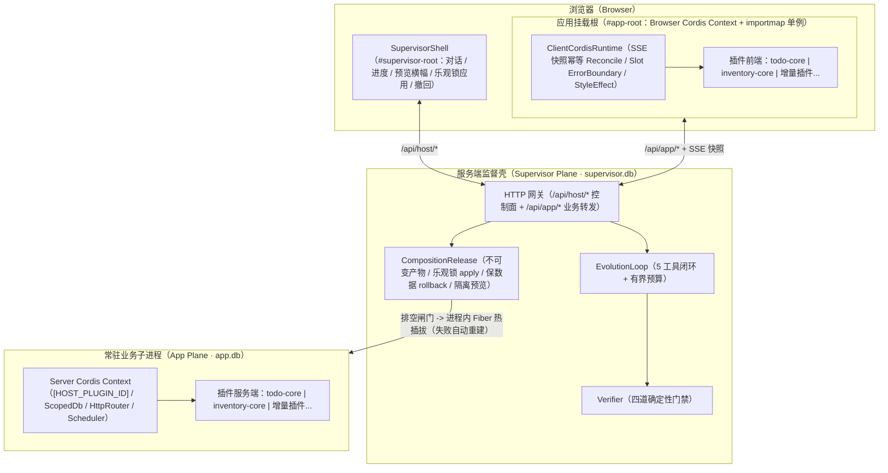

# Todo by Cordis

**基于双端插件组合的 LLM 软件自迭代参考架构。**

本项目的核心目标不是做一款待办软件，而是回答一个更根本的工程问题：**如何让运行中的应用在 LLM 驱动下持续生长新能力、随时启停或撤回，且跨业务零改动迁移？** 仓库保留 `todo-by-cordis` 名称并以 [`plugins/todo-core`](plugins/todo-core) 与 [`plugins/inventory-core`](plugins/inventory-core) 作为两个平等的全栈示例插件，宿主监督壳（`SupervisorShell`）本身**零具体业务硬编码**。

---

## 核心问题与方法论

直接让 LLM 改写单体代码库，或在外层堆砌前置 JSON 形式化规格编译器（本项目 V2 阶段曾用 2.2 万行规格编译与双模型复核代码跑了 679 次真实调用，六步连续通过率为 **0**），都会撞上同一批结构性死穴。最终验证收敛出的方法论，用四项正交机制一一拆解：

| 持续自迭代的核心痛点 | 最终方法论与机制 |
| --- | --- |
| **上下文随轮次膨胀** | **内容寻址插件 DAG**：软件表达为有向无环的插件组合；每次只增量新增/升级目标插件，其余成员锁定原 `versionId`。模型只需读 `contract.d.ts` 拓扑摘要与目标插件源码。 |
| **改新功能污染旧功能、启停要删代码** | **双端对称真 Cordis（`Fiber` + `effect` + `ScopedDb`）**：服务端路由/钩子/定时任务与浏览器端页面/React `<Slot>`/插件级 Tailwind `<style>` 均绑定 `Fiber` 生命周期，并通过 SQLite `setAuthorizer` 隔离表前缀 `plg_<id>__*`。停用即 `dispose()`，零代码手术、零历史数据丢失。 |
| **如何相信模型没改坏、没耦合、没放水** | **四道确定性验证门禁**：① AST 导入白名单、DAG 无环与双端热插拔探针 → ② 上游改接缝时的下游**剥离验证**（防单体退化）→ ③ 最小依赖子图 `closure(P)` **红绿差分测试** + `sqlite.backup` 在线克隆库全组合冒烟 → ④ 既有测试 diff 透明披露。 |
| **模型被抽象规格锁死** | **极简 5 工具代码闭环 + 真实克隆预览**：仅暴露 `inspect_plugin`、`clarify_request`、`stage_plugin_changes`、`verify_candidate`、`present_preview`，让模型直接写标准 TypeScript 插件与测试、直面真实报错堆栈；全绿后自动挂载基于真实生产库在线克隆的隔离预览，支持预览内对话微调，最终由用户乐观锁确认应用。 |

**真实模型端到端实证**（DeepSeek，全流程归档见 `docs/reports/v3-real-model/`）：
- **Todo 六步连续自迭代（`6/6` 通过）**：新增标签插件 → 新增独立计数插件 → 标签小写归一化（保历史数据）→ 上游开双端拦截接缝 + 下游复盘必填插件（过剥离验证）→ 停用标签（零代码变更、数据零丢失）→ 重新启用标签恢复。详见 [Todo 六步真机验收报告](docs/reports/v3-real-model/2026-11-24-todo-six-step-outcome.md)。
- **跨业务零改动迁移（`2/2` 通过）**：内核零行修改，仅将种子插件切换为 `plugins/inventory-core`，连续迭代“批次效期预警”与“出库超额审批拦截”两步全绿。详见 [库存跨业务迁移真机报告](docs/reports/v3-real-model/2026-11-24-inventory-migration-outcome.md)。

---

## 双平面架构

系统严格划分为维护者持有的**监督壳平面（Supervisor Plane）**与模型可演进的**双端 Cordis 应用平面（App Plane）**：



---

## 一个全栈插件长什么样

每个业务能力（包括根业务本身）都是 `plugins/<pluginId>/` 下的自治包：

```text
plugins/<pluginId>/
├── manifest.json     # 静态元数据：pluginId / name / dependencies（严格 DAG）
├── contract.d.ts     # 公开 Service / 双端 Events / 前端 SlotPropsMap（同时作为模型上下文）
├── server.ts         # 服务端 Cordis 插件：ctx.db / ctx.http / ctx.schedule / ctx.provide
├── client.tsx        # 浏览器端 Cordis 插件：ctx.router / ctx.slots / <Slot> / Tailwind utilities
└── tests/*.spec.ts   # 绑定最小依赖子图 closure(pluginId) 的 HTTP / Playwright 契约测试
```

---

## 快速开始与跨业务演示

环境要求：Node `24.18.x`、pnpm `12.3.4`。

```sh
pnpm install --frozen-lockfile
pnpm build
pnpm start
```

默认打开 http://127.0.0.1:4517 ，自动加载 `plugins/todo-core`。

**一行命令验证零内核修改跨业务迁移**（切换至库存管理插件，使用独立数据目录）：

```sh
APP_DATA_DIR=.runtime/inventory SEED_PLUGIN_DIR=plugins/inventory-core pnpm start
```

- **开发模式**：`pnpm dev`（通过 `tsx` 直接运行 `src/main.ts`）
- **常用环境变量**（模板见 [env.example](env.example)）：
  - `HOST`（默认 `127.0.0.1`）、`PORT`（默认 `4517`）
  - `APP_DATA_DIR`（默认 `.runtime/host`，存放 `supervisor.db`、`app.db` 与运行工作目录）
  - `SEED_PLUGIN_DIR`（默认 `plugins/todo-core`，可指向任意符合契约的根业务插件目录）
  - `APP_TITLE`（默认 `Cordis Self-Iteration Host`）
  - `DEEPSEEK_API_KEY`（可选，保存在本地 `.env`；未配置时日常插件与监督壳照常运行，绝不发起付费模型调用）

---

## 仓库地图

`src/` 的模块划分与方法论 1:1 对应：

```text
src/
├── main.ts            # 唯一装配与启动入口（CLI + 编程调用）
├── contracts/         # 公共类型、DAG 拓扑纯函数、@host/server-sdk、@host/client-sdk 与单源模型契约
├── runtime/           # 双端对称真 Cordis 运行时（server/ 子进程与 ScopedDb + client/ 浏览器热插拔与 importmap）
├── build/             # 无环插件包读盘、tsc 类型检查、客户端 external ESM 打包与 Tailwind v4 按需编译
├── verify/            # 四道确定性门禁（gate-static-hotswap / gate-ablation / gate-subgraph-smoke / gate-test-diff）
├── release/           # supervisor.db 控制面存储、乐观锁发布、保数据撤回与在线克隆隔离预览
├── evolution/         # 5 工具自迭代状态机、有界预算与单一 DeepSeek 传输层（含代理隔离与脱敏）
└── supervisor/        # 极薄零业务监督壳（server/ Hono 控制面路由 + ui/ 受保护外壳与自迭代抽屉）
```

---

## 验证与测试（默认零付费）

```sh
pnpm typecheck
pnpm build
pnpm exec playwright install chromium
pnpm test
pnpm test:e2e
pnpm accept
```

所有 CI 检查、应用单测与 Playwright E2E 回归均使用确定性零付费模型桩，覆盖双端热插拔、`ScopedDb` 引擎级隔离、四道验证门禁、在线克隆预览、乐观锁应用与保数据撤回、Todo 六步连续自迭代及 `inventory-core` 跨业务迁移。

### 受控真机验收（默认 fail-closed 关闭，遵守 STOP_SERIES）

仓库提供受显式授权标志、调用上限与费用护栏保护的真机验收入口 [`scripts/accept-real-model.ts`](scripts/accept-real-model.ts)（约束见 [ADR 0008](docs/adr/0008-controlled-real-model-acceptance-guardrails.md)），**默认关闭**，仅在用户单次明确授权时执行：

```sh
REAL_MODEL_AUTHORIZED=1 pnpm accept:real-model \
  --authorize-paid-run \
  --scenario=all \
  --max-calls=24 \
  --max-cost-cny=8.0
```

---

## 延伸阅读与历史归档

- **现行设计基线**：[全栈自迭代架构蓝图](docs/engineering/07-cordis-self-iteration-v3.md)、[领域词汇与不变量](CONTEXT.md)、[产品边界](PRODUCT.md)、[设计规范](DESIGN.md)、[架构决策记录 `docs/adr/`](docs/adr/)
- **历史复盘与实证归档**（保持原样不可篡改，供审计追溯）：[V2 核心方向与 679 次调用复盘](docs/engineering/00-core-direction-v2.md)、[前期技术调研](docs/reports/self-evolution-research.md)、[`docs/reports/v3-real-model/`](docs/reports/v3-real-model/) 与 [`docs/archive/`](docs/archive/)
