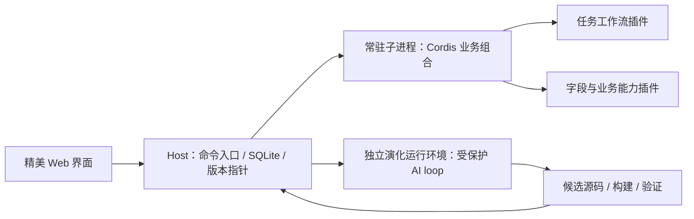

# 自迭代核心优先：当前实施基线 V2

日期：2026-09-06。依据：用户本轮明确调整。本文覆盖旧工程方案冲突内容；原 PRD 保留历史原文。当前目标是本地单所有者的自迭代软件模板，不按完整平台交付。

2026-09-07 Agent 设计访谈已收口。Agent 的当前实施依据为 [重构详细设计](06-agent-redesign.md)；本文 M0/M1/M2 内容保留阶段背景，不作为限制新 Agent 只能生成文本工作流的依据。调查、执行进度、候选体验（宿主管理的隔离会话、合成可写数据）与绑定式 apply 已有公开命令与测试验收；体验不是第二套完整应用实例；持续迭代与恢复主线另票。

2026-10-23 核心目标重新明确，经验与架构复盘见第 10 节。第 2–9 节保留历史取舍、阶段目标及其适用范围，不把旧提供者、硬预算、里程碑或单次通过当作当前事实。现行技术契约见 Agent 设计和已接受 ADR；复盘建议不自动授予应用内 Agent 修改保护机制的权限。

## 1. 目标与判断标准

最高目标：探索并验证基于 LLM 实现软件自迭代的最佳架构，尽可能简单、通用、可跨业务迁移。当前仓库是参考原型，Todo 是验证业务，不是通用内核的永久业务前提。

核心验证：同一个应用和同一批数据能真实生成、验证、运行、继续修改、修复和撤回新的实现；更换业务时，公共控制不应依赖 Todo 的字段、状态或页面。有效迭代、独立验收和可恢复性是约束，接口简洁与迁移成本是架构优化目标。性能和现有极简界面要求继续保留，但增加 Todo 功能、协议层数、测试数量或视觉工作不替代架构进步。

“最优雅”落实为：一次改动尽量集中在一个模块，调用者只学习很小的接口；为可替换性增加的抽象，应以实际第二种实现检验价值，不能靠命名证明通用。不给内部所有函数增加扩展钩子，不为尚不存在的适配器建包。

“性能最高”是优化目标，不能直接作为已实现结论。分别衡量任务命令 P95、候选生成/验证/切换时间、有效改进所消耗 token、连续迭代资源走势。模型耗时与本地执行分开；先建立基准，再优化占比最高的阶段。

## 2. 对旧方案的审查

| 旧设计                                          | 当前决定               | 原因                                                      |
| ----------------------------------------------- | ---------------------- | --------------------------------------------------------- |
| Todo 工作流、AI loop 可替换                     | 业务流程保留；AI 策略仅维护者升级 | Agent 不能修改自身执行策略，保证自迭代机制稳定 |
| 稳定插件身份、源码版本、活动组合                | 保留并精简             | 第二次修改必须找到第一次成果，重启后要继续存在            |
| 独立执行的验证与失败复现                        | 保留目标断言与基础回归 | 少测试但验证真实改进，避免“无异常”冒充修复                |
| 运行终止、上一个可用版本、任务保留              | 保留                   | 错误代码不能让系统永远失去继续修改能力                    |
| 每插件一个 Linux 容器、逐调用能力代理           | 删除当前要求           | 改为整个组合一个常驻子进程，插件内部直接调用              |
| 细粒度授权、审批哈希、多风险等级、CSRF/远程认证 | 不纳入当前演示         | 当前按本机使用；用户不需要学习审批治理系统                |
| 分布式租约、复杂发布状态机、客户端 ACK 门禁     | 删除                   | 单一数据写者、串行切换、事务性活动指针即可先验证          |
| 约二十张表、十余 packages、独立治理平台         | 不预建                 | 按真实存储需要增加；模块先共处一个工程                    |
| 完整 JSON UI DSL、通用 renderer 引擎            | 收缩为少数真实扩展插槽 | UI 壳直接用高质量 React 组件，动态字段/动作使用小描述结构 |
| 所有内容包括存储均可在线热换                    | 延后非核心实现替换     | 数据持久模块保持窄接口；没有需求不做运行中数据库迁移      |
| 原 42 项全部是第一版阻断条件                    | 改为分期参考           | 本版以第 7 节的核心演示验收为准                           |

取消安全平台建设不等于删除一致性。保护已完成的改进、区分真实通过与失败，属于核心产品行为。外部发布、多租户及恶意插件防护不在当前任务中。

## 3. 推荐架构

这里“一个组合一个进程”指稳定运行时的业务组合，不禁止候选验证期间启动第二个临时组合。演化工作与业务运行不能挤在同一个故障域，否则待修复业务卡死会阻塞修复工作。两种环境复用同一运行器实现，不建立逐插件 RPC 系统。

仅保留四个深模块：

- **Workspace**：`query / command` 隐藏持久化、任务修订和数据提交。生成流程返回决策，Workspace 负责提交。
- **Runtime**：`start / invoke / close` 隐藏 Cordis 状态、跨进程通信、超时和退出。插件之间仍消费 Cordis 服务。
- **Evolution**：`command / observe / close` 隐藏模型调用、相关上下文、候选构建和验证；loop 为维护者持有的受保护策略，Agent 不能修改，记录由外部保存。
- **Release**：`activate / restore` 隐藏候选就绪、串行切换、活动指针和兼容状态映射。

这四个名字是模块设计，暂不创建四套包、服务或网络端点。M0 使用 JavaScript 小实验和 Node 内建测试器，减少工具链变量。正式 UI/API 再引入 TypeScript、React/Vite；依赖在需要时固定。

推荐子进程的依据：进程内直接调用最快，但生成代码同步死循环会阻塞监督器；Worker 可终止 JS，却与宿主共享进程故障范围。常驻子进程多一次 IPC，能重建整个 ESM 模块图。本机小载荷 P95 约 0.133ms，比 Worker 多约 0.040ms；目前值得用这点开销换取简单的组合重启机制。详见一手研究与基准，不外推为生产指标。

## 4. 简化发布规则

候选使用独立运行环境执行目标用例；失败直接丢弃候选运行环境，保留源码和原因。通过后串行处理活动切换：等待正在执行的任务命令完成，启动候选，检查当前数据是否兼容，在一个 SQLite 事务里更新必要状态映射和活动版本，切换运行引用，再关闭旧环境。

重启只读数据库中的活动版本：事务未提交继续旧版，已提交启动新版。新版尚未真正可运行时不能标记发布成功。M0 只证明精确手写组合下的机制；生产化仍需不可变源码产物、启动失败恢复和副作用约束。

首期新增字段采用增量数据，不用整库快照回退。流程回退如需 review→open，显式提供完整映射并保留复盘文本。UI 按动作/表单契约展示，取消补充输入不改变任务。

## 5. 自迭代质量与性能

先做最小差异：读当前实现与接口，生成候选，验证，切换，观察。每次请求只涉及一个主要能力，避免全站重新生成。只有出现第二个真实需求才增加新的通用契约。

保留小而有效的验证：新增行为正例、边界反例、旧有任务操作、数据保留。自动修复必须先让旧版本复现失败，再让新版本通过相同断言。模型新增测试可以补充证据，不能单凭它自写自测认定正确。

记录生成、构建、验证、切换各自耗时以及真实 usage。稳定上下文前缀、按需加载相关接口、复用常驻进程值得优化；是否使用缓存、并行模型调用或多 Agent 搜索，依据真实耗时和成功率决定，不先构建调度平台。

## 6. 视觉与体验方向（2026-09-07 更新）

用户调整为 **Microsoft To Do 的极简风格：干净、克制，任务优先**。覆盖之前暖白青绿和灵动助手的设计方向。使用最新版 Tailwind CSS 与 Base UI 减少自定义交互成本，具体约束见根目录 DESIGN.md。

日常界面只保留任务列表、筛选、搜索、添加与详情。AI 由常驻入口呼出需求侧栏，开始执行后进入专门进度视图；不是默认首页或永久一级导航。版本和日志等周边信息收进二级入口，保留生产运行时回归及旧数据库兼容。

Agent 只负责应用自迭代，不执行普通任务操作或通用问答。Plan 阶段读取真实实现、能力、依赖和测试，澄清必要业务取舍；计划包含目标、验收、步骤、数据影响及应用方式。用户点击开始后锁定需求，自动生成、验证和范围内修正；体验候选后再确认应用。执行中不能修改需求；必须改变范围时停止并保留证据，调整后重新规划。

执行过程展示实际服务端阶段；可以收起继续处理任务，回来恢复状态。禁止定时器伪造进度、无证据的成功状态和未接入时的模拟方案。M2 接通真实路由、模型生成、持久化运行和候选发布；前端只展示宿主记录的真实阶段。

## 7. 重排后的里程碑

| 阶段              | 产物                                         | 验收                                                 |
| ----------------- | -------------------------------------------- | ---------------------------------------------------- |
| M0 核心实验，本轮 | Cordis、执行方式比较、流程替换、事务恢复     | 实测证据与失败边界，详见 m0-validation.md            |
| M1 精美可用切片   | 持久化 Todo + 动态动作 + 精致响应式界面      | 同一批任务可操作/刷新/重启；视觉浏览器审查通过       |
| M2 第一轮真实进化 | 输入“完成前写一句复盘”，真实生成插件并应用   | 候选源码、测试、版本与界面变化可核验，继续改同一插件 |
| M3 组合与修复     | 简单消费既有字段的第二插件，已知故障现场修复 | 能力复用；旧失败/新通过；重启与撤回保留数据          |

以上为历史阶段划分，不代表本轮重新验收。下一次开发按 [Agent 重构实施顺序](06-agent-redesign.md#12-迁移与实施顺序) 推进调查到开始、候选到应用、持续使用与恢复三条主线，不以闹钟或其他具体业务功能作为交付目标。

## 8. 已知边界与后续决策

本节为 M1/M2 时点的历史背景，下面的模型选择与“尚未验证”不是 2026-10-23 的现状；当前证据及缺口见第 10 节。

M1 历史报告已覆盖浏览器与 1000 任务负载；真实模型、长期内存和大消息性能仍未验证。进程冷启动样本很少，不能把它当可靠尾延迟。Node 内建 SQLite 在实验中使用，正式存储驱动在 M1 结合运行环境固定。

M2 使用原生 Gemini Developer API、官方 @google/genai SDK 和 gemini-3.1-pro-preview。驱动只返回完整模型响应，Evolution 显式执行工具循环并保存历史；不使用自动工具执行、隐式重试或备用模型。密钥仅由服务端读取忽略的 .env 中 GEMINI_API_KEY。声明式插槽的表达范围用首个真实生成场景检验，避免为“任意 UI”提前设计语言。

## 9. M2 阶段约束与 Agent 重构修订（2026-09-07）

本节记录当时的目标约束，不表示每项模块解耦已经实现。历史固定预算不覆盖后来接受的用户追加授权；生产默认、冻结评测预算及跨运行的外部调用授权必须分别记录。

M2 的文本字段/动作是历史验收切片。新 Agent 使用行为目标、按需能力发现和完整候选产物，不以该切片限制生成范围。Runtime、Evolution、Release 不包含 Todo 字段或状态分支；不拆包。Gemini 驱动与工具执行、持久化、发布控制分离，不预建 Agent 框架。

计划冻结可执行目标、验收规则、稳定插件身份、基础版本和组合修订。点击开始前只调查和规划，开始后生成及验证，确认应用前不能改正式版本。候选使用现有工具链在独立环境构建和验证，源码、构建结果、契约版本和证据形成不可变产物。切换前重新核对组合和当前数据，事务提交活动版本、发布记录及回执，完成状态还须核对运行就绪。具体应用与恢复以新设计为准。

撤回使用已发布版本，不恢复数据库快照；期间新增的任务和字段保留。旧数据库增量加列，兼容旧工作流。单工作区一次运行，最多三个候选、十二次模型调用、十分钟活动执行；等待确认不计时。取消终止后续工具和发布，已经提交的结果仍显示完成。重启核对数据库中的提交事实，未完成运行标记中断，不自动重复调用模型。

本次不交付特定 Todo 功能，不重做无关 UI，不建设市场、模板生成器、多模型调度或远程部署。允许修改 Agent 所需的计划、进度及候选体验界面。Agent 自身策略纳入保护范围；本次工程重构由维护者实施，不赋予应用内 Agent 修改自身策略的能力。

## 10. 项目经验与架构复盘（2026-10-23）

### 10.1 复盘口径与结论

基线为本地 `37cb2a69a07ff9b5caf72ca54d368c22f95511c7`。盘点了该提交可达的 136 个提交、GitHub #1–#46、5 份 ADR、工程文档 00–06、M0/M1 报告、#8/#30/#35/#36/#46 的验收材料，以及 10 月的协议、职责对照、稳定性和交互验收归档；重点核对当前源码的模块接口、依赖、可写面及验证路径。没有重跑历史付费实验或修改其结果。

结论：四模块、单权威写入、故障可终止、冻结、独立验收、候选体验和绑定应用已经形成有价值的基础。复杂度主要累积在 Todo 语义编译、事实投影和复核协议之间，已影响职责局部性。主线没有被完全放弃，但研发重心有向“把固定 Todo 规格编译器做完整”偏移的风险。当前证明了多种 Todo 能力的迭代，尚未证明跨业务迁移，更不能称已经找到最佳架构。

这里区分三种判断：**实现事实**由源码和实际回归支持；**经验有效性**限定在已经暴露并验证过的失败模式；**架构建议**仍需下一业务和对照实验检验。保留保护门禁不等于保留它们当前的每一层实现，简化也不等于删除门禁。

### 10.2 开发阶段留下了什么

| 阶段 | 取得的有效经验 | 不能外推的部分 |
| --- | --- | --- |
| 9 月 6 日 M0/M1 | Cordis 生命周期需显式确认 ACTIVE；组合子进程可终止、可重建；唯一写入、短事务、幂等回执和版本切换成立。复用现有运行器比逐插件 RPC、完整平台更直接。 | 手写夹具不是 LLM 生成；微基准不是生产尾延迟，子进程不是恶意代码安全隔离。见 [M0](../reports/m0-validation.md)、[M1](../reports/m1-validation.md)。 |
| 9 月 7–8 日 #1–#8 | 从混合聊天/任务执行转为专门自迭代；调查、开始锁定、生成修正、隔离体验和最终应用成为独立事实。 | 当时闭合的合成与真实局部路径不签发所有后续功能的通过。见 [ADR 0001–0004](../adr/0001-evolution-scope-and-application-confirmation.md)、[#8 收据](../reports/issue-8-validation.json)。 |
| 9 月 9–20 日 #9–#35 | 多成员组合必须显式继承完整身份；主工作流版本与组合载体不同；所有成员同源构建；业务验收经真实 Workspace 提交链，保留未知字段。 | 19 次历史试跑只有一次完整单轮，没有通过双轮；短试跑、桩层六步或子 Issue 关闭不满足旧 #30/#35 完成线。见 [交付状态](../reports/issue-35-validation.json)。 |
| 9 月 23–30 日 #36–#46 | 复用已有在线调度；能力发现与实际注册、健康、授权、检查器同源；指南、骨架和精确版本绑定有用；时间测试需驱动真实调度链。 | 同口径六场完整路径为 2/6→2/6，不能声称当时整体稳定性改善；补充轮次的截止路径成功与整个模板完成不同。见 [比较](../reports/issue-36-comparison.json)、[补充收据](../reports/issue-36-completion.json)。 |
| 10 月 8–18 日统一规格与语义复核 | 机械身份、引用、字段投影和差异摘要应由宿主生成；初始业务值、初始显示、后端拒绝、动作可见与页面反馈必须分开；历史值须经基础版本真实操作准备。 | 冻结了错误或遗漏的解释，仍会“候选符合计划却不符合原需求”；来源复核、严格 JSON 或更强思考都不提供完整性证明。详见 [设计中的逐轮反证](06-agent-redesign.md)。 |
| 10 月 18–22 日采样与职责对照 | 已有冻结清单、独立业务 oracle、正向/边界分母、实际职责观察、原始调用与完整性归档；应继续复用这套评测。 | 同一 Todo 的多场景不是第二业务；不同清单、预算、源码、模型策略及补充分析不能合并成一个成功率。证据范围见 10.4。 |
| 10 月 23 日交互、默认与续行 | 追问必须有明确交互契约；可审查默认优于反复转交技术细节；效率目标与追加授权分开；检查点、同运行续行及可重试的宿主未就绪检查有价值。 | 默认不保证猜中所有意图；增加授权不等于效率达标；受控恢复复现不证明已丢失现场的历史故障唯一成因。原失败仍保留。 |

### 10.3 应继续复用的经验与实现入口

以下是已经有实现、反例或实测支持的工程经验，不是待建平台清单。

| 已验证的经验 | 防止重复犯错的规则 | 现有入口或证据 |
| --- | --- | --- |
| 控制和可变业务分开 | 模型不能修改自己的权限、预算、保护断言、验证报告、发布或恢复来取得通过；维护者升级与普通自迭代分开。 | [ADR 0002](../adr/0002-protect-independent-evolution-controls.md)、[候选构建](../../src/release/business-bundle.ts) |
| 冻结与授权必须绑定具体对象 | 开始绑定需求修订、计划和基础版本；应用绑定候选与证据。冻结防漂移，不证明需求理解完整。 | [需求门禁](../../src/server/requirement-coverage.ts)、[篡改反例](../../tests/app/requirement-gate.test.ts) |
| 唯一写者比多套提交路径可靠 | `decide` 正确不代表提交后正确；必须经过 command、beforeCommit、持久化、query 及必要事件。复用这条链，不新建验收专用业务写入。 | [Workspace](../../src/server/workspace.ts)、[提交钩子反例](../../tests/app/before-commit-acceptance.test.ts) |
| 组合和成员身份不能靠猜 | 只改 A 时保留 B 的精确版本、启用态和角色；规范化序列化不改变未改业务身份，未知字段不丢失。 | [组合处理](../../src/release/composition.ts)、[连续继承回归](../../tests/app/composition-inheritance.test.ts) |
| 发布成功是持久事实加就绪 | 网络响应、事务提交、运行就绪是不同事件；提交前后取消不能混为一谈。撤回指向旧实现并处理当前数据，不恢复整库快照。 | [Release](../../src/release/release.ts)、[恢复回归](../../tests/app/recovery.test.ts) |
| 进程监督与组合生命周期值得保留 | 长驻组合复用一个运行器；候选单独运行，超时可终止，旧订阅和定时资源必须释放。不要回到宿主直接执行生成代码或逐插件 RPC。 | [Runtime](../../src/runtime/runtime.ts)、[在线调度](../../src/server/host/online-schedule-service.ts)、M0/M1 报告 |
| 技术事实和机械引用应由宿主确定 | 资料目录、可读范围、首次交付和生成输入同源；宿主生成 ID、摘要、版本和可推导案例，不让模型维持重复控制字段。 | [调查存储](../../src/evolution/investigation.ts)、[规划](../../src/server/planning.ts)、[差异组装](../../src/evolution/candidate-delta.ts) |
| 用户原话、解释、默认和事实分开 | 问题的假设不是用户回答；默认须有作用域、依据和影响并独立审查。只问真正改变目标或影响重大的未决分支，不把技术缺口改写成用户放弃。 | [交互契约](../../src/evolution/interaction.ts)、[预检与澄清](../../src/evolution/request-admission.ts) |
| 验收必须独立于候选自述 | 系统保护、冻结业务验收、模型自测分别留证；独立调用的复核仍可能和规划共享误解，需原文约束、可信业务 oracle 与反例。 | [语义状态](../../src/evolution/requirement-semantics.ts)、[独立评测 oracle](../../scripts/lib/stability-eval/oracle.ts) |
| 后端与界面不是同一断言 | 后端拒绝不推出按钮隐藏或页面特定报错；原生 required 不等于 alert。真实页面应验证动作、表单、保存、刷新和重启。 | [浏览器验收](../../src/server/browser-acceptance.ts)、[操作反馈](../../tests/app/operation-feedback.test.ts) |
| 旧值必须有可信历史 | “已有任务”不意味着已执行过旧动作；通过基础版本冻结成功案例准备历史，不直接注入候选需要的字段值。 | [历史准备](../../src/evolution/historical-preparation.ts)、[历史准备反例](../../tests/app/historical-preparation.test.ts) |
| 能力的多个状态不能压成一个 ready | 声明、注册、支持、健康、授权、检查器覆盖及正在使用分别判断；暂时恢复中不等于契约永久变化。 | [能力目录](../../src/server/planning.ts)、[恢复预检回归](../../tests/app/candidate-experience-session.test.ts) |
| 时间能力要复用真实调度链 | 测试时钟只驱动注册、取消、触发和统一命令；停机不承诺准点，补执行不承诺外部副作用恰好一次。 | [ADR 0005](../adr/0005-host-extension-registry.md)、[调度验收](../../src/server/schedule-acceptance.ts) |
| HTTP 成功不等于有效模型响应 | 正文保活、空正文、length、非法 JSON、协议拒绝、语义错误、服务不可用分别记录；未知 usage 不按零费用处理，不能都交给候选修代码。 | [模型适配](../../src/evolution/deepseek.ts)、[传输失败](../../src/evolution/transport-failure.ts)、[原生协议回归](../../tests/app/deepseek-protocol.test.ts) |
| 失败纠正必须有界且有诊断 | 参数错误在原运行内返回具体路径、实际值和可纠正原因；保留无效响应与消耗，不外层无限重跑、手改真实候选或换期望凑通过。 | [协议校验](../../src/evolution/model-protocol.ts)、[修复与执行回归](../../tests/app/execution.test.ts) |
| 效率目标和授权资源分开 | 初始资源随运行保存；只有用户可追加。续行复用有效结果和检查点，不重放已处理响应或发布；不能以追加掩盖权限、能力、协议或验收失败。 | [预算授权](../../src/evolution/budget-authorization.ts)、[完整续行 E2E](../../tests/e2e/evolution-interaction.spec.ts) |
| 进度和操作必须表达当前意图 | 追问、计划、执行、等待资源、待应用使用明确标签和操作；调用用量是辅助信息，不是任务完成百分比；草稿、焦点、中文输入法及窄屏是行为契约。 | [控制侧栏](../../src/web/AssistantPanel.tsx)、[浏览器交互回归](../../tests/e2e/assistant.spec.ts) |
| 证据要先保存再清理 | 留下源码、运行、原始调用、usage、候选、断言、实际结果、截图和回执；恢复与重放单列，不改原失败。日志序号以持久事件为依据，未知根因保留 unknown。 | [六步失败归档](../../tests/e2e/v1-acceptance.spec.ts)、[归档工具](../../scripts/lib/stability-eval/archive.ts) |
| 评测定义本身也要验证 | 正向完成、正确阻塞、误阻塞、错误放行分别计数；先冻结需求、口径、源码、评测器和预算。Issue 关闭、旧版本绿测、一次成功、重复视口都不是当前整体完成。 | [当前清单](../../scripts/lib/stability-eval/current.ts)、[计分](../../scripts/lib/stability-eval/scoring.ts)、[职责实验](../../scripts/lib/stability-eval/responsibility.ts) |
| 简化应减少调用方知识和重复权威 | 复用 Cordis、SQLite、TypeScript/Vite、Playwright 和已有四模块；不为一个案例新建框架、DSL、平台或第二条生产兼容循环。旧记录可读不等于旧命令重新获授权。 | 第 2–5 节、[模型驱动 Interface](../../src/evolution/driver.ts)、[现行 ADR](../adr/) |

### 10.4 证据能证明到哪一步

- **机械机制**：复盘前将当前工作区与上一轮 798 项冻结输入逐项比对，无内容变化；已有 `typecheck`、`build`、705/705 应用测试、94/94 E2E 支持同源机制回归。本轮只修改文档，不把这些结果说成新跑的真实模型验收。它们不证明任意需求、任意模型或第二业务可靠。
- **历史交付门槛**：GitHub [#30](https://github.com/tower1229/todo-by-cordis/issues/30)、[#35](https://github.com/tower1229/todo-by-cordis/issues/35) 查询时均为 closed，但仓库 [#35 收据](../reports/issue-35-validation.json) 仍明确没有同一固定源码上的完整真实双轮。后来的独立场景采样不替换这条历史完成定义，也不在复盘中改写状态或结果。
- **职责对照已存在**：本机 `.runtime/responsibility-contracts-v7-gpk2wfms/report.json` 的固定源码 `aeda6175…`，48 次运行中，model 组正向 18/18，host 组 16/18，两组边界各 6/6；焦点场景首候选为 3/6 与 6/6。总体 `acceptancePassed=false`。这说明确定性交互协议的归属值得研究，但焦点改善不等于整体方案更好；每场三对、同一 Todo、已知前序结果下的补充分析均有限制，不支持直接宣布切换生产策略或架构最优。现有生产默认仍为 model。
- **较新 Todo 采样不是早期 2/7 的重复**：本机 `.runtime/stability-scoped-contract-24-87e4rjq_/completion-receipt.json` 的固定源码 `655aa267…`，24 次记录完整，正向 17/18、边界 6/6，129 次调用，26 个候选，保留 9 个失败候选；其中 8 个涉及缺失输入表单。原生 `acceptancePassed=false`；外层活动 HEAD 核验也失败，后来保存了相同 Git tree 与内容完整性的补证，没有覆盖原失败。本次复核了收据所列 20 个文件哈希。它支持特定 Todo 样本内的闭环与修正能力，不是当前提交或跨业务可靠性的普遍证明；30 分钟活动预算也不能与旧 10 分钟批次混作公平改进对照。
- **单次交互成功**：本机 `.runtime/interaction-deadline-89-4c2oqdsa/summary.json` 记录一条截止时间候选在 10 次真实调用内通过验收与体验、0 次用户追问、10 项默认经审查，停在待应用；总 usage 为 599609 tokens。它证明一条具体路径，不代表正式应用、总体成功率或默认决策普遍正确；调用数达标不意味着上下文与推理成本已经最优。
- **不要误读架构脚本的汇总**：`scripts/accept-architecture.ts` 仍是 workflow、addition、upgrade、clarification 四类 Todo 场景，`passed || boundaryAccepted` 允许已知不支持的 addition 作为正确阻塞计入总体通过。必须分别报告正向交付与边界检查，不能把该汇总解释为四个正向功能完成或跨业务验收。后续优先复用当前稳定性评测的分项指标，不再创建平行汇总口径。

上述 `.runtime` 路径是本机研究材料，不是 Git 内完整可移植的交付包；原始源码、清单、限制和归档身份才是结果的适用范围。没有将不同版本样本合并，也没有在本轮发起新模型调用。固定旧源码上的强结果应保留，不能为说明当前架构问题而只挑早期失败。

### 10.5 当前架构的具体判断

| 维度 | 判断及当前证据 | 后果 |
| --- | --- | --- |
| 值得保留的基础 | Evolution 的使用 Interface 仍是 command/observe/close；Driver 将提供者调用分开；Runtime 可终止并重建；Release/Workspace 以不可变产物和持久事实协作。 | 不应推倒重写进程监督、版本、写入、预算或恢复；新业务应先尝试复用这些机制。 |
| 复杂度 | 当前受版本控制的生产 TS/TSX 约 27988 行；Evolution 2510、领域实现 1910、planning 1760、需求覆盖 1041 行。数字只描述规模，不单独证明过度设计。真正的问题是控制循环处理领域字段裁决，多个投影与来源/事实契约须同步，改变一种领域语义会牵动多个模块。 | 复杂度偏高且存在可消除部分，但不能按文件数拆包或通过删验收“简化”。应减少调用方必须学习的知识和多处权威。 |
| 接缝与依赖 | `Domain` Interface 有 18 项成员，context/parse 等使用 `server/planning.Investigation`、`InvestigatedPlan` 及 Todo 的字段、成员和浏览器类型；生产只有 `EvolutionDomain` 一个实现。静态 import 中 evolution→server 有 19 条，10 条为运行时导入。此次静态分析未检出运行时 import 环，不能把含 type-only 的环当作运行故障。 | 命名成 Domain 并不等于业务可替换；应以第二真实 Adapter 的接入成本检验接缝，之后收窄接口，避免先建更多假想层。 |
| 可迁移范围 | 数据仍是 Task、字符串 fields、open/done 类别与文本 Field；共享规格显式携带 workflowRules/memberCases。业务界面主要是固定宿主渲染和声明式贡献，候选还排除宿主生成的 view/config/compatibility 投影。 | 已证明跨 Todo 功能，未证明跨业务。ADR 允许的业务界面与必要接口迭代，比当前实际开放面更宽；应明确哪些属于领域 SDK，哪些才是不可变控制，不能把当前文本/呈现契约当成永久架构能力上限。 |
| 确定性协议归属 | 8/9 个失败候选集中在表单协议；已有 host/model 双分支及实际职责观察，当前默认仍为 model。 | 应复用已有实验研究“领域 SDK 承担机械协议，LLM 提供业务规则和逻辑”的分工；不是把 Todo 语义塞进通用控制内核，也不能凭局部 6/6 宣布全面接管更优。 |
| 资料成本 | 当前 `read_guides` 同时返回 `content.documents` 与顶层 `documents`，规划循环把整个 result 放进工具回执，DeepSeek 再完整序列化。首次有效文档因此有重复表示；已有 InvestigationStore 解决存储/交付身份，但不等于模型传输已去重。 | 这是可定位的简化点：分离内部证据与单份模型视图、复用现有资料闭包，先测实际重复字节和阶段 tokens，而不是增加模型调用或再建资料系统。 |
| 主线偏移风险 | 后期大量工作围绕同一组字段、表单、反馈和截止策略补齐编译与裁决，验收可信度提高有实际价值；但还没有非 Todo Adapter 或整个架构的等条件比较。 | 主线仍在，重心有局部偏移。先验证现有业务的可重复交付及修正、恢复，再检验迁移；不继续无目的扩展 Todo 功能或语义协议。 |
| 最优性与外部使用 | 现有对照主要比较同一 Todo 框架中的职责分配；单机、单所有者及非恶意插件威胁模型明确，未验证任意宿主、远程多租户或强沙箱。 | 目前是有价值的领域原型，不是已经验收的通用自迭代框架。扩大部署/信任范围时另做相应验证，不为此预建平台，也不提前承诺安全。 |

具体源码入口：[Domain 与控制循环](../../src/evolution/evolution.ts)、[领域实现](../../src/server/evolution-domain.ts)、[共享规格](../../src/shared/change-spec.ts)、[业务契约](../../src/server/business/contracts.ts)、[候选可写面](../../src/evolution/candidate-delta.ts)、[资料回执](../../src/server/planning.ts)、[提供者消息转换](../../src/evolution/deepseek.ts)。

### 10.6 后续主要关注什么

以下顺序按用户后续决定调整：先稳定现有业务，第二业务放到最后。架构建议不自动授权大范围重构；冻结、独立验收和应用确认继续保留。

1. **P0：以完整交付收益约束架构收缩。** 连续局部修复没有带来完整流程收益时，停止默认追加下一处提示或协议补丁，先梳理同一需求的调用链、单一权威、重复投影与审查职责，再选择一个能减少调用方知识的收缩方案做零付费对照。独立声明退出条件：必须保留原文、冻结、保护反例和应用确认，同时减少模型负担与维护位置；字符减少、纠错减少、测试增加均不能单独签发功能或效率通过。已有失败先复现并定位，正确性、恢复及证据丢失问题仍可修复。暂缓全面宿主生成、通用规格语言与大规模 Domain 重构，不为每类失败增加状态、配置或编排层。必填输入专项的历史局部收益保留，当前架构验证见 10.8。
2. **P0：守住目标正确性，统一复用评测。** 继续使用当前 stability-eval 的原文 oracle、正向/边界指标、实际职责绑定及归档；给旧专项脚本明确适用范围。不以正确阻塞抵消正向失败，不将计划自洽当原需求完整。保留未说明实体作用域导致合理追问的歧义证据，不能为减少追问而把验收假设伪装成用户要求。
3. **P1：验证现有业务连续交付与成本。** 同一业务的继续修改、继承、失败修正、预算续行、重启和保数据撤回共同组成退出条件；单场成功不替代连续链。保留原效率目标，追加后完成明确记为超初始目标；分别测资料、推理/输出和本地构建浏览器耗时。只向模型发送一份必要资料视图，保留复验需要的不可变快照。旧 #30 双轮标准另列，不以新专项冒名完成。
4. **后续：根据专项结果决定是否扩大架构比较。** 复用已有 host/model 对照，结合完整交付及上游失败判断；局部首候选改善不能证明全面接管更优。必要时才在相同能力、门禁、模型配置、预算和数据条件下比较较少专用协议的路径；生产不长期叠加并行执行机制。
5. **最后：用第二业务检验迁移。** 现有业务稳定性得到重复证据后，再选择真正不同的业务；例如库存记录、入库/预留/释放与非负约束，而非重命名 complete/reopen。记录业务适配量、核心改动和隐含规则，再依据真实阻碍收窄接口；不先建设通用实体平台，也不自动运行付费迁移实验。

近期暂停无验证目的的 Todo 功能扩张、平台化、第二套评测、全量改名拆包和无证据的模型参数追逐。已复现的正确性、恢复及证据丢失问题仍应修复；冻结、独立验收、开始与最终应用确认、数据保留、取消和用户资源授权继续保留。

2026-10-26 专项进展：必填表单契约的 4 次真实生成对照为旧 0/2、新 2/2；完成提示与组合刷新同步的最小修复通过 707 项应用测试、102 项 E2E 及 20 次重复验证，随后在当前补丁上通过一条真实模型完整流程，含原生预算暂停、界面追加、独立验收、隔离体验和显式应用。该流程实际调用 5 次，但使用了追加授权，不记作初始授权内闭环；累计 90/97。详见 [Agent 设计中的版本及证据边界](06-agent-redesign.md#2026-10-26界面修复后的真实模型完整验收)。这支持保留该最小修复，不能由小样本推导长期稳定率、维护成本下降或全面宿主接管更优；后续顺序与暂停范围保持不变。

### 10.7 每次新增机制前的检查

- 它解决了哪个可复现失败或哪一种真实业务变化？旧实现应出现什么反例？
- 现有 Workspace、Runtime、Release、Driver、调查存储、检查器或评测入口为什么不能复用？
- 新知识是否留在恰当模块，还是又要求控制循环理解一个领域字段、页面或状态？拆文件后调用方需要知道的规则是否真的变少？
- 同一事实是否已有权威来源？哪些是必要的冻结快照，哪些只是重复声明或重复传输？
- 在保留现有保护约束下，哪个公开 Interface 的测试和哪份独立证据能证明收益？没有第二种业务证据时，迁移性只记假设。
- 哪份现有文档需要更新，哪些历史结论须标清版本？只修改当前约定，不覆盖原失败；本机研究材料、Git 内交付和实际部署分开报告。

### 10.8 2026-10-29：先验证单份模型业务视图，暂停连续补丁与付费重跑

本轮基线为 `d19e718ddbba59a7b94493fe540df44acf86f033`。用户要求回到全局视角后，仅审视当前业务并制作离线原型；生产源码、模型策略、调用链及门禁未修改。最近四轮计数复验使用第 112–134 次共 23 次调用，均未完成完整流程；它们不是同版本随机对照，不能合并估计稳定成功率。最新样本的规划前置纠错由一次变为零，但规划交换耗时由 140.888 秒变为 183.290 秒；独立需求复核在 224.597 秒窗口内只收到 HTTP 200 和三个空白字节，未冻结、未进入生成。最新暂停归档约 0.996 秒，属于有效的交互与证据修复，不能代替候选交付。

现行调用链及职责取舍：

| 阶段 | 当前职责与权威 | 本轮决定 |
| --- | --- | --- |
| 资料捕获 | Workspace/Release、`capture` 与 InvestigationStore 保存精确版本、源码、资料及哈希 | 保留全量不可变快照；模型常规输入与审计载体分别审视 |
| 准入及来源复核 | 原始需求中的初始呈现、外部作用及早期澄清；最新样本各一次模型调用 | 保留；尚无反例等价证据证明可直接合并或删除 |
| 规划及确定性编译 | 模型给出业务行为、默认与案例，宿主推导引用、可达路径、可执行验收及统一规格 | 收缩模型面对的基线表示；继续由宿主维护机械身份与编译检查 |
| 独立需求复核 | 检查来源、遗漏、额外限制、默认、业务选择及技术主张 | 保留独立语义判断；下一重点是划分宿主可判定检查与模型语义任务，尚未删除任何复核字段 |
| 冻结与开始 | 绑定需求、业务定义、验收、已审默认、版本及明确开始 | 保留；旧保护代码身份失效的收据仍须重新规划 |
| 生成、独立验收、体验与应用 | 冻结范围内生成业务变更，通过真实 Workspace/浏览器验证，再隔离体验和显式确认应用 | 保留；最新样本未进入生成，不填写虚构的零耗时或成功结论 |

选定的收缩候选为：**模型使用单份冻结业务定义，完整审计快照继续由现有宿主持有并可按精确身份读取。** 现行 `active-acceptance` 把 `changeSpec.definition`、平铺的重复业务段和浏览器/工作区执行报告一起交付规划器。离线原型只在模型视图保留一份 definition，完整保留 RequirementGate 的原文、独立复核和来源；保留未分类的上下文，分开 source 哈希与 view 哈希。它不把摘要冒充原文，也不将视图可用冒充完整原文已交付。没有可靠冻结、出现重复段冲突、复核异议或封印无效时回退原始快照；原型没有接入生产。

预先设定的表示实验门槛为规划消息字符至少减少 20%，业务定义与冻结来源逐项相同，原归档精确可读，保护反例不被放行。对四份实际归档首轮消息，字符分别从 224632→175069、224602→175039、223413→173850、223411→173848，减少 22.06%–22.18%；最新 UTF-8 消息为 242829→189728 字节。仅把原归档字符串改成单层 JSON 只节省 8602 字符，不能把全部收益归因序列化。该实验不估算新模型 token、不证明推理加速、语义等价或端到端完成。

另一种候选是在复核中新增义务索引。实际最新消息有 21 次义务出现、17 个唯一义务，精确重复正文仅 1603/72739 字符，未计新增引用开销的上限为 2.20%。当前不采用这项新间接层：它未减少较大的语义与技术证明任务，还会增加模型查找规则。直接删除准入/复核阶段、调整思考策略、追加时间或建设通用规格语言也没有成为本轮替代方案。

原型以现有 PlanningDriver 和原生 Evolution 创建新的模型桩测试计划，再经现行冻结门禁检查相同 definition 及八类篡改：需求、默认、浏览器断言、后端案例、写入范围、复核、来源和门禁缺失。旧真实收据因 gateVersion 不同而失败的初始夹具记录保留，未重签旧真实批准。后续接入应限于已有领域资料交付 Interface，复用存储和原文读取；视图必须同时绑定来源与自身身份，不能增加第二份可维护业务权威、资料存储或并行生产流程。

推进条件分开评估：本轮只有离线表示与保护反例结果；接入前还需证明真实资料交付、按需原文读取、失效与恢复均正确，且独立复核收到的判断依据完整。进入付费实验前须固定同一业务、基线、模型、门禁和资源，比较完整交付、总耗时、用量、误放行与误阻塞；本轮不执行真实调用或双轮。若收益仍只体现在局部计数、移走阻塞或增加协议层，停止该实现路线，不再以补提示或追加预算维持它。

本机原型、职责表、消息分解、原生门禁反例及实际回归日志保存在 `.runtime/architecture-view-zero-14p_6xnx/`。原型 18/18 及其独立严格类型检查通过。现有八个测试文件的门禁子集为 59/60，A06 在未改生产源码时因“需求预检事实或来源已变化”阻塞；随后 A06 单独串行运行 1/1 通过，不能拼接为一次 60/60，也尚不能归因某个瞬时事实。初次受限浏览器环境的失败和中止记录另存。接入生产或付费比较前，应先保存并对比冻结时与预检时的事实差异，验证究竟是合法身份变化还是暂时运行状态，不先放宽校验或重签旧冻结。本轮新增付费调用为零，累计仍为 134/234，原真实失败不变；没有重跑全量、提交、推送或部署。

### 10.9 2026-10-30：资料交付接缝验证与预检诊断补全

本轮沿用 `d19e718`，生产源码、模型策略和保护门禁未改。先给原生 `admission` 与预检事件加一次性捕获，原样执行上轮八文件子集，本次 60/60 通过，未捕获到 A06 的非预期事实变化。上轮 59/60 及单项 1/1 仍分别保留；本次通过不能反推旧失败已修复。恢复/不可用与真实事实变化的受控回归分别得到 `runtime-not-ready` 和 `admission-invalid`，后者保留同一版本、同一来源及具体 changedFacts 身份，证明诊断路径能区分它们，不证明某一个就是旧失败的原因。

稳定复现的证据缺口在测试等待器：`apply.test.ts` 自带的六十秒循环在运行已阻塞时继续等，只输出 run，临时库清理后丢失已有的 `host:plan-preflight` 诊断。本次复用已有 `settleEvolution`，意外终态立即失败，并在同一快照内输出 run 与预检事件；不改变宿主等待、超时、预算或恢复行为。新增反例先失败再通过，应用/体验/恢复子集 17/17 通过。该修改补全下一次失败的证据，不签发 A06 根因修复结论。

资料实验使用新的隔离 SQLite 和原生模型桩流程，先经规划、独立复核、冻结、明确开始、候选验证、体验及显式应用形成测试基线；应用只发生在该临时库，且这段仍使用原文路径。随后在现有 Domain.read、InvestigationStore 和 Driver 接缝验证模型实际接收的视图、交付回执、按精确 ref 补读原文、存储损坏及重开 SQLite。原文与视图使用不同 ref/hash，视图内容绑定 source ref/hash 和基础版本；捕获原文不等于交付原文。业务 definition、完整 RequirementGate、来源、默认及独立复核依据保留；旧证据、无效封印或重复段冲突回退原文。此原型 11/11 通过；仅证明存储重开和身份校验，未证明新视图已走通原生规划冻结或预算续行。

本轮发现直接接入的确定性阻碍：现有交付身份只有 `ref + hash`。将视图放在旧原文身份下会误记原文已交付，使后续 `read_acceptance` 返回 reused/null；采用独立 `model-view/active-acceptance` 身份时，原生规划正确报告“缺少调查证据：active-acceptance”。另一个原生绑定反例 1/1 通过：即使同时给出原文和视图，当前 bindPlan 也只保留已知原文身份，不能据此签发视图已绑定冻结的结论。负面对照保留旧回执，三个关键断言如预期失败（测试框架连父测试共记四项失败）。不能将视图视为原文已读，也不能只删必读检查来取得 ready。

最小接入范围因此收敛为**扩展现有资料身份，绑定来源与视图，而不是新增资料系统**：宿主验证 source ref/hash 与 view ref/hash 的映射后，才可用于必读依据和冻结绑定；原文交付仍独立记账，视图不能抑制原文补读；恢复时复核基础版本、来源、视图契约及冻结身份，旧记录继续走原文路径。独立需求复核及候选验收保持原入口，不删语义判断。本轮没有把这个试验性契约接入生产，也没有增加第二份可维护业务定义、存储、配置或生产执行循环。

该实验的接收桩主动要求补读原文，视图和原文因此各交付一次；这验证可取回性，不证明总传输或调用成本下降。后续收益必须按完整流程累计输入、调用及交付成功评估；若常态补读抵消视图收益，或需要更多协议层才能维持流程，则停止此路线，不用首轮字符缩减代替净收益。

证据位于 `.runtime/architecture-delivery-zero-pxhd6b7a/`，保留旧失败和本轮负面对照。`pnpm typecheck`、`pnpm build` 以及原型和测试夹具的额外严格类型检查通过；同一次 `pnpm test` 完整应用回归为 734/734，无失败、取消或跳过，耗时约 33.4 分钟。`pnpm test:e2e` 本轮未重跑，不签发全 CI 或新视图端到端通过。新增付费调用为零，累计仍为 134/234；没有真实模型、双轮、正式数据应用、提交、推送或部署。下一接入门槛仍是可审查的来源/视图绑定及原生冻结与预算恢复反例；A06 的历史具体差异目前无法从已清理的旧临时库补回，继续列为未确认原因，不以推测或本次全绿消除记录。

### 10.10 2026-10-30：原生资料身份接入与恢复验证

按上一轮接缝结论，仅扩展现有 PlanEvidence 的可选 source 身份，复用 Domain.read、InvestigationStore、evolution_materials 和原有规划/执行循环。可靠基线采用独立 view ref/hash，宿主验证并冻结其 source ref/hash、基础版本和内容；原文归档、原文交付与视图交付分开记录。旧原文检查点不自动升级，旧格式或冲突基线回退原文；恢复前拒绝过期来源、视图、损坏正文和失效冻结，且不先追加额度。完整业务定义与独立审查依据保留，未引入第二业务、通用规格语言或新的资料系统。

新增原生单元及集成专项 18/18 通过。真实浏览器的新流程 1/1 通过：临时库形成可靠基线后，连续修订复盘长度，规划暂停和候选耗尽后分别重启，通过界面追加同一运行，经过规则修订确认、开始、独立验收、隔离体验及显式应用。累计 8 次模型桩调用、两次追加，初始效率目标为 5 次；判定为“完成，超过初始效率目标”。该验证主动补读原文，不能据首轮视图缩减推导净输入、耗时或真实成功率收益。

本轮新增浏览器重启验证在同一测试服务端口关闭并重建 Workspace、Evolution、体验宿主及 SQLite 连接，使用全新无隐藏决策状态的 Driver，确认不自动续调；它验证后端生命周期恢复，不声称操作系统重启或真实供应商会话恢复。整个流程没有拦截接口伪造运行状态，也没有应用正式数据。

中间失败原样保存：早期测试预算未触发目标边界；模型桩在仅结论阶段发起未授权读取被协议门禁拒绝；连续变更模型桩误用 active-source 候选路径被冻结授权拒绝。分别修正测试条件和桩的契约遵守，未放宽生产预算、工具白名单、写入范围、独立复核或应用门禁。旧 A06 的历史具体差异仍未知，不用本轮通过消除历史失败。新证据集中于 `.runtime/material-identity-zero-yce6b6gn/`，保留日志、暂停快照、失败 SQLite、浏览器截图和轨迹。

首次应用全量还发现本次契约升级遗漏的测试调用点：schedule-policy 已验证时序候选后，继承计划的测试代码只拷贝 ref/hash，丢掉 source，原生规划正确报“调查视图或来源身份无效”和“缺少调查证据：active-acceptance”。该错误单独稳定复现。测试改用同一个 materialIdentity，并断言发布基线的视图进入后续冻结；原时序、来源、验收及应用门禁断言保留，专项 4/4 通过后重新启动完整应用批次。旧测试已自动清理首次失败临时库，因此此项只保留原断言日志、调用者原始源码和复现记录，不补造原库；该测试现可按本轮证据目录在后续失败时保留临时库。首次全量与最终批次分别记账，不拼接通过。

最终 `pnpm typecheck`、`pnpm build` 通过；完整 `pnpm test` 为 739/739，零失败、取消或跳过，耗时约 34.2 分钟；完整 `pnpm test:e2e` 为 111/111，耗时约 21.6 分钟。首批应用全量 738/739（约 32.2 分钟）和稳定复现均保留，不能改写为通过。浏览器批次之后仅修正时序测试的资料身份调用点和失败保留钩子，生产代码未变，最终源码快照另行核对。桌面与 320px 新流程截图已检查。

三组旧证据的 1270 项哈希核对全部一致，原付费台账未变化；本轮证据、运行身份与源/视图绑定、失败索引及最终差异在上述新目录封存。新增真实调用 0 次；累计仍为 134/234。本轮没有真实模型、双轮、正式数据应用、提交、推送或部署；本地回归通过不等于 CI 或真实模型验收通过。进入真实验证前仍需固定可复核版本、对应 CI 和明确实验预算；用完整流程评估净输入、成功率和耗时，不能只用字符缩减签发架构收益。

额外严格类型检查单独记录：新增的四个测试/夹具文件通过；将未纳入仓库 typecheck 的旧 schedule-policy 测试一并检查时，发现四处将缺少 id/requestRevision 的草稿传给完整计划函数的类型错误。修改前测试源码在同一未改签名下也报相同四处错误，证据为 schedule-before-typecheck.log；本轮未扩修，不将这项额外检查记为通过。

### 10.11 2026-10-30：全流程计量与 A/B 零付费预演冻结

计量复用现有 SDK transport、evolution_calls、原生步骤事件及稳定性评测归档。SDK 仅增加实际 JSON 编码后、交给 HTTP 前的 UTF-8 requestBodyBytes；不改变模型、网络初始化、max 输出策略、工具与 schema、重试或阶段时间预留。所有准入、规划、复核、生成与纠错尝试分别累计，历史、工具定义、schema 和原文补读进入实际请求体。请求字节数不冒充供应商已接收字节或计费 token；主指标仍为供应商完整 prompt_tokens（含缓存），缺失用量保持未知，不填零、不用字符数估算。原始调用、缓存用量、提出的工具调用、实际交付回执分别保留，工具提案不冒充已执行读取。

全流程 wall、宿主活动时间、模型分阶段区间、原生构建/验证/浏览器步骤、独立浏览器验收及自动化浏览器路径分别记录；嵌套区间不相加。wall 复用评测器从场景准备至最终证据整理的计时，不包含预先克隆实验基线；自动化路径的人工等待为零，不推断真实用户等待。调用失败或未返回时仍保留已知请求、传输和用量缺口，原生错误分类与终态继续使用原入口。

冻结实验位于 `.runtime/material-ab-zero-rzoklb0z/pilot-5/experiment.frozen.json`，身份为 `62ace8ca44e9b3b913a3362ced6d78539a07d287f9b16d9ea63ee4a427452f14`。A/B 使用相同当前代码和门禁，通过现有 Domain.read 接缝分别交付原文及来源绑定视图；不在生产加入原文切换配置。两组都能按正常工具补读原文，补读及后续完整历史全部计量。固定业务基线来自已封存的 `counter-path-real-awsdzznz/baseline` 克隆，组合版本为 `5765967f89828b53c4de635c6423632cb7f608684b5dfe56c3130710f182ed4f`；每个场景首次模型调用前的准备必须保留该基础版本及验收原文身份。固定需求为 v1Requests[1] 的新增独立计数并保留标签，顺序 raw/view/view/raw，每次独立 SQLite 克隆。基线文件、代码/夹具闭包、模型策略、需求、独立判定、分组、预算和停止条件共同冻结；当前 HEAD 是 d19e718，未提交补丁另有完整文件身份，不把 HEAD 冒充已包含补丁的版本。

每次最多 12 次调用、3 个候选、10 分钟活动时间，第一对最多 24 次。任一运行终态失败、预算暂停、来源/版本漂移、真实用量未知或请求计量缺失均停止，不补跑、不清零、不自动追加、不手改候选；已启动失败与未执行项分别列出，不能缩小分母。主输入和完整 wall 的降幅均至少 10% 才考虑第二对；反向 BA 对也必须同向达标。小样本只用于判断是否值得继续，不能签发总体失败率下降。四次付费最多 48 次，第二对须另行决定，第一对授权不自动覆盖第二对。

最终零付费预演为完整 4/4，每次 4 次 SDK 模型桩交换、1 个候选，无追加；全部经过原生需求复核与冻结、明确开始、候选独立验收、额外独立业务浏览器判定、隔离体验、显式应用及持久化恢复入口。A 的交付记录均为原文，B 均有真实 source 绑定视图。四次完整请求体总量依次为 456022、389882、389878、456021 字节；wall 依次为 34808、33600、36069、33790 毫秒。输入字节约少 14.5% 只是受控路径的字节观察，桩没有供应商用量，且时长无双向改善；评估器明确返回 stub-only，不以此宣称真实 token、推理耗时或成功率收益。

三批准备失败独立封存，不与最终通过拼接：pilot-1 首次准入因受控 HTTP 桩漏掉 SDK result 信封被协议门禁拒绝；pilot-2 通用 dual 场景准备替换了克隆基线，A/B 实际均回退原文，曝光检查拒绝该批；pilot-3 保留正确基线后，通用桩将“拒绝空白标签”误解释为必需页面反馈，被独立来源复核拒绝。仅修正评测清单与受控桩解释，补上场景开始前基础身份校验、原生消息角色、即时请求归档和反例；未放宽生产协议、复核、冻结、并发保护、验收与应用确认。失败库、原始响应、传输、截图和封存身份均保留。

台账核对 76–134 共 59 条连续原始占用，无重复或缺号；1–75 沿用既有历史基数，不声称本轮重新取得其逐次原始记录。累计仍为 134/234，余额 100，本轮真实调用为零。拟第一对 raw→view 最多新增 24 次，累计封顶 158，第二对不自动执行。此轮只完成准备与零付费预演；真实执行仍需固定干净提交、对应 CI 及第一对的明确执行确认，现有 clean-commit/CI/授权门禁没有绕过。当前无真实模型、正式数据应用、提交、推送或部署。

最终封存补入构建配置、Node 运行环境和实际 dist/web 产物的身份，并将台账及预检正文绑定到实验哈希；未改变生产模型路径。此前已通过的 pilot-4 原样保留，最终清单 pilot-5 独立重跑 4/4，不拼接结果。另建受控预检篡改反例，改动 Node 记录后在首个运行创建前被拒绝：模型调用与启动运行均为零，四项全部列为未执行。最终 `pnpm typecheck`、`pnpm build` 和新增测试的独立严格类型检查通过；受影响应用回归 87/87、来源/补读/重启续行及两阶段预算暂停浏览器回归 3/3 通过。本轮没有重跑完整应用或完整 E2E 套件，旧全量结果不冒充本轮全量。早期受限环境的本机 HTTP 回归失败且中止、预演夹具与断言修正、以及第一次额外类型检查遗漏 node 类型配置均单独保留，最终检查不覆盖这些记录。四组旧证据共 1796 项内容哈希一致。

### 10.12 2026-10-31：首对真实对照停止与设计授权来源契约收敛

`ed4c880` 已提交推送，对应 CI 的 typecheck、build、746 项应用测试和 111 项 E2E 全部通过。随后按授权仅执行第一对原文 A→视图 B：A 的 5 次调用、1 个候选在约 8 分 30 秒内完整通过，实际输入为 151712 prompt_tokens；B 的 5 次调用停在需求复核和纠错，约 7 分 46 秒进入阶段时间预算暂停，零候选。最后一次已发出的调用没有完整响应或供应商用量，保留 unknown 并计数。累计从 134 增至 144/158，未追加、未重跑、未启动第二对、未应用正式数据。原始证据封存在 `.runtime/material-ab-real-l415oebp/`；完整对照失败，不能用提前停止耗时或已知部分输入证明架构收益或总体失败率下降。

本轮从同一失败收敛接口：原复核把当前计数引文绑定历史标签来源，门禁正确拒绝。字段/反馈回执使用目标内局部数字，设计授权仍使用全局数字，模型输入中的同名 `source` 有两种含义。零付费最小修复只让设计授权直接返回现有 `sourceRevision`，取消这一路数字到稳定身份的转换；原文、目标和冻结校验不放宽，不猜测或自动修正旧响应。持久化结构和读取入口不变，旧回执保持可读并按来源修订与作用域核对，但升级前冻结仍由 gateVersion 过期门禁拒绝，不能重新签名或直接续行。后续真实对照需重新冻结清单并核验对应 CI，不直接沿用旧第一对/第二对身份；不增加通用规格语言、宿主生成、第二业务或额外模型复核轮次。

新增四项永久回归从原始第 143 次来源/目标/回执的最小投影复现，旧响应仍拒绝。新契约按 schema 限定精确修订，顶层来源重排不影响解析，错误来源、虚假引文、重复目标/修订及冻结来源被删改仍拒绝。已有原生设计授权规划与候选验收测试同步使用新回执，不改变候选正反例和冻结篡改断言；专项 85/85、`pnpm typecheck` 和 `pnpm build` 已通过。新证据保存在 `.runtime/design-source-fix-qfrf_d23/`，全部检查的最终结果在下文单独记账。

本轮最终零付费全量重跑使用 Node 24.18.0、pnpm 12.3.4：`pnpm typecheck`、`pnpm build` 通过；`pnpm test` 为 750/750，零失败、取消或跳过，约 29.7 分钟；`pnpm test:e2e` 为 111/111，约 20.6 分钟。两套独立测试并行执行，临时数据库及浏览器验收目录隔离，日志和原生浏览器证据分别保留。已发布原生来源视图、原文补读、两阶段预算续行与重启、业务验收修订、体验及显式应用路径均在完整批次通过。旧 A 组真实成功记录另行只读重放：稳定规格及设计授权回执仍可核对，当前冻结门禁因版本变化拒绝旧冻结，未重新签名或续调模型。新旧来源解析受控对照确认正确数字编号会随来源顺序变化失效，稳定修订引用在重排前后结果相同；该结果仅证明本层接口一致性，不代表真实模型误选率或全流程耗时下降。

检查失败和中止分别保留：首次全量由 PATH 中备用 pnpm 11.25.0 启动，发现版本偏差后中止，31 通过、92 取消，不计为完整通过；随后用正确管理器完整重跑。额外严格编译两份测试源码仍有 4 处旧类型诊断，修改前副本在相同类型环境下复现同样 4 处，未扩修；仓库规定的 typecheck 通过，不把额外检查写成通过。初次额外类型命令遗漏 `--ignoreConfig`、修改前副本初次遗漏 import() 类型路径调整、以及先红后绿记录都保留。未通过减少断言、跳过用例或放宽门禁获得通过。

最终核对上一轮真实证据归档 2077 个文件、较早证据 1796 项内容哈希及 10 份付费台账均未变化；可见原始占用 76–144 共 69 条连续、无重复，1–75 仍沿用既有历史基数。本轮新增付费调用为 0，累计保持 144/158。当前补丁不提交、不推送、不部署、不执行真实模型或第二对；真实完整流程收益仍未证实，后续须固定补丁、重新冻结实验身份、核验对应 CI，并另行确认真实复验安排。

### 10.13 2026-11-01：额外默认退回规划，不能扩大用户必答范围

来源契约补丁 `cec44bf` 提交推送后，对应 CI 的 typecheck、build、750 项应用测试及 111 项 E2E 全部通过。重新冻结的首对真实 A→B 对照在 A 的第 145–148 次调用后按失败即停结束，累计 148/168，B 和第二对未执行。终止前 356374 毫秒、88832 输入 token 都不是完整流程收益。规划者主动提出将异常历史计数重置并覆盖，独立复核正确以数据损失风险返回 `requires-choice`；现有宿主把该额外默认直接转为用户必答问题，在需求冻结前等待回答。原始调用、截图和台账封存于 `.runtime/material-ab-source-sw8avx6c/`，本次不回写为成功，也不声称实际覆盖了非空设计授权分支。

最小调整只在已有默认复核契约增加 `out-of-scope`：独立复核可要求撤回 Agent 自行扩展、且可整体撤回而不减少用户要求、既有规则及必要能力的额外行为；不能用该裁决撤回已绑定业务选择。宿主记录原提案和裁决，经现有有界规划纠错循环提交完整新方案，并重新独立复核；不自动删除规格或替模型选择答案。用户任务所必需的重大未决分支仍为 `requires-choice`，冲突仍为 `conflict`，只有 `safe-default` 可取得默认授权并冻结。额外规划及复核照常消耗原预算，追加、重启、过期与最终应用确认保持现有门禁。

零付费回归以第 147–148 次默认及裁决的最小投影复现完整与单项两种追问。原始 `requires-choice` 回执在修改后仍追问；新裁决及撤回提案由明确标识的模型桩提供，不能当作真实模型重新解释了原响应。保留先红后绿、旧桩纠错时丢失需求来源的失败以及重复纠错边界记录；实际验证与完整性索引保存在 `.runtime/default-scope-zero-79jy3cnz/`。本轮不调用真实模型、不提交或推送；是否减少真实追问、输入或耗时仍须固定版本后另行验证。

### 10.14 2026-11-01：规划暂停后的输入与时间分配诊断

`a65d3d3` 提交推送后，对应 CI 的 typecheck、build、758 项应用测试及 111 项 E2E 全部通过。随后授权的单次原文计数复验占用第 149–152 次共 4 次调用，累计 152/168；前三次有完整用量，最后一次规划仅返回 HTTP 200 与 4 字节空白，在约 252 秒阶段窗口结束后取消，供应商用量未知仍计数。整轮 376937 毫秒，及时归档为 `awaiting-budget`，零计划、零候选、零追加；浏览器继续按钮可见，未体验或应用正式数据。模型提出的既有标签必填性问题由独立澄清复核采用合理默认，没有用户补答；新增 `out-of-scope` 尚未到达，不能把此次失败当作该机制有效或无效的证据。原始归档保留在 `.runtime/default-scope-real-prep-dl3q5lf3/`。

零付费诊断使用原生 SDK 的本地 HTTP 替身重建第 149–152 次及第 147 次的实际 JSON 编码，请求字节与原 transport 记录逐项一致，不加载模型凭证或发送网络请求。第 152 次 229522 字节中，资料值的请求体贡献为 208678 字节（90.9%），工具为 12306 字节（5.4%）；前三大资料为 Workspace 源码 58518、原文验收 51774、应用目录 48976 字节。第 147 次为 227477 字节，仅少约 0.9%，却在 127773 毫秒返回完整规划；其后独立默认复核正确要求澄清，完整流程仍未完成。这两次都没有完整交付，不能用部分输入或终止时间计算效率、成功率收益，也不能把字节差直接解释为模型耗时差。

原 600000 毫秒时间池先消耗约 122854 毫秒，规划保留后续复核、生成与验证共 225000 毫秒，实际窗口为 252145.63 毫秒。前三份完成响应仅作为离线夹具，另建隔离运行；原生受控时钟回放在约 0.5 秒复现同阶段暂停，该运行保留三份有效响应、原授权及零追加，不改写真实失败。未完成响应不伪装为可恢复结果。假设省去那次澄清复核也只增加约 18.3 秒窗口，这只是敏感性计算，不能据此跳过独立复核。旧样本的 127.8 秒规划本可放入当前窗口，因此前置多用时间或既有预留均不能单独解释此次失败；供应商排队、推理及上游缓冲仍不可区分。

只替换同一第 152 次输入中的原文验收为现有原生业务视图，完整 definition、RequirementGate、原文身份、其他资料、来源、裁决、工具及模型策略不变，请求从 229522 降至 193851 字节，少 35671 字节（15.5%）。这是现有实现的单请求离线观察，既不是新补丁收益，也不代表完整流程 token 或耗时改善；固定无完整响应的原文与视图回放仍均按原窗口暂停。当前不新增运行时补丁，不改模型输出策略、时间预留或门禁。后续验证优先复用现有视图与读取入口，在固定输入下取得真实规划完成的证据，再考虑完整流程对照，不因原文控制组停止就连续增加提示、协议层或资源。诊断与失败回放保存在 `.runtime/planning-profile-zero-c6zikds8/`；本轮新增真实调用为零，未提交或推送。

本轮实际通过仓库 typecheck、诊断脚本严格类型检查、10 项预算/模型输入/首轮资料专项及原生迟到响应保护测试，三次隔离保护回放通过；两次要求未完成正文产出方案的诊断断言按预期为红，不是新增产品回归失败。修改仅为现有两份设计文档，不重跑构建与耗时全量测试，不把上一提交的 CI 结果当作本轮新跑的检查；也不把取消保护的受控重放当作真实模型延迟的稳定复现或修复。

### 10.15 2026-11-01：调用职责审计与执行策略的单变量准备

本轮按“职责审计 → 策略对照 → 必要时收缩接口 → 完整及连续交付”的顺序推进。当前退出条件仍是同一业务在保留原文、冻结、独立验收、预算恢复和最终应用确认时可重复完成有效变更，不能用阶段模型桩或一次成功代替。此前视图真实探测第 153 次仍在原 252.1 秒窗口内未完成；累计 153/168，剩余 15。新增真实调用为零。

逐份核对 13 份实际付费台账，现存原始序号 76–153 连续；较早 75 次沿用既有累计记录，不声称重建了其全部原始响应。以下统计仅描述第 112–153 次的 42 次调用，跨提交、跨场景且含纠错，不据此估计成功率或因果收益。首次有效正文指 firstContentMs，既不是完整响应耗时，也无法区分服务端排队、推理及链路缓冲；未完成样本不填零、不计入中位数。

| 调用职责 | 次数 / 有有效正文时间 | 已知时间中位数 | 新增判断与处置 |
| --- | --- | --- | --- |
| 准入解释 | 8 / 8 | 67.19 秒 | 从原文提取初始语义、能力作用和必要问题；已知输出 85312 token 中 84688 为推理。优先检验统一 max 策略是否适配，不把语义判断改成关键词规则。 |
| 来源审查 | 8 / 8 | 3.23 秒 | 独立核对提出的解释是否由真实原文支持；成本较低，保留，不因同样读 sources 就视为重复。 |
| 澄清审查 | 3 / 3 | 19.11 秒 | 区分可采用默认、真正分支与技术障碍；保留已回答问题和已审默认的复用。 |
| 规划及纠错 | 12 / 10 | 140.90 秒 | 形成业务变更、案例和默认，宿主编译引用与准备路径；是当前重点，不继续凭请求字节减少宣称工作量下降。 |
| 独立需求复核 | 9 / 5 | 132.44 秒 | 核对遗漏、额外范围、业务解释与可验证性；4 次未完成仍计费占额，不能只比较完成样本。保留独立性。 |
| 生成 | 2 / 1 | 10.67 秒 | 一个完成、一个未完成，样本不足以判断生成效率；先解决上游可重复形成有效方案。 |

当前已有模型输出策略注入入口，但只接受 max 或关闭思考。维护者实验最小扩展为允许 thinking=enabled、reasoningEffort=high；生产 modelPolicy 的全部默认仍为 max，调用者、模型请求和 UI 均不获得切换权限，不新增配置或状态。max_tokens、完整历史、工具权限、截断拒绝、预算计时和后续审查保持原规则。来源依据为 [DeepSeek 思考模式文档](https://api-docs.deepseek.com/guides/thinking_mode/)（2026-11-01 核对）：high 与 max 均为支持值，high 是文档默认；它不是本项目已验证的最佳策略。完整响应之前的空白保活符合[官方说明](https://api-docs.deepseek.com/quick_start/rate_limit/)，不能据此归因代理故障或已完成推理。

策略扩展不签发旧冻结，model-policy/deepseek 本来就属于 gateVersion，旧记录继续按原身份过期保护。新增反例先出现 2 项失败，再通过；相同真实规划输入的离线编码只有 reasoning_effort 变化。原生模型桩的 max/high 两条规划与独立复核均进入 ready，仍需显式开始；没有候选、体验或应用，不能称为真实验收。

下一阶段的策略探测须事先冻结请求、顺序、调用上限、质量判据与停止条件。规划探测可以证明响应与编译，不能代替对新提案的独立复核或完整流程；未完成、协议错误、身份漂移及用量未知均保留并停止，不补跑。只有有效阶段证据才进入原生完整流程，再推进既定两轮六步；若仍只有局部计数改善，停止这条策略路线并重新评估职责分配，不追加语义协议。真实调用及提交推送尚未启动；具体回归日志、台账清单和准备材料在本机 `.runtime/policy-audit-zero-6ofa7ly5/`。

最终零付费验证：`pnpm typecheck`、`pnpm build`、`pnpm test` 760/760、`pnpm test:e2e` 111/111 通过，零失败、零跳过。E2E 在 826 个受版本控制文件与当前补丁逐字节一致的临时副本执行，独立工作目录避免浏览器归档干扰；未复制模型凭证。新增两个驱动反例先失败后通过，另有 25 项驱动/HTTP/计量检查、3 项原生规划预演及 5 类探测入口控制；保留首次沙箱监听失败、预期红例和辅助脚本类型检查失败，不拼接它们为一次绿色结果。最终检查后仅补充本段文档及归档记录，运行时代码与测试未再修改。

下一对探测拟使用相同规划输入，按 high→max 各一次，共最多 2 次，累计最多 155；保留原 252.1 秒窗口及其余全部参数。两者都完整返回、用量已知、原生编译通过且原需求/既有规则/额外默认质量不退化时，high 的模型等待时间至少降低 20% 才作为进入完整流程的筛选信号；单对不证明总体失败率或因果收益。真实完整流程仍要重新执行独立复核、冻结、开始、候选验收、体验及显式隔离应用；拟至多另用 12 次，两阶段合计最多 14 次、累计最多 167，不提高现有 168 上限。任一失败、预算暂停、身份漂移或用量未知即停止相应获准批次，不补跑、不自行追加；两轮六步需要在取得完整流程进展后另核预算。此处是待确认执行安排，不是新授权，也不表示真实模型已通过。

### 10.16 2026-11-02：模型接口收缩阶段 B，完整回归待 CI 确认

用户将目标确定为按阶段推进收缩方案，取得最终真实模型评价后再决定研究方向。阶段 B 基于 `705284d`，只改变模型可见接口和资料表示，保留准入、来源裁决、独立需求复核、冻结、预算、候选验收、体验与应用确认；阶段 C 的语义调用合并尚未接入。DeepSeek Harness 的参考点是按需查询真实接口、由宿主报告实际状态和修复依据，其开发 Skill 不代替本项目的独立业务验收。

规划工具由 11 项收缩为 `inspect_application`、`read_materials` 及四项结论工具。资料按精确 refs 合批补读；环境预检及验收定义编译由已有宿主路径承担。Workspace 的默认正文改为来源绑定的只读消费方接口，直接解析捕获源码，无法可靠提取时回退原文，不依赖当前工作目录或外部编译器。能力共同版本与资料地址放到现有成员行，各项能力的安装、启用、授权、健康和检查器覆盖保留。省略两个非必需前端正文，以及与规范身份正文哈希完全相同的主成员源码和契约；完整目录和原文仍归档并可补读，省略的身份不记为已交付。

失败与修正分别留证：运行时编译接口曾依赖隔离目录不存在的 tsconfig，已改为解析捕获源码；视图夹具曾将宿主接口视图误当成业务验收视图，已按来源区分；最初把 ActionForm 省略导致原生消费方必读检查失败，恢复该必需材料，未放宽门禁。旧工具测试调用迁移后专项 79/79 通过；主成员去重接入后相关专项 62/62 通过。新增测试的第一次严格检查发现夹具联合类型缺少可选资料字段，修正显式类型后通过。

随后完整应用批次发现旧断言仍要求消费方源码全文、主成员重复别名和能力行共同版本；改为核对来源绑定、实际规范正文及成员共同身份，不放宽冻结或未交付检查。另有实际缺陷：压缩目录按投影前的身份判断复用，导致重发正文，且旧完整目录回执可触发空正文投影。新增原生回归先红后绿，改为先投影再按模型身份复用；旧回执不补签新身份。旧应用批次保留并中止，不能作为全量通过。完整 E2E 批次为 109/111：一项旧协议错误计数断言、一项 30 秒夹具准备超时；修正断言、其他浏览器批次结束后单独复验 2/2 通过，未增加超时。最终原生专项 103/103、项目 typecheck/build 和新增测试严格类型检查通过。全量结论仍待对应提交的 CI，不拼接不同批次结果。

集成后的第一次完整零付费 A/B 为 390925→314736 请求字节（19.49%），未过预设 20% 筛选线。按精确正文身份省略重复主成员材料的原型为 20.80%；随后接入生产，并在目录复用修复后再次冻结评测。最终原生 A/B 位于 `.runtime/interface-contraction-20261102/integrated-pair-3/`：同一源码和门禁下，A 使用基线 `705284d` 的 11 工具、原规划指令和完整宿主源码表示，B 直接使用当前 EvolutionDomain，未套原型适配器。源码闭包身份为 `bc3b44212290575f38c84f6077f68151f7be9c5b43d3f91d68468ee5c4cf2617`，评测脚本另有快照和身份。两组各 4 次 SDK 模型桩交换、1 个候选，都通过独立业务浏览器判定、隔离体验、显式应用及恢复入口检查；完整请求体 390925→309617 字节，减少 20.80%。所有请求和补读进入计量；真实 token 保持未知，不把模型桩时间用于推断供应商速度。

本轮真实调用为零；按既有哈希重新核对的 13 份付费台账未变，累计仍为 153/168。阶段 B 的当前结论限于接口、交付身份和完整模型桩路径的收缩。完整回归、干净提交及对应 CI 未完成前不签发阶段交付；真实模型对照及连续双轮六步仍未完成，且不得自行突破现有付费上限。

随后提交 `a5b3a48` 的 CI 41384035003 已结束：typecheck/build 通过，应用测试 763/766，未通过后 E2E 未执行。三项失败位于 schedule-browser-acceptance、schedule-preparation、stability-baseline-history，调用方构造资料身份时仅拷贝 ref/hash，丢失新宿主消费方视图的 source。原生门禁正确拒绝该身份；修复调用方复用 materialIdentity，保留来源及未交付检查，不放宽生产门禁。完整原 CI 日志另存 `stage-b-ci-41384035003.log`，后续复验单列。

### 10.17 2026-11-02：阶段 C 语义调用收敛验收中

常态规划取消固定的前置模型准入，将完整来源解释、宿主效果矩阵及遗漏检查并入既有空历史独立需求复核。来源语义与宿主支持结果分别处理，普通计划不补造准入收据；保留确定性预检、冻结和事实重核。提前模型阻断仍经过条件式独立来源审查，澄清、纠错正常消耗原预算。具体现行草稿见 Agent 设计的同日阶段 C 小节。

原生反例已复现并修正两处草稿问题：删除全部宿主事实使复核失去必要的交互与检查器契约；来源证实的离线能力阻塞被误记为普通规划失败。恢复非效果支持性的必要事实，并以宿主绑定的来源裁决记录实际阻塞类别。新增来源完整性、伪造引用、事实翻转、冻结篡改及逻辑零/显示零反例；旧控制夹具迁移显式模型桩回执，原始真实响应不修改或补签。

阶段过程中来源专项 61 项、规划/开始/应用专项 75 项通过，均为零付费且不是全量结论。首个完整应用诊断批次在已知阶段 B CI 失败到达后主动停止，退出 130，日志保留；不得将其取消项当成新增产品失败或一次绿色全量。当前完整回归、B/C 原生完整对照、预算恢复及连续交付和最终真实模型结果仍待完成。付费累计保持 153/168，不能因阶段收敛自行提高额度。

第二个冻结源码应用批次完整结束：774 项，764 通过、10 失败、零取消及跳过，830 个源文件在运行前后保持相同身份，日志 `stage-c-application-full-2.log` 原样保留。九项为旧调用计数、预检诊断字段、缺少新来源回执或失去预算压力的夹具；保留原业务与保护断言，单例先红后迁移。另一项揭示边界桩仍假定准入先于规划，抛错导致归档没有到达预定的证据故障注入。补充两个原生反例先红后绿，离线交付和空白呈现均经三次真实记录的桩调用完成条件来源裁决，保持零冻结、零候选和正式数据不变，不放宽归档失败优先级。

修正后契约/预算专项 47/47、体验/恢复/归档专项 20/20、项目及新增测试类型检查通过。三项 E2E 首次全部失败，分别复现预算用例进入重复无效提案、旧调度种子收到 PLAN_STALE；迁移初始压力额度与宿主事实/来源回执后 3/3 通过，仍验证两次跨重启追加、失败候选保留、隔离体验、显式应用及定时器触发/退出清理。未增加生产预算、未延长测试超时，也未重新解释旧真实响应。分次专项通过不替代新的完整回归和对应 CI；B/C 完整原生对照及真实模型评价继续待办。本阶段付费调用仍为零，13 份历史台账保持不变，累计 153/168。

随后完成冻结 B/C 原生完整模型桩对照：B 由 `a5b3a48` 的 828 个 Git blob 重建，C 使用 830 文件副本，各自执行本组原生 Evolution；预算、模型策略、SDK、独立业务 oracle 及浏览器判定等 11 个关键文件逐字节相同。相同已发布标签基线、计数需求和独立合成库下，两组各一个候选，均通过完整业务判定、体验、显式应用及恢复入口检查。调用从 admission/planning/review/generation 四次变为 planning/review/generation 三次，全部请求体 309680→296135 字节（减少 4.37%），真实 token 保持未知，不比较桩耗时。

对照原始请求与宿主冻结表进一步确认，C 复核交付并逐项覆盖两份原始来源、完整三项效果矩阵，复核空历史无工具，普通准入回执为零。派生汇总初稿误从 run 内读取 plan，来源数量显示为零；更正为顶层持久计划及可信冻结记录并核对原始请求，保留初稿，不改变原始证据或计量。完整证据与源码身份位于 `.runtime/interface-contraction-20261102/stage-c-integrated-pair-1/`。此结论限于完整桩路径的职责和传输量收缩；全量回归、固定提交及对应 CI、真实模型和双轮六步仍未达标。

完整 C E2E 此后结束：111 项中 108 通过、1 失败、2 未执行，该旧批次的 830 文件闭包身份未变。必要澄清桩仍假定前置准入，直接提交计划；独立判定正确拒绝跳过用户明确要求的澄清。正常规划原生反例进一步复现：结构化选择已由独立来源审查确认，但等待回答前未保留对应草稿；评测冻结答案也仅认旧准入来源证明。两个原始失败分别保留，不通过放宽自由问题或来源校验消除失败。

修复复用现有结构化选择、复核账本和计划历史，保存未冻结草稿；冻结答案按原始来源条目、字段、complete 动作输入作用域、事实和选择哈希重放正常路径证明。独立业务定义哈希由原复核模块统一生成，评测验证实际未决复核与澄清裁决均对应同一草稿；旧准入路径保留。原生测试包含两次重启、回答后独立复核及错误来源/作用域/事实/草稿反例；注册场景桩改从正常独立复核声明未决项。专项 24/24、项目 typecheck/build 和澄清测试严格类型检查通过，完整澄清浏览器单项通过；该批次 831 文件未变。新全量、对应 CI、真实模型评价及双轮六步仍未完成。13 份付费台账哈希未变，新增调用为零，累计保持 153/168。

### 10.18 2026-11-02：真实评价未达标，优先补齐业务修订表达

结论：六工具接口和规划职责收敛已经接入并验证，但本轮真实评价未证明提速、节省 token 或连续六步可靠性。应保留宿主机械编译与按需补读，继续保留完整原文独立复核、冻结、预算、历史准备、业务及浏览器验收、隔离体验、精确应用确认和恢复；不继续删减这些机制来追求通过。下一步优先研究业务接口能否准确表达连续变更，再用匹配样本检验输入和推理成本。

`5b423e6` 的对应 CI [41398074853](https://github.com/tower1229/todo-by-cordis/actions/runs/41398074853) 完整通过应用 778/778、E2E 111/111 及 typecheck/build。真实 max 单场景试验使用 3 次调用，在独立复核阶段触发时间预留限制，未生成候选；最后一次用量未知并占额度。经用户确认，源码和预算不变、只注入 high 的诊断试验用 3 次调用完成独立业务、浏览器、体验、应用及恢复入口检查，墙钟 231.323 秒。一次诊断成功不能证明 high 的总体优越性；生产默认保持 max。

用户另行授权 B/C 最多 24 次、两条独立六步最多 144 次，新增上限 168 次，从累计 159 至 327。冻结批次 `full-real-evaluation-v2` 使用实际 SDK enabled/high，同一已发布标签基线和计数需求，原生每变更预算为 12 次调用、3 个候选、600000ms，无外层重试。

| 单场景真实对照 | B：a5b3a48 | C：5b423e6 | C 相对 B |
| --- | ---: | ---: | ---: |
| 调用次数 | 8 | 6 | -25.0% |
| 墙钟秒 | 298.431 | 388.750 | +30.3% |
| 全部请求体字节 | 1037809 | 1030497 | -0.7% |
| 输入 token | 289589 | 283573 | -2.1% |
| 输出 token | 39934 | 56556 | +41.6% |
| 全部 token | 329523 | 340129 | +3.2% |

两组首方案均须修订，首个候选均通过完整独立路径。B 复核要求撤回无用户依据的异常计数重置默认；C 复核要求补齐加一后的标签和未知字段保留验证，说明该机制实际阻止了不完整方案直接冻结。两组对异常计数回退默认的语义裁决不同，原始意见均保留；当前 oracle 不证明未指定异常数据的普遍一致性。14 次调用用量完整，实际返回模型均为 deepseek-flash。此为一次顺序匹配观察，不能推断总体耗时、成功率或推理强度优劣。

B 的历史 CI 仍是应用 763/766、E2E 未运行，不能改称全量绿色。两组 11 个关键保护文件相同；原生前端整树哈希不同，因为 C 的 dist 保留历史未引用资源，入口 HTML 及其两个显式 JS/CSS 资源逐字节相同，各整树分别冻结。以上边界与原始 phase-result/config 一并留证，不隐去比较限制。

随后第一条六步链完成标签新增、计数新增，各 3 次调用；第 3 步“小写保存”使用 6 次后，在规划阶段触发 phase-time-reserve，终态 awaiting-budget、零候选。最后一次调用失败或用量未知，仍占额度。按预定失败停止规则，第二条链未启动；完整六步通过数为 0，整个真实验收未通过。批次共占 26 次，累计 185/327；其中对照用 14/24，连续链用 12/144，剩余全局 142 次、连续链 132 次。不得重置失败调用或将未启动链算作通过。

离线核查定位到通用接口缺口：旧标签要求按旧原文保留“保留大小写”的规范，新原文生成新身份；模型只能更新预期或重复旧原文，不能明确将旧要求修订为较新的权威来源。独立复核连续阻止了这一冲突。修改前源码归档 `source-5b423e6-before-upgrade-fix.tar`、真实数据库和全部调用保留；原始提案在数据库副本上零 API 回放，复现旧说明，并验证新增 `requirements[].revises` 后可沿用旧身份、绑定新原文，执行预期及其他要求保持不变。修订仍经过原独立复核和验收修订确认。新实现的验证结果单独记录，不补签旧批次或声称修复后真实通过。

修复后本地项目 typecheck/build、新增回归及模型桩驱动的严格类型检查通过；编译/引用专项 34/34、原生连续变更专项 12/12 通过。首次相关专项为 33/34，唯一失败是沙箱禁止 Chromium 启动，允许浏览器正常启动后完整专项通过；首次原提案回放缺少宿主 inspect/environment 读取证据，补齐实际读取后通过，原失败日志均保留。额外直接严格编译整个 v1 测试文件时发现既有 findLast 的 ES2022 库声明及可选 diagnostics 类型错误；该检查不属于项目 typecheck，未借本次改动顺带修改。新提交的完整 CI 须按精确提交另行核验，不能沿用 5b423e6 的绿色结果。

本轮评价在预定失败条件下结束。后续研究建议依次为：先以来源修订及未改义务保留为连续变更主问题；再量化原文补读、历史和协议必需 reasoning_content 的完整输入成本；最后进行重复的 max/high 匹配试验，再决定默认策略。新的真实实验须另立源码和预登记版本，继承累计台账及剩余授权；不自动重启本次失败冻结或把调整后的多轮尝试混为同一成功样本。

本机原始证据位于 `.runtime/interface-contraction-20261102/`：`stage-c-real-result-audit.json`、`stage-c-high-real-result-audit.json`、`full-real-B-C-result-audit.json`、`full-real-batch-failure-audit.json`、`full-real-evaluation-v2/real/summary.json` 及逐次 request/reply/transport/ledger。Git 文档只携带结论和证据位置；这些本机忽略文件未作为远端可复核附件发布。

### 10.19 2026-11-03：按新授权推进连续迭代验证，先修复零付费暴露的继承缺口

用户新目标为“按建议顺序推进，授权过程中必要的调用次数和费用”。本轮完整范围依次是既有调用零付费成本归因、修复版本的定点真实升级、两条全新独立六步真实链，以及通过后的重复 max/high 策略对照。不能以定点或模型桩通过代替后续范围完成。原批次未通过的结果、累计 185 次调用及全部台账保留，新试验独立编号并连续计数。

14 次 B/C 原始调用在当前 SDK 的离线编码中逐一重建为相同请求体字节数，没有外部请求。按原始 usage 和调用时间归因，B 的推理 token 占输出 88.5%，C 为 90.4%；规划和复核占模型等待的比例分别为 81.5%、92.3%。C 的规划/复核分别消耗 115942/188699ms；该结果说明下一步应分解语义判断及方案修订成本，不证明某项输入或推理策略的因果收益。reasoning token 已包含在输出用量中，字节归因不能冒充精确 token 归因，重叠区间不相加。

维护者为新研究设定有限保护线：定点最多 12 次，双六步最多 144 次，两个顺序平衡的 max/high 对照对最多 48 次，合计最多 204 次，从累计 185 至 389；按公开峰值价估算的费用保护线为 20 美元，未知或失败调用预占保守费用。数值是对本次广泛资源授权的执行约束，不伪称用户逐项确认了这些数字；既有各项数字授权及失败台账不改写。费用估计不代表供应商实际账单。具体授权、价格来源、冻结和全部检查见本机 `.runtime/continuous-revision-study-20261103/`。

准备时复制原六步链前两步的已发布合成组合，在副本上经公开命令取消旧暂停运行，仅作为新版本研究基线；原数据库、任务及组合不变。预演 v2 在任何模型桩交换前暴露了 SQL 空原型对象与 JSON 快照的表示差异，规范化比较后重新预演，原失败保留。v3 随后暴露真实继承缺口：新来源与字段预期已正确小写，旧浏览器案例却因字段贡献绑定和历史准备改变了派生身份而被按旧 ID 重加，仍要求保存后为 Alpha Project，正确候选实际显示 alpha project。

最小投影回归先红，修复在既有引用编译模块中匹配同业务要求、同字段、同任务与完整相同操作的唯一当前字段案例，记录显式替代。保持其他字段字面值、刷新重启、已有历史准备及所有非匹配旧断言；不自动退役系统保护案例，也不按业务关键词改值。缺原因、身份歧义、操作或作用域变化等 16 项正反例通过。原副本场景再经原生 Evolution、独立业务检查、真实 Chromium 和公开确认控制完成：4 次模型桩交换、7 项独立业务检查、4 个独立浏览器案例、页面体验、精确应用、旧任务未迁移、重启及精确撤回均通过；类型检查、构建及相关 58 项回归通过，均为零付费。

本轮仍处于修复验证及新试验准备阶段。新提交的完整 CI、重新冻结的全阶段 SDK 预演、定点真实调用、双六步及 max/high 对照均须取得对应新证据后推进；生产默认 max、原生每变更 12 次/3 候选/600000ms、独立复核和应用确认保持不变。不得用此前 42bd008 的 CI 或零付费回放签发修复后的真实能力。

`2088735` 的全阶段 SDK 预演 v5 随后完整通过：定点 4 次、双六步 36 次、四个策略对照臂 12 次，共 52 次模拟交换，付费为零；独立核对确认源码、原始台账、基线及策略未漂移，12 个六步变更均无预算追加。对应 [CI 41563015423](https://github.com/tower1229/todo-by-cordis/actions/runs/41563015423) 的 typecheck/build 和应用测试 800/800 通过，E2E 为 103/111，8 项均在 application-readiness 的 host 夹具准备阶段触发 30000ms 超时，部分伴随 trace ZIP 错误。完整原日志、元数据及失败源码已归档，没有签发 CI 门禁或启动真实调用。

零付费诊断确认这 8 项测试将既定的 90000ms 预算设置在测试正文内，夹具启动时仍注册为 30000ms。实际 Playwright 发现报告的快速检查先红，原 90000ms 设置提前到文件级配置后转绿；业务断言、生产预算和 trace 保留策略均未改。本机修改前单项在 23.8 秒通过，不能冒充 CI 低速环境的超时复现；修正后的全部 8 项真实浏览器场景在 2.7 分钟通过，项目 typecheck 通过。新完整 CI 与重新冻结预演仍须独立验证，旧失败保持原结论；付费累计仍为 185。

### 10.20 2026-11-03：真实定点失败后的字段投影修复

`529b008` 的 [CI 41571781282](https://github.com/tower1229/todo-by-cordis/actions/runs/41571781282) 完整通过 typecheck/build、应用 800/800 及 E2E 111/111。对应全阶段 SDK 预演 v6 的 52 次模拟交换亦通过，随后启动独立编号的真实定点试验。该 CI 和预演不覆盖本节后续字段投影修复。

真实 v6 使用第 186–189 次共 4 次规划调用后因引用编译阻断结束，零冻结计划、零候选，没有启动双六步及策略对照。4 次用量均已知，输入 248096、输出 35232 token；其中 reasoning 29842 已包含在输出内。按公开峰值价估算为 0.099998592 美元，实际供应商账单未知；累计调用 189，不能重置失败计数。运行活动耗时约 213.162 秒，没有追加原生预算。原始 65 份失败文件和此前 16 份台账按哈希封存。

第 186 次包含未授权的 acceptanceReason 字段；第 188 次兼容性修订引用的是旧行为要求，原文真实存在但类型不匹配，拒绝保持有效。第 187、189 次则暴露确定性的宿主缺口：旧计数要求中的标签派生义务，与新标签规范声明具有相同成员、字段和贡献，却因身份生成路径不同无法重绑。零 API 重放复现该失败，最小投影回归先红后绿；没有通过补造原文或放宽类型检查消除原失败。

修复局限于既有 references 模块：同字段唯一投影保留宿主身份、派生来源和历史准备，完全相同的初始状态及操作/值样本共用规范身份；重新生成派生案例时更新其旧引用，其他冻结引用保留。显式初始值、不同样本和歧义不自动合并，业务值不自动修正。原第 189 次提案的浏览器案例由 32 份去重为 25 份，逐项比较任务、操作、准备及断言后，25 种不同断言的集合不变；现有 30 项上限和 9 项后端案例均未减少。

新增 13 项正反例与相关专项一次完整批次 71/71 通过，项目 typecheck/build、新测试严格类型检查通过。最终源码绑定的原第 189 次未修改提案完整原生回放通过：4 次夹具交换、7 项独立业务检查、4 个独立浏览器案例、页面体验、精确应用、历史数据保留、重启及精确撤回。其独立复核和生成明确使用夹具，付费为零，不代表真实模型修复成功；较早的悬空引用等中间失败亦单独保留。最终证据位于 `.runtime/continuous-revision-study-20261103/offline-original189-native-3/result.json`，真实失败审计为同目录 `real-targeted-failure-audit.json`。

当前待办仍为修复提交的完整 CI、新冻结的零付费全阶段预演、定点真实升级、两条全新独立六步真实链及顺序平衡的四个 max/high 对照臂。后续实验使用新目录并继承全部调用和费用，不覆盖已结束的 v6。生产默认 max、每变更 12 次/3 候选/600000ms、独立复核、冻结及应用确认不变；所有真实阶段达标前不签发整体完成或效率改善结论。

### 10.21 2026-11-03：定点真实升级通过，连续链暴露字段复核假冲突

字段投影修复提交 `a1df49f` 的 [CI 41584342620](https://github.com/tower1229/todo-by-cordis/actions/runs/41584342620) 完整通过 typecheck/build、应用 813/813 及 E2E 111/111，原始日志和元数据独立封印。新目录 `.runtime/continuous-revision-study-20261103-r2/` 保留旧 v6 失败，继承累计 189 次调用及其 0.099998592 美元峰值价估算；前瞻选择本批最多 204 次、累计至 393，同一目标的 20 美元费用保护线不重置。这些数值是广泛资源授权下的执行上限，不伪称用户逐项确认。52 次 SDK 模型桩全阶段预演及独立审计通过后才启动真实调用。

定点真实升级使用第 190–193 次共 4 次调用，1 个候选、约 237.730 秒活动时间、无追加，通过 7 项独立业务检查、4 个独立浏览器案例、隔离体验、精确应用、历史数据保留、重启及精确撤回。4 次用量均已知，输入 173870、输出 31788 token，其中 reasoning 28883 已包含在输出；请求体共 607801 字节。本次按公开峰值价估算 0.076458024 美元，连同旧 v6 为 0.176456616 美元，实际账单未知。它证明该提交的定点能力，不能代表双六步或推理策略收益。

随后启动两条全新独立六步真实链。第一条第 1 步新增标签完成，使用 4 次调用、1 个候选；第 2 步新增计数又用 4 次调用，在独立需求复核阶段 blocked，零候选、无追加。第二条链和四个策略臂未启动。第 194–201 次共 8 次用量均已知，累计占额 201；本目标两批已执行调用的峰值价估算合计 0.369623772 美元，实际账单未知。第一条未完成的部分不能计为六步成功，原定点通过也不抵销本次失败。

复核实际指出三类业务问题：未经要求归一化异常历史计数、标签初始呈现的来源错误、增加计数时缺少保留标签和未知字段的可执行断言。这些问题继续保留。另有确定性的宿主缺陷：原始模型对额外初始约束给出 forbidden，逐字段原文解释同样为 unspecified；宿主却给同一 extra-constraint 标 required，账本在同次复核中制造相反立场并停止。原完整输入约 0.9 秒零 API 重放复现，60 次结构缩减得到一个要求、一个字段、一条模型意见及一条字段解释的核心；单变量对照确认仅更正宿主生成立场即可消除假冲突，真正反向意见仍阻断。

修复只改变 field-review 中 unspecified 的立场为 forbidden，不改账本、来源语义、业务值、预算或审批。6 项回归先出现 5 失败/1 通过，修复后全部通过；相关 88 项同批全绿，typecheck/build 和新增测试严格类型检查通过。原完整第 201 次回执与最小投影再回放均不再产生假冲突，其他业务问题保留。原生协调器通过克隆合成库重放 3 份原规划回执及原复核，仅重绑临时来源/宿主身份，真实到达第 5 次规划修正请求；随后以明确夹具停止，零候选，原生终态 failed 是该控制主动停止，不是完整流程成功。原 181 份真实证据及源码、前端归档保持可核对。

该立场修复目前仅有零付费证据，未覆盖于上述 a1df49f 的 CI 或真实调用。后续须固定新提交、完成对应完整 CI 与预演，再按顺序推进真实定点、两条全新六步链及平衡策略对照。不得重开旧失败目录、清零累计调用或费用，也不能以此次修复机会恢复代替整体交付。原始失败审计见新目录 `real-chains-failure-audit.json`，定点审计为 `real-targeted-pass-audit.json`，离线诊断位于 `review-conflict-diagnosis/`。

### 10.22 2026-11-03：完整响应后的协议纠错上下文缺口

立场修复提交 `d50612f` 的 [CI 41597719607](https://github.com/tower1229/todo-by-cordis/actions/runs/41597719607) 完整通过 typecheck/build、应用 819/819 及 E2E 111/111。新批次 `.runtime/continuous-revision-study-20261103-r3/` 完成 52 次零付费预演及独立审计后，只执行第 202 次真实规划调用；约 375 秒模型时间窗口内仅收到六个空白字节，原生终态 awaiting-budget，零候选，用量未知。原始 56 份文件封存，后续阶段未启动。

离线按实际 SDK 重建成功的第 190 次与失败的第 202 次请求：189350/189346 字节，模型参数及工具相同，消息仅有运行身份和剩余时间差异。官方事故于 08:58 UTC 开始，影响 Flash API，与第 202 次请求的部分等待区间重叠；这不能证明单次请求的唯一故障原因，也没有依据修改代理、模型策略或原生时间预算。未知调用继续占额，保守预留 0.4718592 美元，与实际扣费分开。

同源码新目录 `.runtime/continuous-revision-study-20261103-r4/` 继承累计 202 次、20 份原台账及费用，保留全局 405 次上限和 20 美元费用保护线。官方 09:36 UTC 更新为已实施修复、监控中后，在零真实调用时前瞻修订试验条件：允许最新公告明确修复的监控阶段或已解决状态，开跑时状态单独归档；调查中或未明确修复仍拒绝。此前要求正式关闭事故的 v1、其归档和预演保留，v2 重新冻结并通过完整 52 次 SDK 预演与独立审计。此为维护者试验条件调整，生产源码、业务门禁、12 次/3 候选/600000ms、无追加及无外层重试均不变。

首次真实启动被自动审批以外发授权范围不足拒绝，尚未创建进程或模型请求。随后核实公开 GitHub 仓库和精确提交、两个隔离合成基线的来源，检查 52 份实际预演请求正文均未包含两项已配置凭据值；补证后相同命令获批。历史单批次内容授权未当作本批次无限授权使用，初次拒绝和复核结果分别保留。

第 203–204 次均取得完整响应且用量已知，实际模型为 deepseek-flash；输入合计 108645、输出 12762 token，其中 reasoning 10284 已包含在输出内。两次按公开峰值价估算 0.03172614 美元。本目标已知用量估算累计 0.401349912 美元，未知调用预留 0.4718592 美元，费用保护线占用合计 0.873209112 美元；实际供应商账单未知。累计占额 204，双六步和策略阶段均未启动。

两次分别因 `defaults[].id` 和 `requirements[].acceptanceReason` 未授权而原生 blocked，零候选、无追加。第二次已修掉第一类错误，不能误记为重复同一字段；第一份提案的修订原因原本在正确顶层。SDK 校验失败后将解析对象留为空对象，原生 `protocolCorrection.rejected` 因此只带空参数；完整原生回放及单字段最小回放约一秒可复现，内存与持久记录一致。仅恢复解析对象的探针使纠错消息保留原提案，原两份非法回执仍被拒绝并按原次数停止。

最小修复把 SDK 的对象赋值移到 schema 检查前；原 `protocolErrors` 和协调器的整体拒绝规则保持。非法 JSON、重复属性和非对象参数仍不产生对象参数，没有静默删字段、改值或放宽工具契约。新增五项回归先红后绿，相关协议与执行专项同批 45/45，项目 typecheck/build 与新增测试严格类型检查通过。原完整回放和最小回放再次确认纠错对象保留、非法调用仍拒绝。额外原生探针使用显式夹具读取实际纠错对象，只删除四个未授权的默认 ID，保留原业务内容与顶层修订原因，随后真实到达独立复核请求并主动停止，零候选；这不是实际模型修正或复核通过。此处只证明纠错上下文的确定性缺口已修正，不证明真实模型下一次一定改对。新源码完整 CI、重新冻结预演、定点真实升级、两条全新独立六步链和四个平衡策略臂仍是后续完整范围，生产默认 max 不变。

原始真实失败 61 份文件、源码和前端归档保持独立；本机证据为 r4 的 `real-targeted-failure-audit.json`、`real-targeted-failure-sha256.json`、`protocol-amendment-v2.json`、`outbound-data-review.json` 及 `protocol-diagnosis/`。这些本机忽略文件尚未作为远端附件发布。

### 10.23 2026-11-03：当前源码定点通过，连续链暴露历史初建与更新混淆

SDK 修复提交 `bbe3bdc` 的 [CI 41618911002](https://github.com/tower1229/todo-by-cordis/actions/runs/41618911002) 完整通过 typecheck/build、应用 824/824 及 E2E 111/111；终态原始日志和元数据已绑定精确提交。新批次 `.runtime/continuous-revision-study-20261103-r5/` 的 52 次 SDK 零付费预演及独立审计通过，官方事故状态在真实阶段前分别归档为 Resolved 后才开跑。全局 405 次上限和同一 20 美元费用保护线保持，不重置旧失败或未知用量。

当前源码真实定点使用第 205–208 次共 4 次调用、1 个候选、约 286.340 秒原生活动时间、无追加，完成独立复核、7 项业务检查、4 个独立浏览器案例、体验、精确应用、历史数据保留、重启和精确撤回。输入 200273、输出 36953 token，其中 reasoning 34324 已包含在输出；实际请求体共 717427 字节。按统一公开峰值价估算 0.103748124 美元，实际供应商账单未知。125 份原始文件封存，独立审计同时核对运行数据库、事件、原需求修订及全部用量；此处只证明该提交的定点能力。

随后两条全新六步链阶段使用第 209–216 次共 8 次调用。第一条新增标签用了 7 次、1 个候选并完整通过；第 212 次因未授权字段被拒，真实第 213 次纠错请求保留了完整原参数，修正响应通过协议校验并进入第 214 次独立复核。该记录证明纠错上下文实际被使用，不证明平均成功率或因果提效。第 2 步新增计数仅用 1 次规划调用，即被“目标字段存在多个可达历史状态”门禁阻断，零候选。第二条链和四个策略臂未启动，完整六步通过数仍为 0。

本阶段 8 次用量均已知，峰值价估算 0.122995068 美元；连同定点，本批 12 次为 0.226743192 美元。本目标新增调用累计 31 次（186–216），30 次已知、202 未知；历史累计占额 216。已知用量峰值价估算累计 0.628093104 美元，未知用量预留 0.4718592 美元，保护线占用合计 1.099952304 美元，均不等于实际账单。60 份连续链原始文件和此前定点 125 份文件保持哈希一致。首次派生失败审计误将本批总费用标为本阶段费用，另存 v2 更正为上述两项，原审计和所有付费证据均保留。

零付费定位使用原已发布五个成员案例、八项继承义务和精确基础版本，约 23 毫秒复现同一门禁；24 次结构缩减后只需“首次保存标签”及“更新已有标签”两条案例，约 7 毫秒复现，继承义务不是必要条件。六项单变量/对照探针区分正常更新与真正同动作矛盾；在精确已发布实现上重放原五个冻结案例，10 份检查回执全部通过，排除实现与期望不符。问题是宿主把正常更新的结果也收集为历史初建状态。

最小修复只要求目标字段从不存在变为存在时才建立历史种子，后续更新仍进入图遍历和矛盾检查。多个独立可达初建状态、错误字段所有者、不可达输入、八步路径和 256 项目录上限保持原阻断；不选任意结果，不删除更新案例，不改变业务值、模型工具/schema、独立复核、预算、冻结或应用确认。新增五项回归最初三失败、两通过，最终全部通过；中间测试错误假定引用编译器会返回成员案例，修正为检查输入案例保持不变并保留日志。相关专项同批 26/26、项目 typecheck/build 和新测试严格类型检查通过，原始及最小输入回放转绿。

原第 216 次未修改参数再经实际 SDK 和原生协调器零付费回放，历史准备阻断消失；后续 32 项派生浏览器案例被既有 30 项上限正确退回规划。探针在下一模型请求处主动停止，原生终态 failed、零候选，未进入独立需求复核，不能称为原生完整路径通过。临时边界日志已清理，原源码及前端归档保留。后续新提交必须取得对应完整 CI、重新冻结的 52 次预演及新真实定点，再完成两条全新六步链和四个平衡策略臂；不重开 r5 已结束的付费目录，不扩大生产预算或改变默认 max。

本机证据包括 r5 的 `real-targeted-pass-audit.json`、`real-targeted-pass-sha256.json`、`real-chains-failure-audit-v2.json`、`real-chains-failure-sha256.json` 和 `history-preparation-diagnosis/`。这些本机忽略文件尚未作为远端附件发布；当前历史准备补丁只有零付费修复证据，不能沿用上述 bbe3bdc 的 CI 或真实定点为新源码背书。

### 10.24 2026-11-03：连续升级中的既有字段更新投影

历史初建修复提交 `7fd17d6` 的 [CI 41635589125](https://github.com/tower1229/todo-by-cordis/actions/runs/41635589125) 完整通过 typecheck/build、应用 829/829 和 E2E 111/111。r6 在新冻结源码、52 次 SDK 零付费预演及对应审计后运行真实定点，第 217–220 次共 4 次调用、1 候选、约 321.064 秒原生活动时间、无追加，完成独立复核、7 项后端检查、4 个浏览器案例、隔离体验、精确应用、历史数据、重启及精确撤回。峰值价估算 0.090666012 美元，实际账单未知，只证明该提交的定点能力。

随后第 221–240 次共 20 次连续链调用均有用量。第一条链新增标签 5 次、新增计数 6 次，各完成 1 个候选；第三步小写升级在 9 次调用后因不足以容纳后续完整复核和执行而停止，零候选。第二条链及四个策略臂未启动，完整六步通过数仍为 0。阶段估算 0.431497836 美元，本批合计 0.522163848 美元；本目标新增累计 55 次（186–240），54 次已知、202 次未知，已知峰值价估算 1.150256952 美元、未知预留 0.4718592 美元，保护线占用合计 1.622116152 美元，不等于供应商账单。全局 405 次及同一 20 美元保护线不重置，125 份定点及 117 份连续链文件封存。

第 232、234 次提案已把同名标签覆盖案例改为小写，复核输入仍继承旧两次保存后的 `miXeD Case` 断言。原生 SDK/协调器及约 65 毫秒计划编译重放复现；仅补回缺失的两次保存场景消除冲突，仅改变身份无效，第 234 次已可达的小写前置也仍被过滤。集合缩减保留合法对象结构与同一字段所有者，区别于另一次过度删键造成的无效缩减。

确定性缺口在显式字段编译的非空前置过滤：它遗漏既有字段的更新结果，尽管工具契约承诺完整投影辅助字段成功案例。修复保留全部实际字段变化并用原冻结图推导前置；同字段身份比较也必须独立纳入更新场景，避免显式声明与继承投影重复。普通未显式声明字段的自动投影范围不变。首次只修过滤时虽消除旧冲突，却生成 34 条浏览器案例；补齐完整样本比较后恢复 27 条，未删除案例或放宽匹配规则。

新增六项回归先红后绿，包括对覆盖动作、原始输入、历史值、无原因阻塞、不可达前置、错误业务值及身份复用的检查。首次身份回归因夹具使用重复原文而在修订绑定处失败，改成真实可区分来源后才复现两份身份，原日志保留。最终相关测试同批 69/69、零失败或跳过，包含现有规划编译及 Chromium 路径；新增测试的严格类型检查、项目 typecheck/build 已通过。完整结果及源码摘要记录于 r6 的 `lowercase-budget-diagnosis/repair-validation.json`。

原第 234 次提案的完整参数通过实际 SDK 与原生协调器重放，复核输入不再含旧大小写冲突，27 条浏览器案例中两次保存的新旧任务断言各一条，16 条系统保护逐项不变；零候选，在下一独立复核请求前主动停止。第 232 次提案尚缺匹配原两步操作的当前可达前置，旧断言继续保留，不将其改写为通过。当前修复真实调用 0、累计仍为 240；新提交对应 CI、52 次预演、新真实定点、两条完整六步链和四个策略臂仍须逐项取得，不沿用 `7fd17d6` 的成功为新源码背书。本机忽略证据尚未作为远端附件发布。

### 10.25 2026-11-04：未变字段重复投影与浏览器案例超限反馈

提交 `88e7766` 的 [CI 41656816594](https://github.com/tower1229/todo-by-cordis/actions/runs/41656816594) 通过 typecheck/build、应用 835/835 和 E2E 111/111。r7 的第 241–243 次真实定点共 3 次调用、1 候选、约 215.248 秒，无追加，完成独立复核、后端与浏览器验收、隔离体验、精确应用、历史数据、重启和撤回。其后连续链在计数步骤的独立复核第 250 次连接中断，用量未知；该批失败原样封存，不以 HTTP 200 或空白保活字节视为完成，也未把供应商或代理认定为唯一根因。

确认外部状态恢复并核对原生网络路径后，r8 在同一源码和完整 CI 下预注册独立新批次，引用已通过的精确源码定点，不重复计费。52 次 SDK/原生后端/Chromium 模型桩预演、独立审计及请求正文凭证扫描通过，1144 份准备文件封存；模型桩不是新的真实成功。随后第 251–258 次共 8 次真实调用均有用量：标签步骤 5 次、1 候选、约 232.244 秒通过，计数步骤 3 次、零候选，以计划编译错误停止。第 251 次非法 `impactNote` 对象完整保留到第 252 次纠错输入；该路径后来完成标签交付，只证明一条协议纠错路径。

第 257、258 次合法 schema 提案均被宿主以“需求定义列表无效”拒绝。原生 SDK/协调器零付费重放和编译重放定位到浏览器案例 36 条超过原有 30 条上限；31 条合法案例的最小数量复现中，删除任意一条即通过。真实标签首次验收时尚无贡献作用域，安装后宿主得知唯一 `tag-detail`；新增计数时，旧标签的自动投影与已接受显式投影使用不同身份，额外产生 6 条案例。仅合并其他完全相同的断言仍有 34 条，不足以解释或解决该失败。

宿主现在只在旧字段已有冻结门禁、所属辅助成员案例逐项未变且没有当前显式同字段预期时，将完整旧字段义务提供给隐式投影。当前 UI 绑定唯一时允许沿用旧无作用域身份；已有不同作用域不合并，歧义不猜测，旧覆盖操作、原始输入和值不变。显式新预期或已变成员案例仍走原修订与独立复核。浏览器上限保持 30 条，真正超限时反馈具体数量和上限，不删除已接受断言或扩大预算。

新增八项回归覆盖有/无旧作用域、完整覆盖场景、成员变化、错误显式值、作用域歧义、未冻结基线、不同明确作用域及超限边界。严格类型检查发现初版夹具将字符串字段写成数字，修正后在冻结 `88e7766` 源码副本重验，八项中五通过、三项如期失败；修复后最终同批相关测试 106/106、零失败或跳过，新增测试严格类型检查、项目 typecheck/build 通过。原始失败和中间检查日志均保留。

原两份提案完整参数重放不再抛编译异常，案例从 36 收敛为 30；原已接受的两条保护及旧标签八条字段案例逐项保留。原生流程在下一规划请求前主动停止，因为旧动作可见性新增宿主绑定仍需原修订门禁的原因说明。仅补充原因的诊断对照可到独立复核，但它不是原提案通过、真实模型成功或候选交付；未修改这道门禁。相关本机材料位于 r8 的 `list-compilation-diagnosis/`，付费阶段 60 份文件封存。

累计调用仍为 258/405；本持续目标第 186–258 次共 73 次，其中 71 次已知、202/250 两次未知。DeepSeek 已知用量峰值价估算 1.472355168 美元，未知预留 0.9437184 美元，保护线占额 2.416073568 美元，实际账单未知；20 美元保护线不重置。完整真实六步链仍为 0，新源码的对应 CI、52 次预演、新真实定点、两条完整链及四个平衡策略臂仍需逐项取得；本轮零付费修复不沿用 `88e7766` 的真实成功作为新源码证明。

### 10.26 2026-11-04：已接受字段的隐式投影仍须覆盖更新

`7b1be80` 的 [CI 41764205185](https://github.com/tower1229/todo-by-cordis/actions/runs/41764205185) 完整通过 typecheck/build、应用 843/843 及 E2E 111/111。r9 在新源码下完成 52 次 SDK/原生/Chromium 模型桩预演和凭证扫描，准备材料封存后，第 259–261 次真实定点共 3 次调用、1 候选、约 207.377 秒、零追加，完成独立复核、后端和浏览器验收、体验、精确应用、历史数据、重启和撤回；128 份通过证据封存。

随后真实链的标签和计数各用 5 次调用、1 候选完整通过。计数中的第 267 次 JSON 参数错误由原生协议纠错恢复，不能把整条链算作首轮成功。第 3 步小写升级再用 5 次、零候选，约 407.768 秒后暂停：剩余约 192.232 秒，低于下一规划阶段的 256 秒预留要求，仍有 7 次调用和 3 个候选额度。第 272 次字段冲突后，第 273 次提案通过编译但遗漏其他旧要求修订；第 275 次已补齐全部相关要求，独立复核仍正确指出旧两次保存后的大写验收冲突。全批 18 次调用用量已知；真实链失败的 107 份文件封存，未恢复或覆盖该运行。

零付费重放精确第 272/273/275 次参数，定位到隐式字段投影过滤已有字段的非空前置。第 275 次当前后端案例保留“先保存周报，再覆盖为小写英文”，宿主却只生成单次保存场景；严格浏览器继承不能用一条动作替代两条，故保留旧断言。修复只为冻结基线中同所有者、同字段及唯一当前 UI 作用域纳入完整可达更新，沿用原操作图，不解析自然语言或改写结果值。未冻结、不同明确作用域、无关字段、不可达前置和缺少修订原因的控制均保留；预算、生产默认 max 和独立复核不变。

新增六项回归，前五项中三项先失败、两项通过；最终同批相关测试 90/90，项目类型检查、构建及新增测试严格类型检查通过。原第 275 次完整参数在刷新新检查器上下文后，经 SDK/原生协调器到达下一独立复核请求，连续操作和刷新重启断言保留，旧大写保存后断言不再出现。未提供复核响应、零候选，不是实际模型成功。直接沿用旧检查器上下文的首次修复重放被环境变更门禁正确阻断，原日志保留；原第 272/273 次遗漏的其他旧要求继续阻断或留待独立复核，不伪称全部原输入通过。

本次修复零付费，累计仍为 276/405，剩余 129 次。本持续目标第 186–276 次共 91 次，89 次用量已知，202/250 两次未知；已知用量按共同峰值价估算 1.897331136 美元，未知预留 0.9437184 美元，费用保护占额 2.841049536 美元，实际账单未知。两条完整真实六步链通过数仍为 0，四个 max/high/high/max 平衡策略臂未开始；新源码不能继承 `7b1be80` 的 CI 或真实定点通过，须重新冻结验证。

### 10.27 2026-11-04：补全派生字段投影的完整来源继承

r9 第 285 次计数提案使宿主将已安装标签的规范字段定义复制给计数及保留要求，但这些副本丢失"宿主派生"标记。后续第 291 次小写升级时，只修订原标签的显式所有者，这些副本仍保留 `Todo List`，独立复核正确指出冲突。零付费重放进一步确认：多副本展开把新生成的副本纳入规范定义集合，以及旧无作用域身份与新绑定身份重复的边界问题。

提交 `608280e` 实施三份源码修复，目标是让宿主派生的隐式投影保留完整来源、身份及历史准备：

1. **obligation-derivation.ts**：从规范字段复制出的隐式投影补上现有 `derivation` 来源，避免副本被误作新的独立业务权威。
2. **references.ts**：继承重编译只使用本次明确输入形成的固定定义集合，避免刚生成的投影再次成为竞争定义；唯一宿主绑定下沿用旧无作用域身份；共享私有 `reuseFieldIdentity`，按完整相同操作路径保留案例身份、历史及保护。
3. **inherited-field-projection.test.ts**：新增 8 项回归，该文件总计 22 项，覆盖多副本重放、身份复用及拒绝控制。

修复没有增加模型字段、工具、轮次、预算或通用规格层，也没有根据关键词改业务值。仍保留的拒绝：旧冻结副本没有派生来源时不猜测重分类；遗漏明确业务所有者的修订继续受阻；不同明确作用域、歧义、错误显式业务值和不可达前置不放行；缩短操作路径不能替代旧连续操作；缺少修订原因仍阻断；30 条浏览器案例上限不变。

零付费验证：9 个相关测试文件同批 118/118 通过，零失败、取消或跳过，包含实际 Chromium 路径；`pnpm typecheck`、`pnpm build` 及新增测试文件的独立严格 TS7 类型检查均退出 0。最先添加的 4 项回归在 `608280e` 上全部失败；随后补充多副本、身份和拒绝控制后，当前字段专项 22/22。所有中间失败日志保留。

反事实编译基线：原第 285 次计数提案在恢复到标签版本的复制工作区中，经真实 `EvolutionDomain.parse` 编译通过，两个旧式副本现在带派生来源，任务数组保持不变。用宿主重新编译的计数元数据组成反事实编译基线后，原第 291 次提案参数不改，编译无阻断、无旧大写动作后值；编译案例 21 条，显式继承后 23 条，两条连续保存断言经原因记录替换，完整动作、输入、刷新重启和系统保护逐项保留。此基线没有重新经过独立复核、冻结、生成或应用，不能称为原失败工作区直接修复成功，更不能称为真实模型成功。原第 289 次遗漏明确业务修订的提案仍被拒绝。

历史控制：旧 r9 原第 275 次提案再次经实际 SDK 和原生协调器离线回放，到达独立复核请求后主动停止；0 候选，终态 blocked 是夹具停止，未提供复核响应。相关回归命令见交接文档。复现工具版本：Node 24.18.0，pnpm 12.3.4。

提交 `80e0487` 在 `608280e` 基础上补充交接文档 `docs/handoff-2026-11-04-model-interface-contraction.md`，总计 128 行新增文档及 127 行源码新增、16 行删除。三份源码修复当时只有上述 118 项本地测试及 typecheck/build 通过，尚未跑当前源码完整应用套件、E2E 或对应 CI。预算阈值更正、r10 总审计、完整 CI 及后续真实定向、两条六步链与四个策略臂仍待恢复后推进。

r10 累计调用 292/405，共享剩余 113。已知用量按共同峰值价估算 2.225884056 美元，两次未知（202/250）预留 0.9437184 美元，费用保护占额 3.169602456 美元，实际供应商账单未知。完整真实六步链通过数仍为 0，r10 第 285–292 次真实链失败封存，不能把修复后的零付费证据签发为真实模型通过。新批次须继承全部历史台账及剩余授权，不重开 r10 的 `real/targeted` 或 `real/chains`。

### 10.28 2026-11-04：当前提交 CI 已通过，真实批次因证据缺口停止

`54b1ba3` 的 [CI 41793691114](https://github.com/tower1229/todo-by-cordis/actions/runs/41793691114) 于 2026-11-04 08:35:39Z 完成，结论 success。应用测试 857 通过、0 失败、0 取消、0 跳过；E2E 发现 111 项并 111 通过；typecheck 与 build 步骤已完成且作业整体成功。该提交只在 `80e0487` 上增加文档。`80e0487` 的 [CI 41792902839](https://github.com/tower1229/todo-by-cordis/actions/runs/41792902839) 在同日 08:41Z 仍处于 E2E 步骤，没有终态，不能记为通过。

预算阈值更正仍以 `BudgetScheduler.modelWindow` 在 600000ms 下的 235000ms 为准。r10 旧文案里的 256000ms 保留在原说明中，本轮没有改写任何旧封存哈希。反事实编译基线继续只表示编译探针，不表示原失败工作区或真实模型通过。

云端工作区没有 `.runtime/continuous-revision-study-20261104-r10/`。历史逐次台账、1191 份付费前材料和 v2 审计器都不在 Git 中，本轮没有重建它们，也没有重开 r10 的 `real/targeted` 或 `real/chains`。r11 只继承交接文档写出的累计 292/405、剩余 113、第 202 与 250 次未知用量，以及已知用量峰值价估算 2.225884056 美元、未知预留 0.9437184 美元、保护占额 3.169602456 美元。供应商账单仍然未知。本批新增付费调用为 0。

52 次 SDK/原生/Chromium 零付费预演因此为 0/52。2026-11-04 08:41:30Z 重新读取官方状态页，页首为全部系统正常；页面内嵌的最近事故 7202016104287 状态为 resolved，Flash API 组件在该记录上为 operational，影响区间约 2026-11-03 08:58:16Z 至 10:41:12Z。本环境没有代理变量，用户本机的原生代理路径不在这里。`scripts/r11-real-phase-gate.mjs` 以退出码 2 拒绝付费阶段，拒绝发生在读取密钥和创建 `real/targeted`、`real/chains` 之前。完整真实六步链通过数仍为 0，四个策略臂未开始。记录见 `docs/reports/r11-20261104/`。

### 10.29 2026-11-04：r10 封存已校验解压，新源码付费阶段仍拒绝

四卷 `r10-part00.gz` 至 `r10-part03.gz` 的 sha256 全部通过，解压到 `.runtime/continuous-revision-study-20261104-r10`，1707 个文件。该目录被 gitignore，检查后设为只读，没有改写封存，也没有重开其中的 `real/targeted` 或 `real/chains`。封存身份仍是 `608280e`、累计 292、剩余 113。`audit-outbound-payload.mjs` 与两份 v2 Python 审计器都在包内。

包内没有 30 份更早台账、两份冻结基线数据库和 `.env`。定点升级要继续的暂停运行以及四个策略臂的计数基线都依赖这两份 `workspace.db`，哈希分别为 `76b1da827ae853280f15f610c0a8c4a05bfedad17a00f73a7dc507d376bfc08d` 与 `93fa8ce2921a1b36cb298b0598114fa6619cec0d61b3295516f980ef0fceed4b`。没有补造。因此新源码的 52 次零付费预演、真实定向、两条六步链和四个策略臂仍是 0。

08:52:16Z 重新归档事故 7202016104287，可见状态 Resolved，最近更新 2026-11-03 10:48:00Z。08:52:45Z 原生 direct 路由的无凭证 `/models` 返回 HTTP 401。本环境没有密钥，付费调用为 0。门禁脚本退出码 2，试验目录未创建。供应商账单仍然未知。详见 `docs/reports/r11-20261104/status.md`。

### 10.30 2026-11-04：基线已核对，52 次零付费预演通过，真实阶段仍关闭

两份冻结 `workspace.db` 已放到 20261103 的 upgrade 与 counter 基线目录。sha256 为 `76b1da827ae853280f15f610c0a8c4a05bfedad17a00f73a7dc507d376bfc08d` 与 `93fa8ce2921a1b36cb298b0598114fa6619cec0d61b3295516f980ef0fceed4b`，预演后未变，且不进入 Git。

在提交 `5bb228d` 上，r11 信封 v1 的零付费预演完成 52 次：定点 4、两条六步链 36、四个策略臂 12。`paidCalls` 为 0，累计占额仍是 292，共享剩余 113。独立审计 `prepaid-rehearsal-audit.json` 通过，线报策略 high 46、max 6，实际模型字段为 zero-paid-stub，`actualTokenCost` 为空。这不是真实模型通过，也不能改写 r10 的失败封存。凭证扫描未运行，因为没有读取 `.env` 或 `DEEPSEEK_API_KEY`。

门禁在证据齐全后仍拒绝创建 `real/targeted` 和 `real/chains`，除非显式传入 `--authorize-real-directories`。本轮没有传入。完整真实六步链通过数仍为 0。本批费用估算没有新增，供应商账单仍然未知。这次文档提交自己的 CI 尚未作为通过依据。
