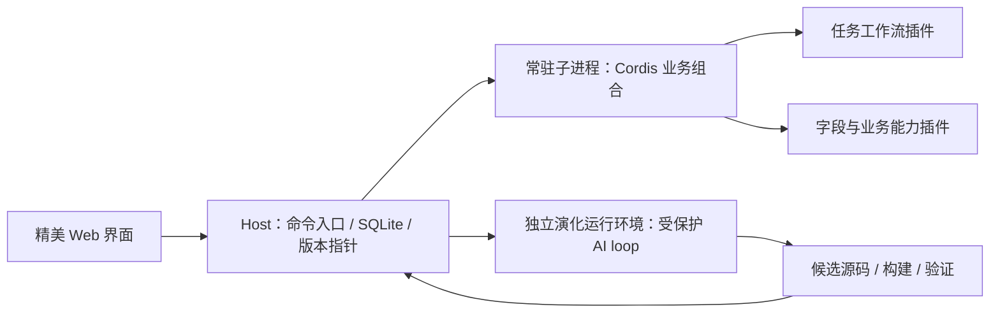

# 自迭代核心优先：当前实施基线 V2

日期：2026-09-06。依据：用户本轮明确调整。本文覆盖旧工程方案冲突内容；原 PRD 保留历史原文。当前目标是本地单所有者的自迭代软件模板，不按完整平台交付。

2026-09-07 Agent 设计访谈已收口。Agent 的当前实施依据为 [重构详细设计](06-agent-redesign.md)；本文 M0/M1/M2 内容保留阶段背景，不作为限制新 Agent 只能生成文本工作流的依据。调查、执行进度、候选体验（宿主管理的隔离会话、合成可写数据）与绑定式 apply 已有公开命令与测试验收；体验不是第二套完整应用实例；持续迭代与恢复主线另票。

2026-10-23 核心目标重新明确，经验与架构复盘见第 10 节。第 2–9 节保留历史取舍、阶段目标及其适用范围，不把旧提供者、硬预算、里程碑或单次通过当作当前事实。现行技术契约见 Agent 设计和已接受 ADR；复盘建议不自动授予应用内 Agent 修改保护机制的权限。

## 1. 目标与判断标准

最高目标：探索并验证基于 LLM 实现软件自迭代的最佳架构，尽可能简单、通用、可跨业务迁移。当前仓库是参考原型，Todo 是验证业务，不是通用内核的永久业务前提。

核心验证：同一个应用和同一批数据能真实生成、验证、运行、继续修改、修复和撤回新的实现；更换业务时，公共控制不应依赖 Todo 的字段、状态或页面。有效迭代、独立验收和可恢复性是约束，接口简洁与迁移成本是架构优化目标。性能和现有极简界面要求继续保留，但增加 Todo 功能、协议层数、测试数量或视觉工作不替代架构进步。

“最优雅”落实为：一次改动尽量集中在一个模块，调用者只学习很小的接口；为可替换性增加的抽象，应以实际第二种实现检验价值，不能靠命名证明通用。不给内部所有函数增加扩展钩子，不为尚不存在的适配器建包。

“性能最高”是优化目标，不能直接作为已实现结论。分别衡量任务命令 P95、候选生成/验证/切换时间、有效改进所消耗 token、连续迭代资源走势。模型耗时与本地执行分开；先建立基准，再优化占比最高的阶段。

## 2. 对旧方案的审查

| 旧设计                                          | 当前决定               | 原因                                                      |
| ----------------------------------------------- | ---------------------- | --------------------------------------------------------- |
| Todo 工作流、AI loop 可替换                     | 业务流程保留；AI 策略仅维护者升级 | Agent 不能修改自身执行策略，保证自迭代机制稳定 |
| 稳定插件身份、源码版本、活动组合                | 保留并精简             | 第二次修改必须找到第一次成果，重启后要继续存在            |
| 独立执行的验证与失败复现                        | 保留目标断言与基础回归 | 少测试但验证真实改进，避免“无异常”冒充修复                |
| 运行终止、上一个可用版本、任务保留              | 保留                   | 错误代码不能让系统永远失去继续修改能力                    |
| 每插件一个 Linux 容器、逐调用能力代理           | 删除当前要求           | 改为整个组合一个常驻子进程，插件内部直接调用              |
| 细粒度授权、审批哈希、多风险等级、CSRF/远程认证 | 不纳入当前演示         | 当前按本机使用；用户不需要学习审批治理系统                |
| 分布式租约、复杂发布状态机、客户端 ACK 门禁     | 删除                   | 单一数据写者、串行切换、事务性活动指针即可先验证          |
| 约二十张表、十余 packages、独立治理平台         | 不预建                 | 按真实存储需要增加；模块先共处一个工程                    |
| 完整 JSON UI DSL、通用 renderer 引擎            | 收缩为少数真实扩展插槽 | UI 壳直接用高质量 React 组件，动态字段/动作使用小描述结构 |
| 所有内容包括存储均可在线热换                    | 延后非核心实现替换     | 数据持久模块保持窄接口；没有需求不做运行中数据库迁移      |
| 原 42 项全部是第一版阻断条件                    | 改为分期参考           | 本版以第 7 节的核心演示验收为准                           |

取消安全平台建设不等于删除一致性。保护已完成的改进、区分真实通过与失败，属于核心产品行为。外部发布、多租户及恶意插件防护不在当前任务中。

## 3. 推荐架构

这里“一个组合一个进程”指稳定运行时的业务组合，不禁止候选验证期间启动第二个临时组合。演化工作与业务运行不能挤在同一个故障域，否则待修复业务卡死会阻塞修复工作。两种环境复用同一运行器实现，不建立逐插件 RPC 系统。

仅保留四个深模块：

- **Workspace**：`query / command` 隐藏持久化、任务修订和数据提交。生成流程返回决策，Workspace 负责提交。
- **Runtime**：`start / invoke / close` 隐藏 Cordis 状态、跨进程通信、超时和退出。插件之间仍消费 Cordis 服务。
- **Evolution**：`command / observe / close` 隐藏模型调用、相关上下文、候选构建和验证；loop 为维护者持有的受保护策略，Agent 不能修改，记录由外部保存。
- **Release**：`activate / restore` 隐藏候选就绪、串行切换、活动指针和兼容状态映射。

这四个名字是模块设计，暂不创建四套包、服务或网络端点。M0 使用 JavaScript 小实验和 Node 内建测试器，减少工具链变量。正式 UI/API 再引入 TypeScript、React/Vite；依赖在需要时固定。

推荐子进程的依据：进程内直接调用最快，但生成代码同步死循环会阻塞监督器；Worker 可终止 JS，却与宿主共享进程故障范围。常驻子进程多一次 IPC，能重建整个 ESM 模块图。本机小载荷 P95 约 0.133ms，比 Worker 多约 0.040ms；目前值得用这点开销换取简单的组合重启机制。详见一手研究与基准，不外推为生产指标。

## 4. 简化发布规则

候选使用独立运行环境执行目标用例；失败直接丢弃候选运行环境，保留源码和原因。通过后串行处理活动切换：等待正在执行的任务命令完成，启动候选，检查当前数据是否兼容，在一个 SQLite 事务里更新必要状态映射和活动版本，切换运行引用，再关闭旧环境。

重启只读数据库中的活动版本：事务未提交继续旧版，已提交启动新版。新版尚未真正可运行时不能标记发布成功。M0 只证明精确手写组合下的机制；生产化仍需不可变源码产物、启动失败恢复和副作用约束。

首期新增字段采用增量数据，不用整库快照回退。流程回退如需 review→open，显式提供完整映射并保留复盘文本。UI 按动作/表单契约展示，取消补充输入不改变任务。

## 5. 自迭代质量与性能

先做最小差异：读当前实现与接口，生成候选，验证，切换，观察。每次请求只涉及一个主要能力，避免全站重新生成。只有出现第二个真实需求才增加新的通用契约。

保留小而有效的验证：新增行为正例、边界反例、旧有任务操作、数据保留。自动修复必须先让旧版本复现失败，再让新版本通过相同断言。模型新增测试可以补充证据，不能单凭它自写自测认定正确。

记录生成、构建、验证、切换各自耗时以及真实 usage。稳定上下文前缀、按需加载相关接口、复用常驻进程值得优化；是否使用缓存、并行模型调用或多 Agent 搜索，依据真实耗时和成功率决定，不先构建调度平台。

## 6. 视觉与体验方向（2026-09-07 更新）

用户调整为 **Microsoft To Do 的极简风格：干净、克制，任务优先**。覆盖之前暖白青绿和灵动助手的设计方向。使用最新版 Tailwind CSS 与 Base UI 减少自定义交互成本，具体约束见根目录 DESIGN.md。

日常界面只保留任务列表、筛选、搜索、添加与详情。AI 由常驻入口呼出需求侧栏，开始执行后进入专门进度视图；不是默认首页或永久一级导航。版本和日志等周边信息收进二级入口，保留生产运行时回归及旧数据库兼容。

Agent 只负责应用自迭代，不执行普通任务操作或通用问答。Plan 阶段读取真实实现、能力、依赖和测试，澄清必要业务取舍；计划包含目标、验收、步骤、数据影响及应用方式。用户点击开始后锁定需求，自动生成、验证和范围内修正；体验候选后再确认应用。执行中不能修改需求；必须改变范围时停止并保留证据，调整后重新规划。

执行过程展示实际服务端阶段；可以收起继续处理任务，回来恢复状态。禁止定时器伪造进度、无证据的成功状态和未接入时的模拟方案。M2 接通真实路由、模型生成、持久化运行和候选发布；前端只展示宿主记录的真实阶段。

## 7. 重排后的里程碑

| 阶段              | 产物                                         | 验收                                                 |
| ----------------- | -------------------------------------------- | ---------------------------------------------------- |
| M0 核心实验，本轮 | Cordis、执行方式比较、流程替换、事务恢复     | 实测证据与失败边界，详见 m0-validation.md            |
| M1 精美可用切片   | 持久化 Todo + 动态动作 + 精致响应式界面      | 同一批任务可操作/刷新/重启；视觉浏览器审查通过       |
| M2 第一轮真实进化 | 输入“完成前写一句复盘”，真实生成插件并应用   | 候选源码、测试、版本与界面变化可核验，继续改同一插件 |
| M3 组合与修复     | 简单消费既有字段的第二插件，已知故障现场修复 | 能力复用；旧失败/新通过；重启与撤回保留数据          |

以上为历史阶段划分，不代表本轮重新验收。下一次开发按 [Agent 重构实施顺序](06-agent-redesign.md#12-迁移与实施顺序) 推进调查到开始、候选到应用、持续使用与恢复三条主线，不以闹钟或其他具体业务功能作为交付目标。

## 8. 已知边界与后续决策

本节为 M1/M2 时点的历史背景，下面的模型选择与“尚未验证”不是 2026-10-23 的现状；当前证据及缺口见第 10 节。

M1 历史报告已覆盖浏览器与 1000 任务负载；真实模型、长期内存和大消息性能仍未验证。进程冷启动样本很少，不能把它当可靠尾延迟。Node 内建 SQLite 在实验中使用，正式存储驱动在 M1 结合运行环境固定。

M2 使用原生 Gemini Developer API、官方 @google/genai SDK 和 gemini-3.1-pro-preview。驱动只返回完整模型响应，Evolution 显式执行工具循环并保存历史；不使用自动工具执行、隐式重试或备用模型。密钥仅由服务端读取忽略的 .env 中 GEMINI_API_KEY。声明式插槽的表达范围用首个真实生成场景检验，避免为“任意 UI”提前设计语言。

## 9. M2 阶段约束与 Agent 重构修订（2026-09-07）

本节记录当时的目标约束，不表示每项模块解耦已经实现。历史固定预算不覆盖后来接受的用户追加授权；生产默认、冻结评测预算及跨运行的外部调用授权必须分别记录。

M2 的文本字段/动作是历史验收切片。新 Agent 使用行为目标、按需能力发现和完整候选产物，不以该切片限制生成范围。Runtime、Evolution、Release 不包含 Todo 字段或状态分支；不拆包。Gemini 驱动与工具执行、持久化、发布控制分离，不预建 Agent 框架。

计划冻结可执行目标、验收规则、稳定插件身份、基础版本和组合修订。点击开始前只调查和规划，开始后生成及验证，确认应用前不能改正式版本。候选使用现有工具链在独立环境构建和验证，源码、构建结果、契约版本和证据形成不可变产物。切换前重新核对组合和当前数据，事务提交活动版本、发布记录及回执，完成状态还须核对运行就绪。具体应用与恢复以新设计为准。

撤回使用已发布版本，不恢复数据库快照；期间新增的任务和字段保留。旧数据库增量加列，兼容旧工作流。单工作区一次运行，最多三个候选、十二次模型调用、十分钟活动执行；等待确认不计时。取消终止后续工具和发布，已经提交的结果仍显示完成。重启核对数据库中的提交事实，未完成运行标记中断，不自动重复调用模型。

本次不交付特定 Todo 功能，不重做无关 UI，不建设市场、模板生成器、多模型调度或远程部署。允许修改 Agent 所需的计划、进度及候选体验界面。Agent 自身策略纳入保护范围；本次工程重构由维护者实施，不赋予应用内 Agent 修改自身策略的能力。

## 10. 项目经验与架构复盘（2026-10-23）

### 10.1 复盘口径与结论

基线为本地 `37cb2a69a07ff9b5caf72ca54d368c22f95511c7`。盘点了该提交可达的 136 个提交、GitHub #1–#46、5 份 ADR、工程文档 00–06、M0/M1 报告、#8/#30/#35/#36/#46 的验收材料，以及 10 月的协议、职责对照、稳定性和交互验收归档；重点核对当前源码的模块接口、依赖、可写面及验证路径。没有重跑历史付费实验或修改其结果。

结论：四模块、单权威写入、故障可终止、冻结、独立验收、候选体验和绑定应用已经形成有价值的基础。复杂度主要累积在 Todo 语义编译、事实投影和复核协议之间，已影响职责局部性。主线没有被完全放弃，但研发重心有向“把固定 Todo 规格编译器做完整”偏移的风险。当前证明了多种 Todo 能力的迭代，尚未证明跨业务迁移，更不能称已经找到最佳架构。

这里区分三种判断：**实现事实**由源码和实际回归支持；**经验有效性**限定在已经暴露并验证过的失败模式；**架构建议**仍需下一业务和对照实验检验。保留保护门禁不等于保留它们当前的每一层实现，简化也不等于删除门禁。

### 10.2 开发阶段留下了什么

| 阶段 | 取得的有效经验 | 不能外推的部分 |
| --- | --- | --- |
| 9 月 6 日 M0/M1 | Cordis 生命周期需显式确认 ACTIVE；组合子进程可终止、可重建；唯一写入、短事务、幂等回执和版本切换成立。复用现有运行器比逐插件 RPC、完整平台更直接。 | 手写夹具不是 LLM 生成；微基准不是生产尾延迟，子进程不是恶意代码安全隔离。见 [M0](../reports/m0-validation.md)、[M1](../reports/m1-validation.md)。 |
| 9 月 7–8 日 #1–#8 | 从混合聊天/任务执行转为专门自迭代；调查、开始锁定、生成修正、隔离体验和最终应用成为独立事实。 | 当时闭合的合成与真实局部路径不签发所有后续功能的通过。见 [ADR 0001–0004](../adr/0001-evolution-scope-and-application-confirmation.md)、[#8 收据](../reports/issue-8-validation.json)。 |
| 9 月 9–20 日 #9–#35 | 多成员组合必须显式继承完整身份；主工作流版本与组合载体不同；所有成员同源构建；业务验收经真实 Workspace 提交链，保留未知字段。 | 19 次历史试跑只有一次完整单轮，没有通过双轮；短试跑、桩层六步或子 Issue 关闭不满足旧 #30/#35 完成线。见 [交付状态](../reports/issue-35-validation.json)。 |
| 9 月 23–30 日 #36–#46 | 复用已有在线调度；能力发现与实际注册、健康、授权、检查器同源；指南、骨架和精确版本绑定有用；时间测试需驱动真实调度链。 | 同口径六场完整路径为 2/6→2/6，不能声称当时整体稳定性改善；补充轮次的截止路径成功与整个模板完成不同。见 [比较](../reports/issue-36-comparison.json)、[补充收据](../reports/issue-36-completion.json)。 |
| 10 月 8–18 日统一规格与语义复核 | 机械身份、引用、字段投影和差异摘要应由宿主生成；初始业务值、初始显示、后端拒绝、动作可见与页面反馈必须分开；历史值须经基础版本真实操作准备。 | 冻结了错误或遗漏的解释，仍会“候选符合计划却不符合原需求”；来源复核、严格 JSON 或更强思考都不提供完整性证明。详见 [设计中的逐轮反证](06-agent-redesign.md)。 |
| 10 月 18–22 日采样与职责对照 | 已有冻结清单、独立业务 oracle、正向/边界分母、实际职责观察、原始调用与完整性归档；应继续复用这套评测。 | 同一 Todo 的多场景不是第二业务；不同清单、预算、源码、模型策略及补充分析不能合并成一个成功率。证据范围见 10.4。 |
| 10 月 23 日交互、默认与续行 | 追问必须有明确交互契约；可审查默认优于反复转交技术细节；效率目标与追加授权分开；检查点、同运行续行及可重试的宿主未就绪检查有价值。 | 默认不保证猜中所有意图；增加授权不等于效率达标；受控恢复复现不证明已丢失现场的历史故障唯一成因。原失败仍保留。 |

### 10.3 应继续复用的经验与实现入口

以下是已经有实现、反例或实测支持的工程经验，不是待建平台清单。

| 已验证的经验 | 防止重复犯错的规则 | 现有入口或证据 |
| --- | --- | --- |
| 控制和可变业务分开 | 模型不能修改自己的权限、预算、保护断言、验证报告、发布或恢复来取得通过；维护者升级与普通自迭代分开。 | [ADR 0002](../adr/0002-protect-independent-evolution-controls.md)、[候选构建](../../src/release/business-bundle.ts) |
| 冻结与授权必须绑定具体对象 | 开始绑定需求修订、计划和基础版本；应用绑定候选与证据。冻结防漂移，不证明需求理解完整。 | [需求门禁](../../src/server/requirement-coverage.ts)、[篡改反例](../../tests/app/requirement-gate.test.ts) |
| 唯一写者比多套提交路径可靠 | `decide` 正确不代表提交后正确；必须经过 command、beforeCommit、持久化、query 及必要事件。复用这条链，不新建验收专用业务写入。 | [Workspace](../../src/server/workspace.ts)、[提交钩子反例](../../tests/app/before-commit-acceptance.test.ts) |
| 组合和成员身份不能靠猜 | 只改 A 时保留 B 的精确版本、启用态和角色；规范化序列化不改变未改业务身份，未知字段不丢失。 | [组合处理](../../src/release/composition.ts)、[连续继承回归](../../tests/app/composition-inheritance.test.ts) |
| 发布成功是持久事实加就绪 | 网络响应、事务提交、运行就绪是不同事件；提交前后取消不能混为一谈。撤回指向旧实现并处理当前数据，不恢复整库快照。 | [Release](../../src/release/release.ts)、[恢复回归](../../tests/app/recovery.test.ts) |
| 进程监督与组合生命周期值得保留 | 长驻组合复用一个运行器；候选单独运行，超时可终止，旧订阅和定时资源必须释放。不要回到宿主直接执行生成代码或逐插件 RPC。 | [Runtime](../../src/runtime/runtime.ts)、[在线调度](../../src/server/host/online-schedule-service.ts)、M0/M1 报告 |
| 技术事实和机械引用应由宿主确定 | 资料目录、可读范围、首次交付和生成输入同源；宿主生成 ID、摘要、版本和可推导案例，不让模型维持重复控制字段。 | [调查存储](../../src/evolution/investigation.ts)、[规划](../../src/server/planning.ts)、[差异组装](../../src/evolution/candidate-delta.ts) |
| 用户原话、解释、默认和事实分开 | 问题的假设不是用户回答；默认须有作用域、依据和影响并独立审查。只问真正改变目标或影响重大的未决分支，不把技术缺口改写成用户放弃。 | [交互契约](../../src/evolution/interaction.ts)、[预检与澄清](../../src/evolution/request-admission.ts) |
| 验收必须独立于候选自述 | 系统保护、冻结业务验收、模型自测分别留证；独立调用的复核仍可能和规划共享误解，需原文约束、可信业务 oracle 与反例。 | [语义状态](../../src/evolution/requirement-semantics.ts)、[独立评测 oracle](../../scripts/lib/stability-eval/oracle.ts) |
| 后端与界面不是同一断言 | 后端拒绝不推出按钮隐藏或页面特定报错；原生 required 不等于 alert。真实页面应验证动作、表单、保存、刷新和重启。 | [浏览器验收](../../src/server/browser-acceptance.ts)、[操作反馈](../../tests/app/operation-feedback.test.ts) |
| 旧值必须有可信历史 | “已有任务”不意味着已执行过旧动作；通过基础版本冻结成功案例准备历史，不直接注入候选需要的字段值。 | [历史准备](../../src/evolution/historical-preparation.ts)、[历史准备反例](../../tests/app/historical-preparation.test.ts) |
| 能力的多个状态不能压成一个 ready | 声明、注册、支持、健康、授权、检查器覆盖及正在使用分别判断；暂时恢复中不等于契约永久变化。 | [能力目录](../../src/server/planning.ts)、[恢复预检回归](../../tests/app/candidate-experience-session.test.ts) |
| 时间能力要复用真实调度链 | 测试时钟只驱动注册、取消、触发和统一命令；停机不承诺准点，补执行不承诺外部副作用恰好一次。 | [ADR 0005](../adr/0005-host-extension-registry.md)、[调度验收](../../src/server/schedule-acceptance.ts) |
| HTTP 成功不等于有效模型响应 | 正文保活、空正文、length、非法 JSON、协议拒绝、语义错误、服务不可用分别记录；未知 usage 不按零费用处理，不能都交给候选修代码。 | [模型适配](../../src/evolution/deepseek.ts)、[传输失败](../../src/evolution/transport-failure.ts)、[原生协议回归](../../tests/app/deepseek-protocol.test.ts) |
| 失败纠正必须有界且有诊断 | 参数错误在原运行内返回具体路径、实际值和可纠正原因；保留无效响应与消耗，不外层无限重跑、手改真实候选或换期望凑通过。 | [协议校验](../../src/evolution/model-protocol.ts)、[修复与执行回归](../../tests/app/execution.test.ts) |
| 效率目标和授权资源分开 | 初始资源随运行保存；只有用户可追加。续行复用有效结果和检查点，不重放已处理响应或发布；不能以追加掩盖权限、能力、协议或验收失败。 | [预算授权](../../src/evolution/budget-authorization.ts)、[完整续行 E2E](../../tests/e2e/evolution-interaction.spec.ts) |
| 进度和操作必须表达当前意图 | 追问、计划、执行、等待资源、待应用使用明确标签和操作；调用用量是辅助信息，不是任务完成百分比；草稿、焦点、中文输入法及窄屏是行为契约。 | [控制侧栏](../../src/web/AssistantPanel.tsx)、[浏览器交互回归](../../tests/e2e/assistant.spec.ts) |
| 证据要先保存再清理 | 留下源码、运行、原始调用、usage、候选、断言、实际结果、截图和回执；恢复与重放单列，不改原失败。日志序号以持久事件为依据，未知根因保留 unknown。 | [六步失败归档](../../tests/e2e/v1-acceptance.spec.ts)、[归档工具](../../scripts/lib/stability-eval/archive.ts) |
| 评测定义本身也要验证 | 正向完成、正确阻塞、误阻塞、错误放行分别计数；先冻结需求、口径、源码、评测器和预算。Issue 关闭、旧版本绿测、一次成功、重复视口都不是当前整体完成。 | [当前清单](../../scripts/lib/stability-eval/current.ts)、[计分](../../scripts/lib/stability-eval/scoring.ts)、[职责实验](../../scripts/lib/stability-eval/responsibility.ts) |
| 简化应减少调用方知识和重复权威 | 复用 Cordis、SQLite、TypeScript/Vite、Playwright 和已有四模块；不为一个案例新建框架、DSL、平台或第二条生产兼容循环。旧记录可读不等于旧命令重新获授权。 | 第 2–5 节、[模型驱动 Interface](../../src/evolution/driver.ts)、[现行 ADR](../adr/) |

### 10.4 证据能证明到哪一步

- **机械机制**：复盘前将当前工作区与上一轮 798 项冻结输入逐项比对，无内容变化；已有 `typecheck`、`build`、705/705 应用测试、94/94 E2E 支持同源机制回归。本轮只修改文档，不把这些结果说成新跑的真实模型验收。它们不证明任意需求、任意模型或第二业务可靠。
- **历史交付门槛**：GitHub [#30](https://github.com/tower1229/todo-by-cordis/issues/30)、[#35](https://github.com/tower1229/todo-by-cordis/issues/35) 查询时均为 closed，但仓库 [#35 收据](../reports/issue-35-validation.json) 仍明确没有同一固定源码上的完整真实双轮。后来的独立场景采样不替换这条历史完成定义，也不在复盘中改写状态或结果。
- **职责对照已存在**：本机 `.runtime/responsibility-contracts-v7-gpk2wfms/report.json` 的固定源码 `aeda6175…`，48 次运行中，model 组正向 18/18，host 组 16/18，两组边界各 6/6；焦点场景首候选为 3/6 与 6/6。总体 `acceptancePassed=false`。这说明确定性交互协议的归属值得研究，但焦点改善不等于整体方案更好；每场三对、同一 Todo、已知前序结果下的补充分析均有限制，不支持直接宣布切换生产策略或架构最优。现有生产默认仍为 model。
- **较新 Todo 采样不是早期 2/7 的重复**：本机 `.runtime/stability-scoped-contract-24-87e4rjq_/completion-receipt.json` 的固定源码 `655aa267…`，24 次记录完整，正向 17/18、边界 6/6，129 次调用，26 个候选，保留 9 个失败候选；其中 8 个涉及缺失输入表单。原生 `acceptancePassed=false`；外层活动 HEAD 核验也失败，后来保存了相同 Git tree 与内容完整性的补证，没有覆盖原失败。本次复核了收据所列 20 个文件哈希。它支持特定 Todo 样本内的闭环与修正能力，不是当前提交或跨业务可靠性的普遍证明；30 分钟活动预算也不能与旧 10 分钟批次混作公平改进对照。
- **单次交互成功**：本机 `.runtime/interaction-deadline-89-4c2oqdsa/summary.json` 记录一条截止时间候选在 10 次真实调用内通过验收与体验、0 次用户追问、10 项默认经审查，停在待应用；总 usage 为 599609 tokens。它证明一条具体路径，不代表正式应用、总体成功率或默认决策普遍正确；调用数达标不意味着上下文与推理成本已经最优。
- **不要误读架构脚本的汇总**：`scripts/accept-architecture.ts` 仍是 workflow、addition、upgrade、clarification 四类 Todo 场景，`passed || boundaryAccepted` 允许已知不支持的 addition 作为正确阻塞计入总体通过。必须分别报告正向交付与边界检查，不能把该汇总解释为四个正向功能完成或跨业务验收。后续优先复用当前稳定性评测的分项指标，不再创建平行汇总口径。

上述 `.runtime` 路径是本机研究材料，不是 Git 内完整可移植的交付包；原始源码、清单、限制和归档身份才是结果的适用范围。没有将不同版本样本合并，也没有在本轮发起新模型调用。固定旧源码上的强结果应保留，不能为说明当前架构问题而只挑早期失败。

### 10.5 当前架构的具体判断

| 维度 | 判断及当前证据 | 后果 |
| --- | --- | --- |
| 值得保留的基础 | Evolution 的使用 Interface 仍是 command/observe/close；Driver 将提供者调用分开；Runtime 可终止并重建；Release/Workspace 以不可变产物和持久事实协作。 | 不应推倒重写进程监督、版本、写入、预算或恢复；新业务应先尝试复用这些机制。 |
| 复杂度 | 当前受版本控制的生产 TS/TSX 约 27988 行；Evolution 2510、领域实现 1910、planning 1760、需求覆盖 1041 行。数字只描述规模，不单独证明过度设计。真正的问题是控制循环处理领域字段裁决，多个投影与来源/事实契约须同步，改变一种领域语义会牵动多个模块。 | 复杂度偏高且存在可消除部分，但不能按文件数拆包或通过删验收“简化”。应减少调用方必须学习的知识和多处权威。 |
| 接缝与依赖 | `Domain` Interface 有 18 项成员，context/parse 等使用 `server/planning.Investigation`、`InvestigatedPlan` 及 Todo 的字段、成员和浏览器类型；生产只有 `EvolutionDomain` 一个实现。静态 import 中 evolution→server 有 19 条，10 条为运行时导入。此次静态分析未检出运行时 import 环，不能把含 type-only 的环当作运行故障。 | 命名成 Domain 并不等于业务可替换；应以第二真实 Adapter 的接入成本检验接缝，之后收窄接口，避免先建更多假想层。 |
| 可迁移范围 | 数据仍是 Task、字符串 fields、open/done 类别与文本 Field；共享规格显式携带 workflowRules/memberCases。业务界面主要是固定宿主渲染和声明式贡献，候选还排除宿主生成的 view/config/compatibility 投影。 | 已证明跨 Todo 功能，未证明跨业务。ADR 允许的业务界面与必要接口迭代，比当前实际开放面更宽；应明确哪些属于领域 SDK，哪些才是不可变控制，不能把当前文本/呈现契约当成永久架构能力上限。 |
| 确定性协议归属 | 8/9 个失败候选集中在表单协议；已有 host/model 双分支及实际职责观察，当前默认仍为 model。 | 应复用已有实验研究“领域 SDK 承担机械协议，LLM 提供业务规则和逻辑”的分工；不是把 Todo 语义塞进通用控制内核，也不能凭局部 6/6 宣布全面接管更优。 |
| 资料成本 | 当前 `read_guides` 同时返回 `content.documents` 与顶层 `documents`，规划循环把整个 result 放进工具回执，DeepSeek 再完整序列化。首次有效文档因此有重复表示；已有 InvestigationStore 解决存储/交付身份，但不等于模型传输已去重。 | 这是可定位的简化点：分离内部证据与单份模型视图、复用现有资料闭包，先测实际重复字节和阶段 tokens，而不是增加模型调用或再建资料系统。 |
| 主线偏移风险 | 后期大量工作围绕同一组字段、表单、反馈和截止策略补齐编译与裁决，验收可信度提高有实际价值；但还没有非 Todo Adapter 或整个架构的等条件比较。 | 主线仍在，重心有局部偏移。先验证现有业务的可重复交付及修正、恢复，再检验迁移；不继续无目的扩展 Todo 功能或语义协议。 |
| 最优性与外部使用 | 现有对照主要比较同一 Todo 框架中的职责分配；单机、单所有者及非恶意插件威胁模型明确，未验证任意宿主、远程多租户或强沙箱。 | 目前是有价值的领域原型，不是已经验收的通用自迭代框架。扩大部署/信任范围时另做相应验证，不为此预建平台，也不提前承诺安全。 |

具体源码入口：[Domain 与控制循环](../../src/evolution/evolution.ts)、[领域实现](../../src/server/evolution-domain.ts)、[共享规格](../../src/shared/change-spec.ts)、[业务契约](../../src/server/business/contracts.ts)、[候选可写面](../../src/evolution/candidate-delta.ts)、[资料回执](../../src/server/planning.ts)、[提供者消息转换](../../src/evolution/deepseek.ts)。

### 10.6 后续主要关注什么

以下顺序按用户后续决定调整：先稳定现有业务，第二业务放到最后。架构建议不自动授权大范围重构；冻结、独立验收和应用确认继续保留。

1. **P0：以完整交付收益约束架构收缩。** 连续局部修复没有带来完整流程收益时，停止默认追加下一处提示或协议补丁，先梳理同一需求的调用链、单一权威、重复投影与审查职责，再选择一个能减少调用方知识的收缩方案做零付费对照。独立声明退出条件：必须保留原文、冻结、保护反例和应用确认，同时减少模型负担与维护位置；字符减少、纠错减少、测试增加均不能单独签发功能或效率通过。已有失败先复现并定位，正确性、恢复及证据丢失问题仍可修复。暂缓全面宿主生成、通用规格语言与大规模 Domain 重构，不为每类失败增加状态、配置或编排层。必填输入专项的历史局部收益保留，当前架构验证见 10.8。
2. **P0：守住目标正确性，统一复用评测。** 继续使用当前 stability-eval 的原文 oracle、正向/边界指标、实际职责绑定及归档；给旧专项脚本明确适用范围。不以正确阻塞抵消正向失败，不将计划自洽当原需求完整。保留未说明实体作用域导致合理追问的歧义证据，不能为减少追问而把验收假设伪装成用户要求。
3. **P1：验证现有业务连续交付与成本。** 同一业务的继续修改、继承、失败修正、预算续行、重启和保数据撤回共同组成退出条件；单场成功不替代连续链。保留原效率目标，追加后完成明确记为超初始目标；分别测资料、推理/输出和本地构建浏览器耗时。只向模型发送一份必要资料视图，保留复验需要的不可变快照。旧 #30 双轮标准另列，不以新专项冒名完成。
4. **后续：根据专项结果决定是否扩大架构比较。** 复用已有 host/model 对照，结合完整交付及上游失败判断；局部首候选改善不能证明全面接管更优。必要时才在相同能力、门禁、模型配置、预算和数据条件下比较较少专用协议的路径；生产不长期叠加并行执行机制。
5. **最后：用第二业务检验迁移。** 现有业务稳定性得到重复证据后，再选择真正不同的业务；例如库存记录、入库/预留/释放与非负约束，而非重命名 complete/reopen。记录业务适配量、核心改动和隐含规则，再依据真实阻碍收窄接口；不先建设通用实体平台，也不自动运行付费迁移实验。

近期暂停无验证目的的 Todo 功能扩张、平台化、第二套评测、全量改名拆包和无证据的模型参数追逐。已复现的正确性、恢复及证据丢失问题仍应修复；冻结、独立验收、开始与最终应用确认、数据保留、取消和用户资源授权继续保留。

2026-10-26 专项进展：必填表单契约的 4 次真实生成对照为旧 0/2、新 2/2；完成提示与组合刷新同步的最小修复通过 707 项应用测试、102 项 E2E 及 20 次重复验证，随后在当前补丁上通过一条真实模型完整流程，含原生预算暂停、界面追加、独立验收、隔离体验和显式应用。该流程实际调用 5 次，但使用了追加授权，不记作初始授权内闭环；累计 90/97。详见 [Agent 设计中的版本及证据边界](06-agent-redesign.md#2026-10-26界面修复后的真实模型完整验收)。这支持保留该最小修复，不能由小样本推导长期稳定率、维护成本下降或全面宿主接管更优；后续顺序与暂停范围保持不变。

### 10.7 每次新增机制前的检查

- 它解决了哪个可复现失败或哪一种真实业务变化？旧实现应出现什么反例？
- 现有 Workspace、Runtime、Release、Driver、调查存储、检查器或评测入口为什么不能复用？
- 新知识是否留在恰当模块，还是又要求控制循环理解一个领域字段、页面或状态？拆文件后调用方需要知道的规则是否真的变少？
- 同一事实是否已有权威来源？哪些是必要的冻结快照，哪些只是重复声明或重复传输？
- 在保留现有保护约束下，哪个公开 Interface 的测试和哪份独立证据能证明收益？没有第二种业务证据时，迁移性只记假设。
- 哪份现有文档需要更新，哪些历史结论须标清版本？只修改当前约定，不覆盖原失败；本机研究材料、Git 内交付和实际部署分开报告。

### 10.8 2026-10-29：先验证单份模型业务视图，暂停连续补丁与付费重跑

本轮基线为 `d19e718ddbba59a7b94493fe540df44acf86f033`。用户要求回到全局视角后，仅审视当前业务并制作离线原型；生产源码、模型策略、调用链及门禁未修改。最近四轮计数复验使用第 112–134 次共 23 次调用，均未完成完整流程；它们不是同版本随机对照，不能合并估计稳定成功率。最新样本的规划前置纠错由一次变为零，但规划交换耗时由 140.888 秒变为 183.290 秒；独立需求复核在 224.597 秒窗口内只收到 HTTP 200 和三个空白字节，未冻结、未进入生成。最新暂停归档约 0.996 秒，属于有效的交互与证据修复，不能代替候选交付。

现行调用链及职责取舍：

| 阶段 | 当前职责与权威 | 本轮决定 |
| --- | --- | --- |
| 资料捕获 | Workspace/Release、`capture` 与 InvestigationStore 保存精确版本、源码、资料及哈希 | 保留全量不可变快照；模型常规输入与审计载体分别审视 |
| 准入及来源复核 | 原始需求中的初始呈现、外部作用及早期澄清；最新样本各一次模型调用 | 保留；尚无反例等价证据证明可直接合并或删除 |
| 规划及确定性编译 | 模型给出业务行为、默认与案例，宿主推导引用、可达路径、可执行验收及统一规格 | 收缩模型面对的基线表示；继续由宿主维护机械身份与编译检查 |
| 独立需求复核 | 检查来源、遗漏、额外限制、默认、业务选择及技术主张 | 保留独立语义判断；下一重点是划分宿主可判定检查与模型语义任务，尚未删除任何复核字段 |
| 冻结与开始 | 绑定需求、业务定义、验收、已审默认、版本及明确开始 | 保留；旧保护代码身份失效的收据仍须重新规划 |
| 生成、独立验收、体验与应用 | 冻结范围内生成业务变更，通过真实 Workspace/浏览器验证，再隔离体验和显式确认应用 | 保留；最新样本未进入生成，不填写虚构的零耗时或成功结论 |

选定的收缩候选为：**模型使用单份冻结业务定义，完整审计快照继续由现有宿主持有并可按精确身份读取。** 现行 `active-acceptance` 把 `changeSpec.definition`、平铺的重复业务段和浏览器/工作区执行报告一起交付规划器。离线原型只在模型视图保留一份 definition，完整保留 RequirementGate 的原文、独立复核和来源；保留未分类的上下文，分开 source 哈希与 view 哈希。它不把摘要冒充原文，也不将视图可用冒充完整原文已交付。没有可靠冻结、出现重复段冲突、复核异议或封印无效时回退原始快照；原型没有接入生产。

预先设定的表示实验门槛为规划消息字符至少减少 20%，业务定义与冻结来源逐项相同，原归档精确可读，保护反例不被放行。对四份实际归档首轮消息，字符分别从 224632→175069、224602→175039、223413→173850、223411→173848，减少 22.06%–22.18%；最新 UTF-8 消息为 242829→189728 字节。仅把原归档字符串改成单层 JSON 只节省 8602 字符，不能把全部收益归因序列化。该实验不估算新模型 token、不证明推理加速、语义等价或端到端完成。

另一种候选是在复核中新增义务索引。实际最新消息有 21 次义务出现、17 个唯一义务，精确重复正文仅 1603/72739 字符，未计新增引用开销的上限为 2.20%。当前不采用这项新间接层：它未减少较大的语义与技术证明任务，还会增加模型查找规则。直接删除准入/复核阶段、调整思考策略、追加时间或建设通用规格语言也没有成为本轮替代方案。

原型以现有 PlanningDriver 和原生 Evolution 创建新的模型桩测试计划，再经现行冻结门禁检查相同 definition 及八类篡改：需求、默认、浏览器断言、后端案例、写入范围、复核、来源和门禁缺失。旧真实收据因 gateVersion 不同而失败的初始夹具记录保留，未重签旧真实批准。后续接入应限于已有领域资料交付 Interface，复用存储和原文读取；视图必须同时绑定来源与自身身份，不能增加第二份可维护业务权威、资料存储或并行生产流程。

推进条件分开评估：本轮只有离线表示与保护反例结果；接入前还需证明真实资料交付、按需原文读取、失效与恢复均正确，且独立复核收到的判断依据完整。进入付费实验前须固定同一业务、基线、模型、门禁和资源，比较完整交付、总耗时、用量、误放行与误阻塞；本轮不执行真实调用或双轮。若收益仍只体现在局部计数、移走阻塞或增加协议层，停止该实现路线，不再以补提示或追加预算维持它。

本机原型、职责表、消息分解、原生门禁反例及实际回归日志保存在 `.runtime/architecture-view-zero-14p_6xnx/`。原型 18/18 及其独立严格类型检查通过。现有八个测试文件的门禁子集为 59/60，A06 在未改生产源码时因“需求预检事实或来源已变化”阻塞；随后 A06 单独串行运行 1/1 通过，不能拼接为一次 60/60，也尚不能归因某个瞬时事实。初次受限浏览器环境的失败和中止记录另存。接入生产或付费比较前，应先保存并对比冻结时与预检时的事实差异，验证究竟是合法身份变化还是暂时运行状态，不先放宽校验或重签旧冻结。本轮新增付费调用为零，累计仍为 134/234，原真实失败不变；没有重跑全量、提交、推送或部署。

### 10.9 2026-10-30：资料交付接缝验证与预检诊断补全

本轮沿用 `d19e718`，生产源码、模型策略和保护门禁未改。先给原生 `admission` 与预检事件加一次性捕获，原样执行上轮八文件子集，本次 60/60 通过，未捕获到 A06 的非预期事实变化。上轮 59/60 及单项 1/1 仍分别保留；本次通过不能反推旧失败已修复。恢复/不可用与真实事实变化的受控回归分别得到 `runtime-not-ready` 和 `admission-invalid`，后者保留同一版本、同一来源及具体 changedFacts 身份，证明诊断路径能区分它们，不证明某一个就是旧失败的原因。

稳定复现的证据缺口在测试等待器：`apply.test.ts` 自带的六十秒循环在运行已阻塞时继续等，只输出 run，临时库清理后丢失已有的 `host:plan-preflight` 诊断。本次复用已有 `settleEvolution`，意外终态立即失败，并在同一快照内输出 run 与预检事件；不改变宿主等待、超时、预算或恢复行为。新增反例先失败再通过，应用/体验/恢复子集 17/17 通过。该修改补全下一次失败的证据，不签发 A06 根因修复结论。

资料实验使用新的隔离 SQLite 和原生模型桩流程，先经规划、独立复核、冻结、明确开始、候选验证、体验及显式应用形成测试基线；应用只发生在该临时库，且这段仍使用原文路径。随后在现有 Domain.read、InvestigationStore 和 Driver 接缝验证模型实际接收的视图、交付回执、按精确 ref 补读原文、存储损坏及重开 SQLite。原文与视图使用不同 ref/hash，视图内容绑定 source ref/hash 和基础版本；捕获原文不等于交付原文。业务 definition、完整 RequirementGate、来源、默认及独立复核依据保留；旧证据、无效封印或重复段冲突回退原文。此原型 11/11 通过；仅证明存储重开和身份校验，未证明新视图已走通原生规划冻结或预算续行。

本轮发现直接接入的确定性阻碍：现有交付身份只有 `ref + hash`。将视图放在旧原文身份下会误记原文已交付，使后续 `read_acceptance` 返回 reused/null；采用独立 `model-view/active-acceptance` 身份时，原生规划正确报告“缺少调查证据：active-acceptance”。另一个原生绑定反例 1/1 通过：即使同时给出原文和视图，当前 bindPlan 也只保留已知原文身份，不能据此签发视图已绑定冻结的结论。负面对照保留旧回执，三个关键断言如预期失败（测试框架连父测试共记四项失败）。不能将视图视为原文已读，也不能只删必读检查来取得 ready。

最小接入范围因此收敛为**扩展现有资料身份，绑定来源与视图，而不是新增资料系统**：宿主验证 source ref/hash 与 view ref/hash 的映射后，才可用于必读依据和冻结绑定；原文交付仍独立记账，视图不能抑制原文补读；恢复时复核基础版本、来源、视图契约及冻结身份，旧记录继续走原文路径。独立需求复核及候选验收保持原入口，不删语义判断。本轮没有把这个试验性契约接入生产，也没有增加第二份可维护业务定义、存储、配置或生产执行循环。

该实验的接收桩主动要求补读原文，视图和原文因此各交付一次；这验证可取回性，不证明总传输或调用成本下降。后续收益必须按完整流程累计输入、调用及交付成功评估；若常态补读抵消视图收益，或需要更多协议层才能维持流程，则停止此路线，不用首轮字符缩减代替净收益。

证据位于 `.runtime/architecture-delivery-zero-pxhd6b7a/`，保留旧失败和本轮负面对照。`pnpm typecheck`、`pnpm build` 以及原型和测试夹具的额外严格类型检查通过；同一次 `pnpm test` 完整应用回归为 734/734，无失败、取消或跳过，耗时约 33.4 分钟。`pnpm test:e2e` 本轮未重跑，不签发全 CI 或新视图端到端通过。新增付费调用为零，累计仍为 134/234；没有真实模型、双轮、正式数据应用、提交、推送或部署。下一接入门槛仍是可审查的来源/视图绑定及原生冻结与预算恢复反例；A06 的历史具体差异目前无法从已清理的旧临时库补回，继续列为未确认原因，不以推测或本次全绿消除记录。

### 10.10 2026-10-30：原生资料身份接入与恢复验证

按上一轮接缝结论，仅扩展现有 PlanEvidence 的可选 source 身份，复用 Domain.read、InvestigationStore、evolution_materials 和原有规划/执行循环。可靠基线采用独立 view ref/hash，宿主验证并冻结其 source ref/hash、基础版本和内容；原文归档、原文交付与视图交付分开记录。旧原文检查点不自动升级，旧格式或冲突基线回退原文；恢复前拒绝过期来源、视图、损坏正文和失效冻结，且不先追加额度。完整业务定义与独立审查依据保留，未引入第二业务、通用规格语言或新的资料系统。

新增原生单元及集成专项 18/18 通过。真实浏览器的新流程 1/1 通过：临时库形成可靠基线后，连续修订复盘长度，规划暂停和候选耗尽后分别重启，通过界面追加同一运行，经过规则修订确认、开始、独立验收、隔离体验及显式应用。累计 8 次模型桩调用、两次追加，初始效率目标为 5 次；判定为“完成，超过初始效率目标”。该验证主动补读原文，不能据首轮视图缩减推导净输入、耗时或真实成功率收益。

本轮新增浏览器重启验证在同一测试服务端口关闭并重建 Workspace、Evolution、体验宿主及 SQLite 连接，使用全新无隐藏决策状态的 Driver，确认不自动续调；它验证后端生命周期恢复，不声称操作系统重启或真实供应商会话恢复。整个流程没有拦截接口伪造运行状态，也没有应用正式数据。

中间失败原样保存：早期测试预算未触发目标边界；模型桩在仅结论阶段发起未授权读取被协议门禁拒绝；连续变更模型桩误用 active-source 候选路径被冻结授权拒绝。分别修正测试条件和桩的契约遵守，未放宽生产预算、工具白名单、写入范围、独立复核或应用门禁。旧 A06 的历史具体差异仍未知，不用本轮通过消除历史失败。新证据集中于 `.runtime/material-identity-zero-yce6b6gn/`，保留日志、暂停快照、失败 SQLite、浏览器截图和轨迹。

首次应用全量还发现本次契约升级遗漏的测试调用点：schedule-policy 已验证时序候选后，继承计划的测试代码只拷贝 ref/hash，丢掉 source，原生规划正确报“调查视图或来源身份无效”和“缺少调查证据：active-acceptance”。该错误单独稳定复现。测试改用同一个 materialIdentity，并断言发布基线的视图进入后续冻结；原时序、来源、验收及应用门禁断言保留，专项 4/4 通过后重新启动完整应用批次。旧测试已自动清理首次失败临时库，因此此项只保留原断言日志、调用者原始源码和复现记录，不补造原库；该测试现可按本轮证据目录在后续失败时保留临时库。首次全量与最终批次分别记账，不拼接通过。

最终 `pnpm typecheck`、`pnpm build` 通过；完整 `pnpm test` 为 739/739，零失败、取消或跳过，耗时约 34.2 分钟；完整 `pnpm test:e2e` 为 111/111，耗时约 21.6 分钟。首批应用全量 738/739（约 32.2 分钟）和稳定复现均保留，不能改写为通过。浏览器批次之后仅修正时序测试的资料身份调用点和失败保留钩子，生产代码未变，最终源码快照另行核对。桌面与 320px 新流程截图已检查。

三组旧证据的 1270 项哈希核对全部一致，原付费台账未变化；本轮证据、运行身份与源/视图绑定、失败索引及最终差异在上述新目录封存。新增真实调用 0 次；累计仍为 134/234。本轮没有真实模型、双轮、正式数据应用、提交、推送或部署；本地回归通过不等于 CI 或真实模型验收通过。进入真实验证前仍需固定可复核版本、对应 CI 和明确实验预算；用完整流程评估净输入、成功率和耗时，不能只用字符缩减签发架构收益。

额外严格类型检查单独记录：新增的四个测试/夹具文件通过；将未纳入仓库 typecheck 的旧 schedule-policy 测试一并检查时，发现四处将缺少 id/requestRevision 的草稿传给完整计划函数的类型错误。修改前测试源码在同一未改签名下也报相同四处错误，证据为 schedule-before-typecheck.log；本轮未扩修，不将这项额外检查记为通过。

### 10.11 2026-10-30：全流程计量与 A/B 零付费预演冻结

计量复用现有 SDK transport、evolution_calls、原生步骤事件及稳定性评测归档。SDK 仅增加实际 JSON 编码后、交给 HTTP 前的 UTF-8 requestBodyBytes；不改变模型、网络初始化、max 输出策略、工具与 schema、重试或阶段时间预留。所有准入、规划、复核、生成与纠错尝试分别累计，历史、工具定义、schema 和原文补读进入实际请求体。请求字节数不冒充供应商已接收字节或计费 token；主指标仍为供应商完整 prompt_tokens（含缓存），缺失用量保持未知，不填零、不用字符数估算。原始调用、缓存用量、提出的工具调用、实际交付回执分别保留，工具提案不冒充已执行读取。

全流程 wall、宿主活动时间、模型分阶段区间、原生构建/验证/浏览器步骤、独立浏览器验收及自动化浏览器路径分别记录；嵌套区间不相加。wall 复用评测器从场景准备至最终证据整理的计时，不包含预先克隆实验基线；自动化路径的人工等待为零，不推断真实用户等待。调用失败或未返回时仍保留已知请求、传输和用量缺口，原生错误分类与终态继续使用原入口。

冻结实验位于 `.runtime/material-ab-zero-rzoklb0z/pilot-5/experiment.frozen.json`，身份为 `62ace8ca44e9b3b913a3362ced6d78539a07d287f9b16d9ea63ee4a427452f14`。A/B 使用相同当前代码和门禁，通过现有 Domain.read 接缝分别交付原文及来源绑定视图；不在生产加入原文切换配置。两组都能按正常工具补读原文，补读及后续完整历史全部计量。固定业务基线来自已封存的 `counter-path-real-awsdzznz/baseline` 克隆，组合版本为 `5765967f89828b53c4de635c6423632cb7f608684b5dfe56c3130710f182ed4f`；每个场景首次模型调用前的准备必须保留该基础版本及验收原文身份。固定需求为 v1Requests[1] 的新增独立计数并保留标签，顺序 raw/view/view/raw，每次独立 SQLite 克隆。基线文件、代码/夹具闭包、模型策略、需求、独立判定、分组、预算和停止条件共同冻结；当前 HEAD 是 d19e718，未提交补丁另有完整文件身份，不把 HEAD 冒充已包含补丁的版本。

每次最多 12 次调用、3 个候选、10 分钟活动时间，第一对最多 24 次。任一运行终态失败、预算暂停、来源/版本漂移、真实用量未知或请求计量缺失均停止，不补跑、不清零、不自动追加、不手改候选；已启动失败与未执行项分别列出，不能缩小分母。主输入和完整 wall 的降幅均至少 10% 才考虑第二对；反向 BA 对也必须同向达标。小样本只用于判断是否值得继续，不能签发总体失败率下降。四次付费最多 48 次，第二对须另行决定，第一对授权不自动覆盖第二对。

最终零付费预演为完整 4/4，每次 4 次 SDK 模型桩交换、1 个候选，无追加；全部经过原生需求复核与冻结、明确开始、候选独立验收、额外独立业务浏览器判定、隔离体验、显式应用及持久化恢复入口。A 的交付记录均为原文，B 均有真实 source 绑定视图。四次完整请求体总量依次为 456022、389882、389878、456021 字节；wall 依次为 34808、33600、36069、33790 毫秒。输入字节约少 14.5% 只是受控路径的字节观察，桩没有供应商用量，且时长无双向改善；评估器明确返回 stub-only，不以此宣称真实 token、推理耗时或成功率收益。

三批准备失败独立封存，不与最终通过拼接：pilot-1 首次准入因受控 HTTP 桩漏掉 SDK result 信封被协议门禁拒绝；pilot-2 通用 dual 场景准备替换了克隆基线，A/B 实际均回退原文，曝光检查拒绝该批；pilot-3 保留正确基线后，通用桩将“拒绝空白标签”误解释为必需页面反馈，被独立来源复核拒绝。仅修正评测清单与受控桩解释，补上场景开始前基础身份校验、原生消息角色、即时请求归档和反例；未放宽生产协议、复核、冻结、并发保护、验收与应用确认。失败库、原始响应、传输、截图和封存身份均保留。

台账核对 76–134 共 59 条连续原始占用，无重复或缺号；1–75 沿用既有历史基数，不声称本轮重新取得其逐次原始记录。累计仍为 134/234，余额 100，本轮真实调用为零。拟第一对 raw→view 最多新增 24 次，累计封顶 158，第二对不自动执行。此轮只完成准备与零付费预演；真实执行仍需固定干净提交、对应 CI 及第一对的明确执行确认，现有 clean-commit/CI/授权门禁没有绕过。当前无真实模型、正式数据应用、提交、推送或部署。

最终封存补入构建配置、Node 运行环境和实际 dist/web 产物的身份，并将台账及预检正文绑定到实验哈希；未改变生产模型路径。此前已通过的 pilot-4 原样保留，最终清单 pilot-5 独立重跑 4/4，不拼接结果。另建受控预检篡改反例，改动 Node 记录后在首个运行创建前被拒绝：模型调用与启动运行均为零，四项全部列为未执行。最终 `pnpm typecheck`、`pnpm build` 和新增测试的独立严格类型检查通过；受影响应用回归 87/87、来源/补读/重启续行及两阶段预算暂停浏览器回归 3/3 通过。本轮没有重跑完整应用或完整 E2E 套件，旧全量结果不冒充本轮全量。早期受限环境的本机 HTTP 回归失败且中止、预演夹具与断言修正、以及第一次额外类型检查遗漏 node 类型配置均单独保留，最终检查不覆盖这些记录。四组旧证据共 1796 项内容哈希一致。
