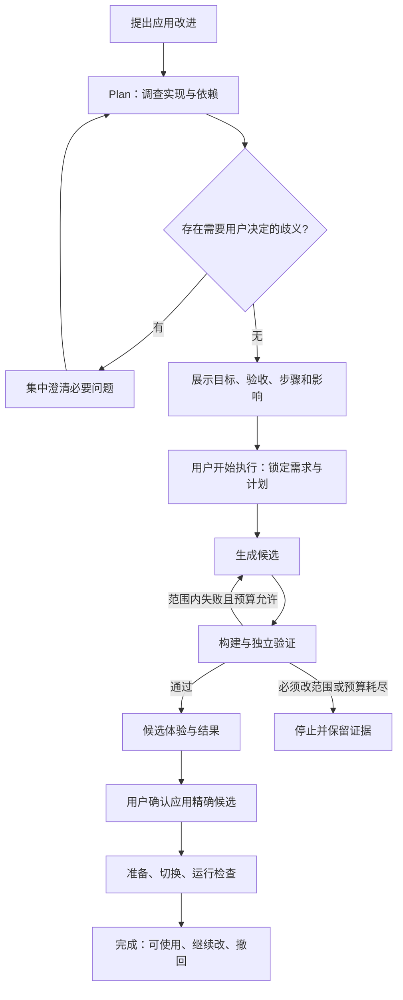

# 自迭代 Agent 重构详细设计

日期：2026-09-07。状态：调查、执行进度、候选体验、绑定式 apply、持续迭代与恢复主线已有公开验收。恢复侧：`activationPending` 区分已提交未开放写入；提交后 abort 不补偿、仅就绪失败补偿；重启时 pending 且启动失败会补偿回旧组合并持久化 `recovery`；A12/A13 含 app 故障注入与浏览器真实撤回保数据。

本文是当前 Agent 重构的实施依据，覆盖原 PRD、V1 工程方案和 V2 中冲突的 Agent 职责、执行策略可修改性、确认流程与生成范围。其他未冲突的本地单所有者、四个深模块、数据保留和极简界面约束继续有效。决策依据见 [ADR 0001](../adr/0001-evolution-scope-and-application-confirmation.md)、[ADR 0002](../adr/0002-protect-independent-evolution-controls.md)、[ADR 0003](../adr/0003-complete-capability-gaps-within-one-change.md)、[ADR 0004](../adr/0004-freeze-request-and-show-execution-progress.md)；术语见 [CONTEXT.md](../../CONTEXT.md)。

## 2026-10-12：统一规格与有预算执行协议

当前模型协议采用 `change/2`，下文历史完整候选提交描述由本节覆盖；Release 仍接收完整不可变组合。四个公开模块及开始、体验、独立应用确认不变，不引入第二模型提供商。

| 内部职责 | 实现与边界 |
| --- | --- |
| 规格编译 | `planning.compilePlanDraft` 从业务规格生成证据引用、工作流验收基线、步骤与发布说明，再经过既有语义检查。`specification` 冻结需求来源、实施选择、宿主保护及完整执行投影。 |
| 调查存储 | `investigation` 按内容摘要持久保存材料，交付回执独立于 provider history；澄清后重新检查源、指南和环境摘要，复用有效事实。基础版本变化不自动重基，重启不自动继续模型。 |
| 复核控制 | `review` 保存宿主分配的问题 ID、精确需求或来源目标、方面和立场。空历史、无工具独立复核计入原预算。历史问题必须有原文支持的显式消解；同规格重复问题或相反立场阻塞。业务澄清可直接进入现有等待回答状态。最终复核账本随门禁摘要冻结。 |
| 预算调度 | `budget` 负责调用准入。默认 12 次中为执行预留 3 次，规划和复核最多使用 9 次；不足以规划加复核时只开放结论。澄清必须留下继续规划、复核和执行预算。失败调用和无效候选照计，活动时间包含调查、构建和验收，等待用户除外。 |
| 差异组装 | `candidate-delta` 接收精确 baseVersion/baseHash/requirementSeal、可选最近失败 parentCandidateId，及带 before 摘要的实际文件或成员改动。宿主继承未改内容，再交完整产物给 Release。纯辅助新增或升级允许 files=[]，不强迫重写旧主工作流。 |
| 验证与证据 | 固定构建→后端与系统保护→真实 browser/1 顺序；schema 与步骤解析共享 `browser-contract`。补读资料只更新交付记录，不改冻结规格。候选、定义、检查器、前端及合成数据均进入证据绑定，独立应用门禁仍生效。 |

模型不提交宿主派生字段或通过报告。需求 ID 由宿主命名，原始需求、澄清、继承要求、实施选择和宿主保护分开记录。界面要求仍须映射真实可见断言；现有检查器或槽位不能表达的需求如实阻塞，不扩展成任意浏览器脚本框架。语义复核降低遗漏风险，不证明自然语言完整性。

迁移：旧活动版本、历史、撤回和恢复保留；缺少新规格的旧待执行、待应用计划须重新规划，不补造通过记录；已提交的应用按发布事实恢复。旧模型提交格式只在测试夹具适配器中转换，正式执行只接受差异协议。验收修订仍沿用现有确认机制。

验收要求：固定预算、完整性反例、冻结篡改、复核冲突、澄清复用、精确继承、同预算两候选修正、隔离与故障回归，分别以确定性测试、真实 Chromium 和真实 Gemini 证据记录。真实模型验收预先固定主工作流规则、新增辅助、升级辅助、必要澄清四个独立合成用例；每例仅运行一次、最多 12 次调用，总上限 48 次，不外层重试或手改候选。四例全部通过才称本次架构验收通过，失败原样归档；不能推断一般成功率。

本轮实施状态：类型检查、构建、333 项本地测试及 80 项 Chromium E2E 通过；真实 Gemini 四例均未通过，共 21 次调用（主工作流 9、新增辅助 7、升级辅助 2、必要澄清 3），没有应用候选。证据见本机 `.runtime/architecture-real-70z6Ip/summary.json` 及各用例调用、数据库和源码快照。主工作流先出现前端字段与业务接口不一致，再出现父候选旧文件摘要不匹配；升级及澄清分别出现无效来源／案例引用和浏览器业务 ID；新增辅助在独立复核时发生一次 `fetch failed`，单独计为 API 故障。所有合成正式任务、组合及验收期间源码保持不变。主体协议迁移已落地，但真实模型闭环未达到交付标准：模型仍须手工保持部分引用、重复字段定义与差异摘要的一致性，且部分协议错误会提前阻塞修正。此结果不构成自迭代可靠可用的证明，不得以本地模型桩通过替代真实验收。

## 1. 目标与非目标

Agent 唯一职责是把对本应用的改进需求推进到可验证、可体验、可应用和可继续修改的实现。它可以解释本次变更及其状态，但不承担通用问答或普通任务操作。日常 Todo 通过现有界面完成，模型不可用不影响基础业务。

本次交付是 Agent 重构，不是开发闹钟。具体功能的行为取舍由重构后的 Agent 在 Plan 阶段调查、澄清和冻结；不得将任何一个示例功能的字段、动作或测试写死在通用执行循环中。

范围包括需求沟通、调查规划、多文件候选、独立验证、范围内修正、候选体验、两次明确用户操作、应用与恢复、继续迭代和进度视图。保留现有框架及依赖，不引入多 Agent 调度平台、插件市场、多租户、远程部署或任意依赖安装。

Agent 不修改自己的执行策略。改造循环、工具权限、预算、取消、验证结果记录、系统保护测试、发布事务与恢复入口由维护者持有。普通自迭代不能修改或通过别名、依赖、配置和入口替换绕过它们。

## 2. 当前实现的具体问题

| 位置 | 已核对的事实 | 重构要求 |
| --- | --- | --- |
| `src/server/evolution-domain.ts` | 规划限制为 complete 时收集文本；目标是字段长度规则；能力上下文只有当前工作流 | 改为行为目标和按需能力发现，字段验收保留为业务案例 |
| `src/evolution/evolution.ts` | Plan 单次调用；执行工具只有读契约、读当前源码、提交单文件；验证后立即 apply | Plan 工具循环；多文件候选；验证后停在待应用状态 |
| `src/shared/assistant.ts` | 包含 task 路由，confirm 只绑定计划；没有候选确认 | 删除普通任务执行路由；区分 start 与 apply |
| `src/release/types.ts`、`src/release/release.ts` | 版本和构建围绕单一源码、单一服务，切换前调用 describe | 版本扩展为完整应用组合产物，业务专有探针由契约提供 |
| `src/server/workspace.ts` | 当前活动版本绑定工作流；同时承担业务和持久提交 | 把可变业务和受保护提交职责划清，保留唯一数据写者 |
| `src/web/useAssistant.ts` | 只观察最新运行；轮询持久状态 | 支持按 runId 恢复进度及历史，不用聊天文本重建运行 |
| `src/web/AssistantPanel.tsx` | 混合路由方案和执行显示 | 需求沟通、计划、进度、候选结果形成明确视图 |

这些是静态核对结果，不是本轮真实模型验收。现有幂等操作、候选尝试记录、独立子进程、版本留存和旧数据兼容可以复用；不能把扩大提示词范围当作完整重构。

## 3. 用户主流程

“开始执行”允许在冻结范围内生成、验证和修正，不授权正式应用。“确认应用”绑定已验证候选，不授权事后替换源码或扩大行为。需要额外数据外发、付费或外部副作用授权时提前说明，已有授权不重复索取。

需求明确时也必须先调查，再展示计划。技术事实由 Agent 自行查明；只问目标歧义、影响用户使用的取舍和范围变化。不使用关键词表代替需求理解。对普通任务操作只指向现有入口；对无关问答简短说明职责，不启动变更。

## 4. Plan 的输出与执行前门槛

Plan 是有预算的只读工具循环，可以读取当前版本、相关文件、接口、测试和诊断，并在隔离环境运行既有检查；不能写正式数据、修改实现或触发外部副作用。调查不读取整个任务库，不读取密钥；默认用合成样例，真实任务按必要范围及授权取用。

每个计划必须包含：

| 内容 | 要求 |
| --- | --- |
| 目标与范围 | 用户可观察的结果、明确不包含的事项、来源需求修订 |
| 调查证据 | 已读的精确实现版本、接口、相关测试及环境检查结果 |
| 能力差异 | 可复用能力、需修改或新增能力、依赖与保护范围交叉检查 |
| 行为验收 | 正例、边界反例、已有行为保留、数据及生命周期要求 |
| 执行步骤 | 每步目的、依赖、预期产物、完成证据；不是任意 shell 清单 |
| 数据影响 | 新增状态或字段、兼容策略、当前数据适用性和撤回方式 |
| 验证与体验 | 目标如何测、使用何种固定检查器、用户如何体验候选 |
| 应用方式 | 组合切换、是否重启业务运行、可预期中断和恢复条件 |
| 预算及未决项 | 剩余调用和候选预算、已知限制、确需用户决策的问题 |

存在未解决的行为歧义、已知阻断依赖、无法执行的验收或未授权副作用时，不进入 ready。未知项不能全部写成“实现时再看”。Plan 不能保证执行永不失败，但必须把能提前查清的问题前置。

模型提出计划，执行器验证必填项、读取证据引用、基础版本、可写范围及检查器可用性后，才允许用户开始。展示计划是短摘要，可展开证据；不向普通用户暴露无关内部类型和文件布局。

## 5. 职责与可修改范围

继续使用四个深模块，不拆成多个项目或服务平台：

| Module | Interface 与职责 |
| --- | --- |
| Workspace | `query / command`：业务数据、唯一持久提交、公开业务契约；业务语义由可变实现决定 |
| Runtime | `start / invoke / close`：组合加载、执行、超时和清理；生成代码故障不阻断 Evolution |
| Evolution | `command / observe / close`：固定 Plan/执行循环、模型调用、工具授权、预算、需求记录和事件 |
| Release | `prepare / activate / restore`：产物验证、候选体验环境、串行切换、提交事实和恢复 |

在现有工程内分离“可变应用实现”和“受保护控制实现”，不靠整个 src 目录白名单粗放授权：

- 可变：业务插件、业务 React 页面、业务接口和必要的运行能力提供者。业务能力通过 Cordis 组合复用；允许一次变更跨多个相关文件。
- 受保护：Evolution 固定策略、模型凭据与工具执行入口、进程监督、数据库提交控制、验证器及系统保护断言、发布恢复、改进入口的开始/停止/应用控件与状态来源。
- 边界：可以新增业务契约，不能修改控制接口。可以变更数据的业务解释与兼容映射，不能绕过持久写入、丢弃数据或替换数据库驱动。可以增加业务运行能力，不能撤销超时、取消或隔离限制。

现有混合文件先由本次维护者工程重构拆出职责，再开放可变部分；不能让应用内 Agent 修改 workspace.ts 整个文件以绕过提交保护。路径策略、解析后的依赖和实际工具能力均由受保护执行器检查。当前正则导入扫描和 Node 子进程不是强安全沙箱，不得声称能够防御任意恶意代码。

## 6. 候选形式与工具

候选工作副本从已发布的完整应用源码产物建立，不直接编辑开发者当前 checkout，也不覆盖正在使用的静态资源。复用现有 TypeScript、React/Vite、Cordis 和锁定依赖。固定构建入口不执行模型提供的 package scripts；不允许修改依赖锁来引入任意安装行为。

能力目录由活动组合的 `members` 与宿主扩展注册摘要（`composition.extensions`）同源生成：提供成员身份/启用/角色、已登记扩展点（命令、字段、事件、调度、UI 槽位等）、提供者成员精确 `versionId`，以及 `ready`（仅当注册状态为 `active` 且组合 ready）。不能把 manifest 声明、证据缓存的 capabilities，或「模块已求值且有导出」单独等同于当前可调用。主工作流 `workflow.provide` 条目可附带 `active-contract` / `active-source` / `active-acceptance` 引用；其他扩展点当前不附源码/验收引用。只读摘要后按需取得详细材料。

内部工具按阶段开放，名称为拟实施契约，不是现有 API：

| 阶段 | 工具 | 返回与限制 |
| --- | --- | --- |
| Plan | `inspect_application`、`read_source`、`read_contract`、`read_acceptance` | 版本绑定的内容与引用，按范围读取；`inspect_application` 含活动 `members` 与扩展注册摘要 |
| Plan | `check_environment`、`describe_verification` | 固定检查目录与可信检查器定义；合成或授权副本，无任意命令 |
| Plan | `propose_plan`、`request_clarification` | 执行器验证结构并记录；可选 `memberAdditions` / `memberUpgrades`；宿主派生 `compositionIntent`；模型不能授权自己 |
| 执行 | `read_contract`、`read_current_source` | 限冻结契约与当前基础源码 |
| 执行 | `submit_candidate` | 提交带旧摘要的 `files`/`members` 差异及精确规格身份；宿主组装完整组合、执行隔离验收；未确认不应用 |
| 执行 | `report_blocker` | 记录障碍，执行器决定状态，不自动扩大范围 |

不提供模型可调用的正式任务写入或 release.apply 工具。apply 只由用户命令触发，经 Release 复查执行。工具参数均校验，未知工具拒绝；任务内容、源码注释及日志作为数据，不授予权限。普通候选必须显式写出完整 `members`（未改成员继承精确 `versionId`/`enabled`/`role`）；`memberAdditions` 与 `memberUpgrades` 本阶段各最多一项且互斥。

首次 `submit_candidate` 将当前工作副本封存为一个不可变 candidate；修改后产生新 candidateId，原产物和失败报告保留。业务配置变化也产生版本，无需强迫生成无意义代码。新增或升级辅助插件由宿主分配/沿用稳定身份；一个变更可以包含主工作流与协作成员及业务界面。

## 7. 状态与外部命令

状态迁移由服务端控制，模型文本不直接作为状态：

| 状态 | 允许的用户操作 | 退出依据 |
| --- | --- | --- |
| planning | 查看、停止；修改需等调查停止 | 调查证据、问题或有效计划 |
| awaiting-input | 回答、修改需求、取消 | 新需求修订后重新调查 |
| awaiting-acceptance | 比较旧、新规则及原因、确认修订、修改、取消 | confirm-acceptance 绑定 planId 与 revisionId，确认后进入 ready |
| ready | 查看计划、修改、开始、取消 | 精确 planId 和基础版本校验 |
| executing | 查看、停止；禁止修改及另起执行 | 候选通过、阻塞、失败或取消 |
| awaiting-apply | 体验、应用、放弃、调整后重新规划 | 精确候选与验收摘要确认 |
| applying | 查看、请求停止 | 提交前可停止；提交后以事实为准 |
| succeeded | 查看结果、继续改、撤回 | 终态，新改进创建关联运行 |
| blocked / failed / interrupted / cancelled | 查看证据、以原需求重新规划 | 终态，不静默恢复模型执行 |

executing 内部阶段为生成、构建、验收、修正、准备体验；一个固定步骤可以多次尝试。改变步骤状态必须对应工具开始/结束事件，不能因为进入下一步就把上一步全部标为成功。

公开命令：request、answer、revise、confirm-acceptance、start、cancel、experience、apply、continue。continue 绑定父 runId 和当前已发布 baseVersion，保留父运行的诊断与预算事实；成功运行仅可继续其仍在使用的精确发布版本。修复请求使用 intent: repair，模型识别为修复时也触发旧版检查；无法复现断言失败时以 unreproduced 阻塞。start 绑定 runId、planId；apply 额外绑定 candidateId、evidenceHash、compositionRevision。revise 仅在等待用户的可编辑状态可用，执行期间返回 REQUEST_LOCKED，服务端强制拒绝，不能只禁用输入框。所有写命令带 operationId，同 ID 同输入返回原回执，同 ID 不同输入拒绝。

observe 支持 runId 和事件游标，默认返回最新运行。保留 `/api/assistant` 和 `/api/assistant/commands` 作为入口，增加按运行查询及事件增量参数；不因内部重构建立第二套 API。旧 confirm 不得在新流程中被解释成应用授权。

单工作区最多一个未结束变更，等待输入、开始或应用时仍占用该位置；可放弃后重建，不建设队列。普通 Todo 在调查、构建、体验时继续可用；应用排空期间短暂停写。

## 8. 运行记录与预算

复用当前 SQLite，按实际需要增量扩展 evolution_runs、evolution_operations、evolution_calls、evolution_candidates；增加事件和独立验收修订的持久记录，不预建通用工作流数据库。

| 记录 | 必需身份与内容 |
| --- | --- |
| Run | runId、parentRunId、requestRevision、baseComposition、policyVersion、状态、计划引用、预算 |
| Plan | planId、需求摘要与 hash、步骤、验收修订、可写范围、调查引用、数据及应用方式 |
| Candidate | candidateId、planId、基础版本、完整文件摘要、构建输出、依赖锁、契约版本、配置与映射 |
| Evidence | candidateId、检查定义 hash、fixture hash、环境、结果及失败诊断；验证器写入 |
| Event | runId、递增 sequence、stepId、attempt、开始/结束时间、结果、证据引用 |
| Application receipt | operationId、候选与确认摘要、前后组合、提交结果、就绪检查结果 |

需求补充保存结构化历史，不只把新文本拼到旧字符串后；继续修改读取已发布版本及历史验收，不读取“最近一次聊天”猜测基础版本。

默认沿用每次运行 12 次模型调用、3 个封存候选、10 分钟活动执行预算。Plan 调查也计入调用和活动时间，等待用户不计时；进入 ready 时展示剩余预算。范围内修正不得重置预算，无新证据的同类失败可提前停止。预算由维护者配置，Agent 不得自行调大；人工开启的新运行保留关联失败记录，不自动创建新 run 绕过上限。

持久化调用开始、结束、失败与真实 usage。无法取得 usage 显示未知，不按耗时推算 token。模型网络错误不自动归因成业务代码缺陷，不静默换模型或无限重试。

## 9. 独立验收与业务规则修订

三种证据必须分开：系统保护回归、冻结的业务验收、模型补充自测。保护测试及检查器从可信控制版本载入，不从候选提供的同名路径载入；报告由验证进程写入，候选只能得到诊断。

业务验收在 Plan 中表达为 Given/When/Then，并绑定明确的可观察结果。为避免建立新的万能测试 DSL，优先用现有命令/查询契约的输入与结果断言、固定浏览器操作及可见状态断言、固定生命周期检查。由可信检查器解释数据化案例；应用代码候选不能改变已冻结案例。辅助成员业务要求可通过 `memberCases` 冻结（目标成员、动作、初始数据、输入、预期最终数据与拒绝案例），由隔离 Workspace 检查器（`workspace/1`）解释；**不再**对辅助字段使用 `probe-*` 式任意业务输入猜测可调用性，业务正确性仅由冻结案例经 command → beforeCommit → 持久化 → query 比较最终事实承担；结构检查保留成员装载、命令注册与归属、计划未授权命令拒绝等不依赖业务输入的核对。通用冒烟不是唯一 oracle。规划门禁（`AffectedAcceptance`）：新增辅助成员必须在本次计划提交该成员受影响动作的成对冻结案例；升级辅助成员时，省略/空 `memberCases` 仅表示 as-is 继承该成员历史成对案例（无历史基线则阻塞），若提交了案例却未覆盖被升级成员的受影响动作（历史动作 ∪ 本次提交动作）则视为错绑并阻塞。宿主在规划 ready 与候选验证共用同一覆盖结构；候选若注册计划未授权的新命令则拒绝并要求重新规划。无关变更继承历史成员案例；修改已有案例预期仍须 `acceptanceReason` 与独立确认，不能靠省略、改名或换绑悄悄移除旧约束。自迭代辅助成员须经可信构建与受限加载；调查可读 `member-source|contract|acceptance/{pluginId}@{versionId}`，生成期用 `read_member` 读取精确实现后再做最小修改。

模型可以提出案例，但不能仅凭自己生成实现和自测报告认定正确。开始前用户能看到业务目标与验收（方案确认用业务语言展示将检查的行为摘要），系统保留已有回归；新类型行为没有可靠检查器时，应在 Plan 阶段揭示并补齐维护者验证能力，不能以自由生成的测试脚本冒充独立 oracle。

用户主动改变既有业务要求时，展示旧规则与替代规则并确认，建立新验收修订。旧版本记录保留；系统保护约束不随业务需求变化。执行开始后禁止修改已冻结断言，失败必须修改候选而不是改期望。

修复类请求必须绑定故障版本，先复现旧版失败再验证新版通过相同案例，并通过其他保护回归；无法复现记录为 blocked/unreproduced，不输出“已修复”。`reproduce` 与新候选验证共用同一份冻结案例和同一隔离 Workspace 检查器。本次不建设无人值守故障自动发布策略。

## 10. 体验、应用与恢复

可变应用产物包含后端业务组合和前端业务资源，受保护控制进程持有模型、数据库提交、版本指针及恢复入口。普通业务变更通过替换业务组合和资源生效；所谓需要宿主扩展，优先在可变业务提供者和公开业务契约层完成。若确实要求改变控制进程协议或保护实现，Plan 明确转维护者升级，不把它隐藏在业务补丁中。

复用同一 Runtime 实现分别启动活动组合与临时候选组合；两者数据空间和副作用能力不同。体验环境默认使用合成数据，无生产 DB 或模型密钥；用户授权的数据副本可按需使用。体验行为不写正式任务、不发送正式通知，页面明确标注候选；有依赖外部交付的功能必须另有真实交付证据，不能把模拟结果冒充验证通过。

应用采用一个受保护的活动组合指针，包含精确业务代码与前端资源版本。前端资源使用不可变路径，旧页面请求携带组合修订，过期写入拒绝并要求刷新，不能让旧 UI 用旧字段语义写入新版本。不增加客户端 ACK 发布门禁。

应用步骤：

1. 用户确认候选、验收报告及影响摘要；校验候选未变、基础组合有效、保护规则未变。
2. 预启动精确候选业务组合，执行契约指定的就绪检查；重新检查当前数据兼容，不使用 Plan 时的数据快照直接提交。
3. 串行排空业务写入，在同一 SQLite 事务提交必要兼容映射、完整活动组合指针、发布记录和操作回执。
4. 更新服务引用，执行无外部副作用的运行检查，开放业务写入；记录真正就绪后才展示完成。前端发现组合变化加载对应资源，保留草稿。
5. 关闭旧组合，登记清理结果。业务资源的启动/清理失败不得使 Evolution 和恢复入口不可用。

文件产物先完整落盘再写引用。事务前失败维持旧版；事务提交后响应丢失按回执查询，不再次发布。若提交后尚未开放写入即启动检查失败，可按预先验证的补偿恢复旧组合；数据库记录必须反映已恢复，不把曾提交等同于仍可用。若已接受新业务写入，撤回使用当前数据的兼容检查与映射，不恢复整库快照。

启动按数据库提交事实恢复组合；planning/executing 的未完成运行标记 interrupted，不自动续调模型。ready/awaiting-apply 保留，用户操作时重查版本和产物；applying 必须核对发布事实及运行状态，不能统一当失败重做。

取消在工具间检查并终止活动子进程；发布事务前阻止提交。事务已提交时不能声称取消成功，继续核对就绪或恢复事实。停止后新执行重新 Plan，不能直接应用旧候选。构建与验证子进程必须有可验证的文件、凭据和进程权限约束；未通过保护测试不得开放扩大后的写入与执行能力。

## 11. 进度与交互设计

保留现有 To Do 布局和常驻小按钮，入口文案为“改进应用”，输入提示为“描述希望应用增加或改变的能力”。侧栏负责需求沟通和计划查看；开始后切换为专门进度视图，桌面允许离开继续操作 Todo，手机使用全屏视图。

计划卡依次展示目标、最终效果、验收、步骤、数据与应用影响，提供开始、调整、取消。进度视图展示计划步骤、当前阶段、实际检查结果、失败与第几次修正、已用预算；日志和源码差异折叠。执行期间无需求输入框，不增加后台排队入口，保留停止。

轮询先沿用现有方式，但按 runId 和 sequence 合并真实事件；只观察不推进。刷新、关闭侧栏或网络中断不能新建运行，显示最近状态及连接中断，不捏造进展。stepId 保持稳定，attempt 独立，失败尝试不会被后续成功抹掉。

候选卡明确“尚未应用”，展示目标达成、验收结果、体验入口、变化及数据影响，提供应用、调整后重新规划、放弃。成功卡必须关联版本及回执，提供去体验、继续改、撤回。无可交互界面的变更展示真实结果或诊断证据，不强制伪造页面预览。

保护的控制 UI 与可变业务 UI 分开，生成业务页面不能遮挡停止、确认和恢复。沿用现有字体、Base UI 焦点与无障碍方式，检查 320px 重排、键盘和输入法，不重做其他页面视觉。

## 12. 迁移与实施顺序

| 主线 | 修改集中点 | 退出条件 |
| --- | --- | --- |
| 调查到开始 | `evolution.ts`、`evolution-domain.ts`、`assistant.ts` 与共享契约 | 普通问答/任务命令不执行；Plan 有证据和验收；开始绑定计划；执行期间后端拒绝改需求 |
| 候选到应用 | `release/*`、`runtime/*`、Workspace 的业务/提交分离 | 多文件业务组合可构建、独立验证、体验；未确认不应用；确认绑定精确候选；保护项不可改 |
| 持续使用与恢复 | 进度视图、`useAssistant.ts`、持久事件、生命周期测试 | 刷新恢复、范围内修正、继续修改、取消、提交断点与撤回均有证据 |

三条主线是完整重构的交付路径，不是三种可择一结束的结果。实现细节遵循现有目录，不预建层层 Adapter；测试通过与调用者相同的公开 Interface 验证。

旧数据库增量迁移，保留任务、字段、版本和运行记录。旧单工作流版本可由内部适配读取为只有一个提供者的组合；新候选统一使用完整产物协议，不长期并存两套 Agent 循环。旧 awaiting-confirmation 不能直接变成新 start 或 apply 确认，标记需要重新 Plan；旧已完成发布保留事实。旧 task 路由停止提供，但历史记录仍能读取。

模型连接沿用现有 Gemini Driver，仍仅负责模型调用，不引入可自修改的 Loop 插件或为了证明策略替换而增加第二实现。重构后的控制策略版本只用于诊断和维护者升级兼容。

## 13. 验收矩阵

以下均为待运行要求，不是通过记录。场景输入可以固定以便复现，但实现必须由真实模型生成；桩仅用于控制流、故障注入和稳定回归。

| ID | 场景 | 必须观察到 |
| --- | --- | --- |
| A01 | 问答、普通任务操作、应用改进三类输入 | 只有改进启动迭代；其他输入不写任务或版本 |
| A02 | 缺少用户行为预期 | 集中必要澄清，技术事实由工具查明；未明确不开始 |
| A03 | 已知缺依赖或需改保护部分 | Plan 提前发现并显示阻塞，不先承诺可执行 |
| A04 | 点击开始、重复请求及执行中 revise | 正确计划只启动一次；revise 被服务端拒绝且冻结内容不变 |
| A05 | 构建或业务断言失败 | 真实诊断进入修正，旧失败保留；断言不变，预算不重置 |
| A06 | 候选通过但用户未应用 | 正式版本和任务不变，体验在独立空间进行 |
| A07 | 候选/报告被改或基础版本变化 | 旧确认不能应用；明确过期并重新 Plan |
| A08 | 非文本工作流类型的需求 | 真实发现、修改相关业务文件/接口、验证与体验；不依靠预置功能答案 |
| A09 | 继续修改既有能力 | 稳定身份、基于真实已发布版本，保留旧功能和数据 |
| A10 | 尝试修改策略、保护测试、构建入口或绕过路径 | 工具和运行约束拒绝；不能通过自报报告绕过 |
| A11 | 离开、刷新、断网重连 | 同 runId 恢复，顺序和尝试记录正确，无假进度或重复执行 |
| A12 | 各阶段停止与服务重启 | 无迟到发布；提交前后正确区分，已提交结果按事实恢复 |
| A13 | 新组合启动失败、成功后撤回 | 无半套资源生效；撤回保留期间新增任务与字段 |
| A14 | 用户明确修订业务规则 | 旧/新规则可见且留痕，系统保护断言不变，执行中不改验收 |
| A15 | 故障修复请求 | 旧版失败、新版相同案例通过；不能复现则如实停止 |

至少覆盖两种结构不同的真实模型需求，其中一类超出现有 complete 文本字段契约，并验证同一能力的继续修改；还要证明既有能力与新能力可同时工作。业务示例只作为测试，不能变成产品范围承诺。真实模型调用必须保存需求/计划、工具、源码差异、候选、验收、确认和应用回执的关联证据。

按仓库脚本执行 `pnpm typecheck`、`pnpm test`、`pnpm build`、`pnpm test:e2e`，再运行明确标注的真实模型验收与构建产物启动检查。报告区分控制流桩、真实模型生成、浏览器体验和恢复证据；未运行不能记为通过。

完成标准：用户能通过一个稳定的 Agent 调查并实现不同类型的应用改进，在明确的开始与应用操作之间看到真实进展，失败可停止和恢复，改进可继续迭代。提示词更积极、计划更完整或单一示例通过均不足以单独交付。

## 2026-10-13：宿主编译引用、字段投影和候选差异

统一规格升级为 `change/3`。规划器提交业务语义、连续原文引用和结构化选择：来源为宿主来源目录的一基序号，验收为 `{kind,index}`。宿主生成精确来源修订、检查器及案例身份；`workflow/enabled` 省略 index 时绑定完整宿主案例。浏览器局部案例键由宿主命名，既有案例修订保留已接受身份。引用不存在、身份歧义、后端案例覆盖界面等仍阻塞；不能从文本相似度推断覆盖。独立复核的来源、目标及历史问题身份使用当次宿主目录的闭集 schema，原文引用、逐项覆盖、冲突和消解门禁继续由宿主检查。

主工作流字段定义从冻结规格编译成 `workflowDefinition`，生成及构建阶段注入同一 `frozenWorkflow` 值。模型实现业务决定并返回该定义；宿主生成 `view.ts` 的字段键投影及兼容产物，拒绝模型覆盖派生产物。原有真实 describe 契约、业务断言及前端字段一致性检查保留，因此手写错误定义仍失败。宿主不会扩充冻结写入范围。辅助成员继续使用既有自包含贡献契约，不新增默认值或 UI 槽位。

浏览器案例只选择业务动作或字段 ID。宿主从基线、冻结规则和成员案例绑定唯一所有者；既有贡献 ID 从宿主基线冻结；新增贡献在浏览器执行时由实际候选贡献目录解析唯一贡献，禁止选择器和脚本。主工作流已有字段展示补稳定 DOM 标识，展示行为保持原样；不存在或不唯一的贡献仍验收失败。

候选工具只接受变更文件内容与成员源码。基础版本、需求 seal、当前修正父候选和所有前后摘要均由宿主状态产生，模型不能提交这些控制字段。宿主保留完整候选，并将实际差异回执纳入最终证据摘要；回执须经持久化往返保持一致。业务失败沿当前失败候选继续修正，计数与活动时间均不重置；环境故障单独阻塞。规划阻断经 `report_blocker` 表达，不再要求模型维护“无/none”等哨兵文本。

迁移仅更新新规划及生成协议；旧待执行/待应用计划需重新规划，活动版本、历史、撤回与恢复保留。测试目录的历史模型桩由测试适配器转为新协议，生产无双协议接收分支。真实 Gemini 验收使用同一四个预声明合成需求，每个运行最多 12 次调用、3 个候选、10 分钟活动预算，无外层重试和候选手工修改，停于独立应用确认之前；历史失败归档保持不变。

生成资料使用独立 `candidate-contract` 身份，区别于活动 bundle 中历史 `business/contract.ts` 的精确资料；二者的摘要与交付回执分别记录，既有版本继续修改不伪造资料未变化。

第一轮 `change/3` 真实反证归档于 `.runtime/architecture-real-siDaZJ/`：四个预声明需求分别使用 12、7、7、8 次调用，0/4 通过，源码及正式合成基线保持不变，未应用。后端通过的 workflow、upgrade、clarification 候选暴露宿主将 `input:{}` 误当成必有表单；workflow 空表单还被原生 required 校验拦截，无法产生冻结的页面 alert。addition 暴露能力目录声明了不可读的消费者源码。API 传输失败另行保留，不能归因于候选业务代码。

这些反证回收至宿主契约：消费者目录、读取白名单和首次真实资料交付共用同一来源；浏览器根据实际动作决定的 input-required/commit 分支处理输入，直接 commit 的动作允许空输入、拒绝忽略非空输入。宿主编译提前阻止原生必填校验无法提交的主工作流案例；错误断言仍只验证可见 alert，不能把原生校验冒充页面错误。静态可执行性检查不删除要求或修改期望，问题须在冻结前由规划循环修正。原运行及失败候选保持归档，新源码另行冻结验收，不重置旧运行预算。

第二轮归档 `.runtime/architecture-real-VdJEbh/` 使用 19 次调用：升级首候选 3 次、澄清后首候选 4 次，均到待应用；workflow 6 次后 API 传输失败，addition 6 次后被独立复核转为澄清。workflow 的首候选后端通过，冻结的连续错误/重试案例暴露浏览器动作解释器未复用打开的表单。解释器现统一处理新动作、同表单报错后重试、切换动作退出表单和提交后返回详情；每次输入为完整数据，不能沿用失败草稿填补遗漏。浏览器回归通过公开 Evolution 入口验证同一冻结规格及预算内的错误、重试、空输入 reopen、刷新和重启。

归档真实候选及原需求、原案例未改动，在只读归档数据库副本上重放最终解释器，双视口 8/8 通过；无 API 调用和应用。独立重放证据为 `.runtime/host-form-replay-wheZuD/result.json`，它证明检查器修正，不补造旧运行的通过或新模型成功记录。

第三轮归档 `.runtime/architecture-real-bt3yNL/` 使用 21 次调用：workflow 3 次、clarification 4 次通过；addition 7 次因缺省“（空）”与要求的空白冲突而阻塞，未改变缺省契约或冻结期望；upgrade 7 次因模型将初始合成任务名猜作“测试任务”，未提供编辑前置而阻塞。旧运行及错误期望原样保留。

合成属性期望同样收回宿主：模型的 task 步骤只接受 kind。宿主将未编辑属性绑定本次真实合成基线，将已编辑属性按冻结 edit 输入和宿主编辑契约编译为期望；运行时始终检查标题及备注。实际初始属性计入 fixtureHash，失败记录包含解析后的精确期望。浏览器契约同时生成模型 schema、持久数据解析及独立复核说明，手工初始名称在冻结前拒绝并回到同一规划循环。已有持久步骤仍按原明确期望读取，不回写旧证据，不改变产品字段缺省契约。

最终源码验证：`pnpm typecheck`、`pnpm build`、`pnpm test` 342/342、`pnpm test:e2e` 80/80、`git diff --check` 通过。归档真实候选在与最终源码相同的检查器及前端摘要下重放 8/8 通过，证据为 `.runtime/host-form-replay-fy4Zrk/result.json`；无 API 调用和候选编辑。

第四轮真实归档 `.runtime/architecture-real-r76gIH/` 共 25 次调用：workflow 5 次宿主通过，addition 6 次宿主通过，upgrade 10 次后因假定 existing 任务天然具有旧 noteMark=ok 而阻塞，clarification 4 次后将检查器文案“字”与明确 Unicode 码点之间的技术解释转为用户澄清。四轮源码实验共 16 个独立运行、99 次宿主记账调用尝试；各运行最多 12 次，没有重置旧运行，旧证据完整保留。未访问正式数据库或应用候选。

**整体可靠性验收未通过，不能把宿主判定通过等同于全部需求达成。** addition 的冻结 UI 要求包含“尚未填写时显示空白”，但浏览器映射的三个案例均未断言初始空白，独立语义复核未发现漏项，宿主仍签发通过证据。独立审计在原归档只读副本上使用未改候选及同一源需求，检查已有/新增任务的初始字段，双视口 4 项全部失败，实际均为“（空）”。审计未修改冻结计划、需求、候选、预算或原归档，也未补造通过。证据为 `.runtime/independent-requirement-audit-cgdNwk/result.json`；汇总为 `.runtime/architecture-real-r76gIH/result.json`。

残余架构缺口已明确：自由文本要求与任意案例引用仍不足以让宿主计算语义覆盖；验证义务需包含初始/动作后/持久化等可执行语义。合成已有任务还缺少显式历史交互准备契约，不能假定创建时间意味着已产生历史字段。独立复核还会把宿主计量语义问题路由给用户。此次机械单源、冻结及差异回执改造不解决这些问题，不能宣称自迭代已可靠可用。

## 2026-10-14：可执行验收义务、历史准备与事实裁决

新规划必须提交结构化 `requirements.obligations`，宿主分配义务身份、绑定业务所有者并编译案例。后端义务绑定受支持的冻结检查器；字段义务必须明确初始可见值或不存在，以及真实操作后的值。宿主强制生成基础版本已有任务与候选新增任务的初始、动作后、刷新及服务重启检查。一般断言仅支持动作可见性、错误及任务属性，不能冒充字段义务。补充浏览器案例引用不能代替这些义务；字段引用缺少义务、初始事实与准备不一致、删除案例或改写任何强制断言均阻塞。开始、候选验证和应用时重新编译核对义务投影；既有 seal、来源、独立复核、保护断言和应用确认仍保留。已接受要求修订沿用义务及案例身份，期望变化继续走原验收修订确认。

历史准备只接受基础版本冻结成功案例支持的动作及输入序列。宿主从精确基础验收记录推导所有者、预期状态、字段及来源摘要，在候选激活前通过基础版本真实页面创建任务并执行动作，不直接注入字段。实际状态必须与基线案例一致，再切换候选检查旧值保留及新动作结果。准备定义、实际任务和逐视口准备回执进入 fixtureHash 及最终证据；基础版本行为不符单独归类为环境/夹具故障，不能要求候选代码修正旧版数据。取消与失败仍保留证据并释放隔离资源。

检查器技术事实使用宿主闭集目录。`workflow/1` 的文本计量说明与原拒绝/边界测试向量共用语义定义，原断言及输入保持不变。复核中的技术争议须给精确 factId、property 和 expected，由宿主比较并保存原意见、事实摘要与裁决；满足的技术条件不再转交用户，冲突或不支持仍阻塞。独立复核的业务问题只允许绑定宿主业务选项目录，用户看到的问题由宿主生成；自由 clarification 文本仅留证，不能直接触发提问。业务歧义及相反业务立场仍使用既有澄清和复核消解流程。

预算仍为每运行 12 次模型调用、3 个候选、600000ms 活动时间，无新增模型提供商、外层重试、自动应用或默认字段契约。旧待执行/待应用门禁证据因检查器版本变化失效并要求重新规划；旧活动版本和历史记录仍可读取、撤回与恢复。结构化义务减少可计算的漏检，不声称宿主能证明任意自然语言需求的绝对完整性。

本轮首个冻结源码实验 `.runtime/architecture-real-V3QeyD/` 四例分别使用 8、11、8、3 次调用，0/4 完成功能验收，无候选应用，源码与合成基线保持不变。它暴露了强制初始检查把未要求的显隐当作业务限制、旧值被错误声明为新任务初始值、复核技术字段可缺失，以及同次复核多项问题被误算为重复尝试的问题。其全部计划、失败候选和原预算保留，不以新版本回写旧结果。

归并后，字段初始语义区分 `baseline` 与明确业务期望：前者从现有只读呈现函数编译为系统保护，后者必须按用户要求验收。只读呈现仍与原代码相同（未赋值显示“（空）”），没有新增默认值能力；对保护范围内无法表达的初始呈现，规划阶段明确阻塞。相同字段、相同操作的检查由宿主复用，冲突期望不能生成计划。后端义务关联完整宿主检查器，关联不增加动作限制。历史保留有独立 `history` 义务，不产生新任务初始值断言；配方绑定精确原版本，后续修改时仍从该版本真实页面准备旧数据。

独立复核必须逐字段返回基于完整来源的初始语义解释（未要求时明确 `unspecified`），目标与来源使用宿主目录序号。宿主比较该解释与可执行义务，即使 `issues=[]`，解释缺失、初始值不同或将业务要求替换为宿主基线也不能通过。技术与业务意见使用互斥 schema；技术意见只提交事实声明，目标和立场由宿主绑定。复核重复判定只比较先前尝试，同次返回的不同问题完整留证；相反业务立场门禁继续生效。针对性回归 44/44 通过，包含原版本历史重放及继续修改反例；这是确定性和浏览器证据，真实 Gemini 结果单独归档。

第二个冻结实验 `.runtime/architecture-real-qoT9qm/` 使用 13 次调用，1/4 完成功能验收：升级 3 次通过并停于待应用；workflow 4 次、addition 4 次停于不必要或降低要求的提问；clarification 2 次遇到 Gemini 空 Content 后的 SDK 历史类型错误。原运行全部保留。随后将规划器直接提问也纳入独立来源审查：仅真实业务歧义进入原澄清流程，已明确、未要求及技术问题返回同一规划循环，范围降低或能力缺口阻塞。审查使用同一 Driver、空历史、禁止工具，调用与 usage 计入原运行；预算预留同时覆盖审查及回答后的复核和执行。复核生成的初始呈现问题必须服从逐字段来源解释，不能把 `unspecified` 转成交给用户的新要求。

SDK 适配层保留原始响应、usage 及有效 parts/签名，但不向下次请求历史追加没有 parts 的空 Content；不增加 SDK 或外层重试。使用第二实验归档的真实空响应及正常响应进行零 API 重放，原归档哈希未变、下次请求仅包含 Content、usage 与有效签名保留，证据为 `.runtime/gemini-reply-replay-41ow4t/result.json`。它证明传输适配修正，不代表新的真实模型功能通过。

最终冻结源码 `pnpm typecheck`、`pnpm build`、`pnpm test` 369/369、`pnpm test:e2e` 80/80 及 `git diff --check` 通过。反例覆盖遗漏初始义务、普通断言冒充字段、删除/替换强制断言、篡改冻结摘要、伪造历史准备、原版本历史继承、技术事实冲突及错误澄清路由；归档重要标记候选仍是后端通过而默认状态浏览器断言失败。模型桩修正闭环与真实 Gemini 证据分别记录。

最终真实实验 `.runtime/architecture-real-vD3Ogl/` 使用 19 次宿主记账调用尝试，workflow 6 次、首候选通过并停于待应用；addition 8 次，独立来源解释及宿主义务比对拒绝将用户的初始空白改成“（空）”，后续提问因剩余调用不足以容纳完整澄清链而失败；upgrade 3 次，前两次无有效工具调用，第三次 `fetch failed`；clarification 2 次，独立澄清审查返回 `{}`，因缺少可靠来源解释而失败，未实际进入用户回答。各运行均不超过 12 次，三例失败均未产生通过候选。68 个源码文件与启动清单完全相同，四例合成基线均未改变，未访问正式数据库、手改候选或应用。本轮三个冻结实验共 62 次宿主记账尝试，旧运行未重置；最终汇总为该目录的 `result.json`。

本次补防在反例回归及真实 addition 运行中阻止了遗漏/替换初始断言的放行，但最终真实功能验收仅 1/4 通过，整体可靠性验收仍未通过。有限义务模型和独立来源解释不能证明任意自然语言需求完整；受保护渲染器尚不支持缺省空白，必要澄清的结构化输出、无效工具调用及网络可用性仍有实际失败证据，不能以测试通过或安全阻塞宣称自迭代已稳定可用。

## 2026-10-14：模型协议与澄清调度

模型传输和宿主验收使用同一份源契约，由 `model-protocol.ts` 编译供应商解码投影并验证原始严格契约。投影保留互斥分支、分支专属必填/禁止字段、枚举和空/非空集合，其他数量、数值和文本边界继续由宿主执行。不能把互斥对象合并成可混填的可选字段。结构化回复统一包在必填 `result` 信封内，由 Gemini Adapter 解码，原始 SDK 响应、usage、签名及历史记录仍完整保留；信封缺失或契约不符不得补造通过。工具阶段设置 `ANY` 及精确授权目录，进入任何工具前验证名称、数量和原参数契约。

空对象、畸形工具和非法参数由统一交换模块处理：每次交换最多一次协议纠正，运行内最多两次纠正机会，全部消耗原调用/活动预算。纠正输入包含原失败文本/调用和针对实际分支的字段路径，不能要求模型猜测失败内容；重复错误立即阻塞，失败响应和用量不丢失。SDK transport attempts 仍为 1，网络及供应商契约拒绝不进入业务修正。HTTP 400 以类型化传输故障保存阶段、状态码、供应商 profile 与精确投影摘要，维护者阻塞；真实验收矩阵遇到契约 400 停止后续用例，不重复发送同类失败。

完整源码交付前增加独立需求预检，仅接收原始来源/澄清和闭集宿主事实，空历史且禁止工具。明确初始呈现与技术条件由宿主比较；受保护渲染器无法满足的空白要求直接阻塞，先于降级提问和候选生成。必要业务歧义在预检集中提出；回答产生新的来源摘要，重新预检。同一来源、基础版本及事实可复用已记录预检；预检绑定计划冻结和开始/应用门禁，删除、篡改或依赖变化须重新规划。普通 Todo 操作不依赖此预检。

预算增加 admission 阶段，仍为每运行 12 次调用、3 个候选、600000ms 活动时间。进入澄清前预留回答后的预检、规划、独立复核及原候选预算；不足时明确阻塞，不先承诺等待回答。独立需求复核、需求覆盖、冻结身份、构建/后端/浏览器顺序及独立应用确认不变。手工生命周期夹具显式携带模型桩预检回执，不能以此冒充真实模型证据。

本轮两份早期传输实验 `.runtime/architecture-real-xjvE7K/` 与 `.runtime/architecture-real-OL9oLg/` 各使用 4 次记账尝试，均在预检被供应商 HTTP 400 拒绝，无候选。完整 SDK 词汇表并不等于具体模型能接受的解码契约，不能据此断言某一个关键字是唯一根因。结构投影版本 `.runtime/architecture-real-YQdIWg/` 使用 14 次：workflow 4 次被互斥字段混填拦截、addition 1 次正确提前阻塞、upgrade 3 次因空列表阻塞、clarification 6 次在实际回答必填后又被复核转为不必要的初始呈现问题。其源码、原响应和预算全部保留。该版本 382 个测试、80 个 E2E 通过仍不足以证明真实模型完成，因此随后恢复保留分支的契约投影与固定信封，而非修改业务提示或降低原断言。

参考供应商公开契约：[结构化输出](https://ai.google.dev/gemini-api/docs/structured-output)、[工具调用模式](https://ai.google.dev/gemini-api/docs/function-calling)。实际 SDK 请求体、400 分类、信封解码及互斥字段反例均有本机零外部 API 回归；最终真实验收与最终源码回归单独记录。

固定信封版本 `.runtime/architecture-real-NZ0XfO/` 共 13 次调用，消除了该轮工具字段混填，但 workflow 5 次、clarification 4 次仍被复核转成未要求的初始呈现提问，upgrade 3 次把规划器错误的初始值误归类为能力缺口；addition 1 次正确提前阻塞。原运行未应用或重置。由此补齐两条控制流：规划器与复核生成的所有后期问题共用 `auditQuestion`，按审查结果分别预留修正或回答后的完整路径，审查结论和原复核意见一起留证并冻结；不必要问题退回同一循环，有来源的业务歧义才等待用户，重复无新证据或预算不足阻塞。

仅由初始呈现触发的技术阻塞允许先独立复核来源，再决定阻塞归属。复核确认初始值未被用户要求时，原技术诊断保留在 diagnostics，当前问题归为规划规格错误，要求模型修正规格；没有删除或替换原期望，也不允许进入 ready。真实用户要求超出渲染能力时保持阻塞，业务立场冲突与技术事实冲突仍不能被此路径覆盖。新增取消反例确认审查的迟到回复不能覆盖 cancelled 状态。

`.runtime/architecture-real-8zpEye/` 共 15 次记账尝试：统一审查真实拒绝了重复的必填问题，但 workflow、upgrade、clarification 随后出现 `fetch failed`；addition 返回了“absent 同时带非空 value”的不一致预检，因而未形成预期的能力缺口回执。随后将 JSON 校验与来源引用绑定都收口到同一有界交换，解码器先验证引用/分支，再返回业务数据；合法的业务复核意见仍进入原 ledger，而不作为格式错误忽略。预检的 absent 分支禁止提交 value，由宿主归一化其协议值；这不新增任务字段默认值或改变现有呈现。原有传输失败没有网络重试，旧归档未回写。

最终冻结源码回归：`pnpm typecheck`、`pnpm build`、`pnpm test` 388/388、`pnpm test:e2e` 80/80；协议、来源和澄清针对性回归 54/54。实际 SDK 本机 HTTP 测试验证信封、授权工具模式及 400 单次请求；归档空复核、畸形工具与互斥字段混填在最终宿主下均被拒绝，原始响应、usage、归档保持不变。归档真实预检业务数据在当前来源解码器和相同宿主初始呈现事实下仍判为能力缺口。这些重放均为零 API 证据，不补造新的真实模型通过，见 `.runtime/model-protocol-final-evidence-2hfzfl/result.json`。

最终真实 Gemini 归档 `.runtime/architecture-real-uySqjk/` 共 22 次调用：workflow 7 次在独立复核时 `fetch failed`，addition 1 次在预检时 `fetch failed`，upgrade 4 次在规划时 `fetch failed`；clarification 同一运行 10 次、首候选通过并停于待应用，双视口浏览器 20/20，通过后浏览器、服务和隔离工作区均已关闭。该成功运行只回答了原始必填问题；复核重复提出必填问题时，第 6 次调用的统一审查根据原文判为 unnecessary，原意见和裁决保留并冻结，随后按原预算修正完成。所有运行均不超过 12 次，70 个源码文件与启动摘要一致，合成基线未改变，未应用候选。

**最终真实端到端验收仍为 1/4，未全通过。** 其余三例未获得有效 HTTP 响应，底层传输原因未定位；没有进行网络或外层重试，不能据此把真实能力阻塞用例标为通过，也不能宣称自迭代稳定。六份源码摘要不同的实验共 72 次宿主记账尝试，旧运行预算、失败及候选全部保留。最终汇总和逐阶段证据见该归档的 `result.json`。没有提交、推送或部署。

2026-10-15 传输诊断：正常本机权限下，归档复核请求单次重放在写出 47135 字节、读取 0 字节后收到 `UND_ERR_SOCKET: other side closed`；当时原生 Node fetch 未采用已开启的 macOS 显式代理，而走 TUN 的 fake-IP 路径。只改为现有系统代理的单次对照成功，修复后的正式适配器在无额外代理环境变量时也单次成功。旧运行的包装错误丢弃了 SDK 的 cause，因此不能把这次复现结果补写为所有历史失败的根因。三个诊断调用独立留证，不计为端到端验收通过，见 `.runtime/transport-diagnosis-20261015/result.json`。

`model-network.ts` 在首次 SDK 请求前确定进程网络策略：环境 HTTP/HTTPS 代理优先，否则读取 macOS 已开启的手动 HTTP/HTTPS 系统代理；`NODE_USE_ENV_PROXY=0` 禁用自动配置，无代理时保留原生直连。使用 [Node 原生代理接口](https://nodejs.org/docs/latest-v24.x/api/http.html#httpsetglobalproxyfromenvproxyenv) 一次配置并缓存，不在调用中反复替换 dispatcher，也不在失败后切换路径或重试。该接口是进程级配置，明确追加 loopback 绕过规则，避免将隔离本机服务交给外部代理；不修改系统设置或 `.env`，不增加生产依赖。

`transport-failure.ts` 保留有界、脱敏的错误链，区分 DNS、连接、TLS、超时、取消与 HTTP 错误，记录实际耗时。`Gemini` 将所选代理来源和错误分类随原调用记录持久化；SDK `attempts: 1`、既有门禁、12 次调用/3 个候选/10 分钟预算保持不变。实际 SDK 断连反例验证旧实现丢失原因、新实现保留 `UND_ERR_SOCKET` 且只发一次请求；隔离代理反例验证默认客户端使用显式代理及本机服务绕过，宿主反例验证仅扣一次预算、无候选且不让模型修业务代码。

本轮只运行一次正式真实 Gemini 批次 `.runtime/architecture-real-rKqefv/`：20 次调用全部正常返回、均使用 macOS 系统代理，无 `fetch failed`、无外层重试。workflow 6 次、clarification 5 次均首候选通过，双视口真实浏览器分别 24/24 与 20/20，停在待应用；addition 1 次按预期提前阻塞不支持的空白初始呈现。upgrade 8 次仍反复遗漏 `noteMark=ok` 历史数据准备，被原门禁阻塞、无候选。这是业务规划失败，不能记为整体真实验收通过，也不通过重开运行消除该失败。72 个生产源码文件与启动归档一致，门禁/预算源文件未改变，合成基线未改变，所有浏览器及隔离服务清理完成。

本轮验证：`pnpm typecheck`、`pnpm build`、`pnpm test` 397/397、针对性回归 26/26 通过。`pnpm test:e2e` 首轮 79/80：计时体验夹具在 `verifyBrowser` 的 `browser.close()` 等待超时，尚未进入实际页面操作，原 trace 保留于 `.runtime/transport-diagnosis-20261015/e2e-initial-failure/`。无并发负载下只定点复跑该项，原断言及 30 秒超时不变，5.8 秒通过；不以此把首轮全量结果改记为通过，也不把并发负载猜测写成已确定的超时根因。最终证据见 `.runtime/architecture-real-rKqefv/result.json`。没有应用候选、提交、推送或部署。

后续归档审查修正了字段升级失败的归因：`.runtime/architecture-real-rKqefv/` 的规划器已经提交 `markNote` 历史准备，并由宿主绑定为旧值 `ok`；最终计划之所以六次报“历史状态未准备”，是覆盖检查按字段名取首个义务，历史义务排在展示义务前时误伤了未赋值任务检查。原归档与阻塞状态保持不变；零 API 重放比较旧覆盖规则的六项误报与修复规则的零误报，见 `.runtime/history-preparation-20261015/replay.json`。该重放不签发旧计划的 ready 或候选通过记录。

历史准备改由 `historical-preparation.ts` 统一推导与绑定。模型的 `history` 义务只声明字段，不再提交动作、旧值、基础版本或摘要；宿主从精确基础版本已冻结的成功案例构造有限可达图，从空字段的 open 合成任务寻找真实动作路径（最多八步、256 个基线案例），拒绝不存在、不可达、多结果或相互冲突的历史。已接受的历史准备保持原版本、原动作、原旧值和摘要，不随下一次字段升级重新推导成候选值。

全部义务编译后按成员、贡献与字段身份关联历史准备，再生成新旧任务检查矩阵，并绑定补充案例的旧值断言。未赋值任务初始检查仍独立执行；已有任务动作后检查先准备旧值，再验证候选动作的新值；历史保留检查继续跨刷新和隔离服务重启。覆盖规则按案例的精确义务或准备身份查找，不能依赖需求顺序。无法推导时在首次计划提交即阻塞，不追加模型澄清或候选修复。准备 metadata 随原规格与证据摘要冻结，删除准备、伪造摘要、更换旧值、调换义务身份及同步篡改义务/案例均有拒绝反例；原独立复核、候选判定、应用确认及每运行 12 次/3 候选/10 分钟预算不变。

本轮验证：`pnpm typecheck`、`pnpm build`、`pnpm test` 407/407、独立运行的 `pnpm test:e2e` 80/80 全部通过；针对性反例 26/26、含真实 Chromium 的合成历史准备回归 34/34 通过。合成候选的浏览器证据覆盖旧版本真实页面准备、候选新动作写入、旧值保留、刷新重启、继续继承原历史版本及错误基线留证，明确属于夹具证据，不能替代真实 Gemini 候选证据。

唯一真实 Gemini 批次 `.runtime/architecture-real-IA8bHM/` 共 19 次调用，均正常返回：workflow 4 次因模型额外声明基线不存在的 review 历史而阻塞；addition 1 次按预期提前阻塞不支持的空白呈现；upgrade 8 次的三份计划均由宿主自动准备旧值 ok，模型只提交 history/field 声明，无历史覆盖错误，但最终修正规格缺少界面要求的浏览器义务，被原门禁阻塞、未生成候选；clarification 6 次首候选通过，双视口 20/20，停在待应用。整体验收未通过，真实字段升级候选仍未验证成功。73 个源码文件与启动归档一致，预算源文件与先前传输修复未改变，旧失败和合成基线均保留；没有外层重试、手工修补真实候选、应用、提交、推送或部署。完整结果见该归档的 `result.json`。

## 2026-10-15：DeepSeek V4.1 Flash 与宿主义务归属

生产入口及真实验收入口统一切换到 DeepSeek V4.1 Flash 的官方模型名 `deepseek-flash`，密钥仅保存在 Git 忽略的本机 `.env`，变量为 `DEEPSEEK_API_KEY`。移除 Gemini Adapter 及 Google SDK，历史调用记录仍可读取。新 Adapter 使用官方 Chat Completions API：工具阶段采用非思考模式和 `required`；独立复核不提供工具，采用思考模式和 JSON 输出，宿主继续校验完整原始 schema 与 `result` 信封。原始响应、usage、工具回执身份及完整助手消息均保留；每次交换只发送一次 HTTP，没有供应商 SDK 或外层重试。新增密钥格式纳入脱敏与原生 usage 记账。模型名依据 https://api-docs.deepseek.com/quick_start/pricing/ ，不从退役别名静默切换。

新增 `obligation-derivation.ts`，由宿主以基础工作流字段、已注册界面贡献及可信写入证据判定字段生命周期和归属。成员案例原样保留的外部字段、仅供动作使用的输入参数不构成字段注册；工作流与界面定义是归属权威。新字段被声明为 history 时，绑定已有可执行字段业务矩阵，不能伪造基础历史；没有可推导业务操作则保持阻塞。对相同成员动作及输入的输出升级，宿主绑定可信旧版本准备；字段已存在本身不等于必须添加历史升级义务。

宿主从可支持的结构化规则及成功案例生成字段初始、写入、新旧任务、刷新和重启矩阵及其引用。无法绑定的界面要求仍阻塞，后端引用不会被标成浏览器证据。`preserve-ui` 只表达保留既有界面身份，具体成员、贡献、字段和动作 ID 快照由宿主生成；可信 `ui-identity` 步骤检查候选注册及实际 DOM，不引入“动作必须显示/隐藏”的额外业务限制。模型不能提交该宿主快照或任意脚本、选择器、网址。

自动生成的字段样本带有派生来源和稳定身份。规则修订时宿主重新编译技术样本并绑定原案例，避免旧合成输入被误当成不可变的用户业务值；用户显式提供的业务定义不自动改写。前后差异仍进入原验收修订确认，执行中不得变更冻结断言。删除既有派生义务、伪造来源、替换冻结摘要及用无关界面冒充覆盖均有拒绝反例。门禁摘要覆盖新模块，旧待执行证据需要重新规划。每运行 12 次调用、3 个候选、600000ms 活动预算及独立应用确认不变。

本轮实际验证：最终项目 `pnpm typecheck`、`pnpm build` 通过。一次完整 `pnpm test` 为 407/409：根目录 pnpm 重建了隔离副本共享的依赖目录，A11 明确记录缺少依赖，A04 同期被阻塞；二者独立复测 2/2 通过。一次完整 `pnpm test:e2e` 为 79/80，可选完成字段场景暴露了夹具按历史关键字推进阶段、以及宿主把保留字段误作成员字段的错误。夹具改按宿主运行来源 ID 推进，并提供原确认机制要求的修订理由；六步夹具相关单测 12/12、最终字段归属与门禁反例 51/51、原失败的可选字段浏览器六步场景独立复测 1/1 通过。保留全量失败记录及后续复测记录，不将它们改写成一次全量全绿结果。归档重要标记、后端通过但界面缺失、贡献 ID 被替换、历史准备失败及取消清理的真实 Chromium 反例继续成立；这些属于确定性模型桩和浏览器证据。

唯一真实 DeepSeek 批次为 `.runtime/architecture-real-VvMv1U/`：4 个场景各只尝试 1 次调用。workflow 返回 HTTP 503，供应商提示繁忙；addition、upgrade、clarification 均未在原 10 分钟活动预算内返回有效结果。没有有效模型回复、规划或候选，usage 未返回，不能推断费用为零；合成基线均未改变，没有外层重试或真实候选应用。模型列表预检返回 200 只证明该预检成功，不能代替生成服务与业务闭环验收。该批次在最后的宿主修正前冻结，因此不能作为最终源码的真实模型通过证据；最终源码仍需在生成服务可用后单独验收。本轮不再追加真实批次。

最终源码清单、早期全量验证源码副本、失败及复测日志分别保存在该目录的 `final-source-manifest.json`、`local-validation/`；完整汇总为 `result.json`，`overallAcceptancePassed=false`。本轮未提交、推送或部署，未访问正式任务进行候选操作。有限义务模型及独立复核不构成自然语言需求完整性的数学证明。

## 2026-10-15：DeepSeek 服务故障定位与最终源码全量回归

本轮先检查上一批次调用时间和供应商状态。DeepSeek 官方事故 `https://status.deepseek.com/incidents/7116348214287` 自 2026-10-15 00:11 UTC 开始影响 V4.1 Flash 与 V4 Pro API；04:27:52 UTC 重新直接读取时仍为 Identified / Full Outage，供应商未公开底层故障细节。上一批次的 02:05 UTC HTTP 503 及随后三次十分钟超时均处于该事故区间。503 有供应商请求 ID 和明确繁忙错误，不是宿主推断的状态码。

三次受控诊断分别使用最小 JSON 思考请求、仅关闭思考模式、仅绕过系统 HTTP 代理。三者均在 137–277ms 内收到 HTTP 200，但六十秒内正文为零字节，无有效模型回复或 usage。关闭思考及绕过系统 HTTP 代理没有恢复生成；最小请求也失败，结合官方事故，当前可将问题定位到供应商生成服务不可用。不能从外部证据进一步断言供应商内部故障部件，也不能把 HTTP 200 或模型列表成功视为生成可用。

工程侧确定缺陷是宿主取消竞争先结束调用，丢失 Adapter 随后抛出的传输证据。`Driver` 增加可选的传输进度回调，DeepSeek Adapter 记录响应阶段、HTTP 状态、请求 ID、响应头耗时、首字节／首内容耗时及正文／前导保活字节；宿主在预算终止或取消先完成时保存最近进度，超时采用标准 TimeoutError 分类。正文分块使用流式 UTF-8 解码，保活不构成有效模型回复。真实验收脚本透传该回调。没有改业务提示词、原断言、门禁、网络路由、十二次调用／三个候选／十分钟预算，也没有增加自动重试或供应商回退。

先新增真实本机 HTTP 反例，原实现三项全部失败，证明响应阶段及宿主终止证据丢失；修复后针对性测试通过。最终全量运行进一步覆盖 503、保活等待超时、零正文等待超时、取消及 UTF-8 分块五项新增回归。四项 HTTP 故障回归验证单次请求记账、无候选和隔离基线不变，分块回归验证原文与进度快照不被破坏。证据保存在 `.runtime/deepseek-diagnosis-20261015/`。

最终源码及验证顺序冻结在该目录的 191 文件 `source-manifest.json` 和源码副本中：`pnpm typecheck`、`pnpm build` 通过；`pnpm test` 一次完整运行 416/416 通过、无跳过；随后 `pnpm test:e2e` 一次完整运行 80/80 通过，包含先前失败的可选完成字段六步浏览器场景。四项全部通过且结束后源码身份一致，没有使用共享依赖副本或并行重建依赖。完整日志及运行时间见 `validation.json`；单测与 E2E 的模型桩结果不替代真实模型证据。

上述四项全绿后，使用最终生产 Adapter 仅进行一次真实生成预检，六十秒上限，无重试。161ms 收到 HTTP 200，正文仍为零字节，最终超时；请求 ID `646242391c6f9e0e0254c2b695af9c97`、`stage=body`、`failure.kind=timeout` 均被保留，usage 未返回，不能推断费用为零。生成可用性前提未满足，因此本轮没有启动新的真实业务验收批次，也没有把旧失败批次当作最终源码验收。包括前三次受控诊断在内共四次诊断请求，未延长任何业务运行预算。整体真实验收仍被供应商服务故障阻塞，详见 `generation-preflight.json` 和 `result.json`。旧失败归档保留；本轮未应用候选、提交、推送或部署。

## 2026-10-15：服务恢复后的唯一真实 DeepSeek 验收批次

用户再次要求检查服务并使用已全量跑绿的源码验收。191 个实现、测试、脚本及配置文件与上一节全量绿色清单完全一致，Chromium、前端产物和检查器可用，本轮复用单测 416/416、E2E 80/80 的同源码证据，没有修改实现或重复运行全量脚本。官方事故页在 05:44:01 UTC 直接读取时已标记 Resolved，恢复时间为 05:04 UTC（北京时间 13:04）。唯一一次生成预检在 1252ms 内返回合法 JSON，宿主完整协议校验通过，HTTP 200、`finish_reason=stop`、实际模型 `deepseek-flash`；预检 usage 为 146 tokens，独立于后续各业务运行预算。

预检通过后仅启动一次现有四场景真实验收脚本，归档 `.runtime/architecture-real-mUWmSo/`，05:44:47–05:50:51 UTC 运行。全部 13 次业务调用均返回 HTTP 200、有效供应商响应及 usage，没有 503 或传输超时；实际模型均为 `deepseek-flash`。四个运行分别使用 6、1、1、5 次调用，均在原每运行 12 次、3 候选、600000ms 预算内，没有外层重试、预算重置或手工修补候选。

实际结果：workflow 在 6 次调用后被规划门禁阻塞，模型提出的浏览器案例会被页面原生必填校验阻止，却要求断言页面 alert，无法按定义执行；此前还出现一次 `propose_plan` 参数不是有效 JSON 的协议失败。addition 在 1 次调用后准确识别“未填写时显示空白”超出受保护渲染器能力并提前阻塞，符合此边界反例的预期。upgrade 在 1 次调用后询问“已有 ok 不自动替换”是否也限制显式点击动作，以及其他既有值的覆盖策略，停在 awaiting-input；本轮没有临时编造回答继续。clarification 实际提出必要问题并收到预先固定回答，但在累计 5 次调用后协议未收敛：第一次计划工具参数不是有效 JSON，原预算内纠正后又提交未授权的 `browserCases[0/1].expected` 字段，被宿主拒绝。

四场景均未进入 ready 或候选生成，候选数量为零，未到达候选构建、后端业务验收、候选浏览器验收或应用。能力边界反例通过不代表备注功能实现成功，整体真实验收 `passed=false`。本轮主要失败证据属于规划可执行性、工具契约和额外澄清，不能继续归因为此前的供应商中断，也不能用已有模型桩绿色记录替代真实业务闭环。

运行前后 191 文件身份、前端产物及各隔离合成基线保持一致，原失败批次及预算记录保留。预检、官方公告快照、启动次数、完整日志和汇总保存在 `.runtime/deepseek-recheck-siutRd/`；两处归档的 `result.json` 绑定同一批次，记录 13 次业务调用的原生 usage 合计 584672 tokens，另列预检 146 tokens，不推算费用。所有归档密钥匹配为零。本轮未应用、提交、推送或部署。

## 2026-10-15：宿主表单步骤编译、严格工具传输与预检澄清裁决

本轮将可推导的浏览器输入步骤收口到 `shared/workflow-browser.ts`。规划工具取消顶层 `browserCases` 及手工浏览器检查引用，由业务义务、冻结字段规则和后端案例编译案例及映射。宿主生成原生空值必填、空白业务拒绝、长度边界、Unicode 上界与重新打开保留矩阵，覆盖新旧任务及两个视口；错误反馈只要求可见，不新增固定错误文案。可信 `form-invalid` 步骤检查真实页面的 required/validity、没有动作提交、任务未变和表单仍可见，模型不能提交此步骤或身份快照。一般业务步骤中缺失／空值的必填输入在规划绑定时直接拒绝，不能绕回一个等待后端 alert 的不可执行案例。无法表达的边界仍阻塞。

新增宿主 `workflow-input` 义务，规则快照、生成案例、检查映射及新编译器进入冻结与门禁摘要。删除义务并同步删除案例、映射仍不能通过开始门禁。首次编译与继承编译使用相同的义务顺序，避免技术重编译产生虚假的业务验收修订；原有真实修订确认断言保持。测试夹具将旧的手工案例迁移成业务义务，保留全部步骤和断言；生产规划没有增加宽松旧协议分支。

新增 `evolution/tool-contract.ts`，由同一原始工具契约编译 DeepSeek 严格传输契约。可选属性使用显式存在标记，动态字典使用唯一键值条目，空授权集合使用闭合空标记，删除值使用明确 null 标记；解码后仍验证完整原始宿主契约。重复键、未知属性、互斥字段混填、原文本／集合边界违反及扩大空授权集合均拒绝。生产 Adapter 的工具阶段使用 Beta 接口及全部 function.strict=true，传输 profile 为 `deepseek-chat/2`；原始参数、原生 usage、工具历史和传输摘要保留，没有自动 JSON 修复或网络重试。依据官方工具契约 https://api-docs.deepseek.com/guides/tool_calls/ ，供应商不支持的长度关键字仍由原宿主校验执行。

需求预检生成的问题先进入独立来源／事实审查，多项问题在同一预算调用中合批。原问题不会被删除：必要业务歧义进入原回答流程，不必要问题沿同一运行继续，范围降低及技术冲突阻塞。裁决按完整来源、问题和事实摘要绑定，旧来源、伪造键、冲突裁决不能清除待审问题；裁决随计划冻结并参与开始复查。规划器、独立复核及预检保持原门禁和独立应用确认，每运行仍为 12 次调用、3 个候选、600000ms 活动时间，预算源文件与此前绿色基线字节一致。

反例先在旧冻结源码／缺失编译器上失败，再验证宿主编译、原生必填阻塞、错误文案约束、私有步骤伪造、删除冻结输入义务、字典重复键、空授权集合、过期／冲突澄清裁决及必要回答流程。针对性回归 56/56 通过。真实 Chromium 的表单矩阵、重要标记归档缺陷和同预算 UI 修正闭环继续通过，全部属于确定性模型桩与浏览器证据。

完整验证曾遇到两个测试观察窗口不足：合法 panel 正例超过原 60 秒，以及双候选加双视口矩阵超过原 30 秒。前者中断的运行和后者完整 426/427 运行均保留在 `.runtime/host-acceptance-20261015-2Z1538/`、`.runtime/host-acceptance-20261015-OYz7cN/`；只有这两个正例的观察窗口调整为 180 秒，原断言和生产预算保持。之后重新冻结 195 个实现、测试、脚本与配置文件，在真实项目串行完整运行 `pnpm typecheck`、`pnpm build`、`pnpm test` 427/427、`pnpm test:e2e` 80/80，全绿且无跳过。最终证据为 `.runtime/host-acceptance-20261015-BCKMAr/validation.json`、`source-manifest.json` 及源码副本。期间 HEAD 被外部操作推进到 3941163；195 文件与冻结清单完全一致，记录于 external-head-observation.json，本代理没有执行提交。

四项全绿后仅发起一次真实严格工具生成预检：完整规划工具契约被接受，HTTP 200，798ms 返回合法 inspect_application，原生 usage 8560 tokens。官方模型页 https://api-docs.deepseek.com/quick_start/pricing/ 当日明确 deepseek-flash 对应 DeepSeek-V4.1-Flash。预检仅证明该次生成与完整契约提交可用，不能代替复杂业务输出验收。

随后仅启动一次现有四场景真实批次 `.runtime/architecture-real-fq5ZYH/`，08:16:11–08:25:17 UTC，共 20 次业务调用，全部 HTTP 200、有效原生响应和 usage，实际模型均为 deepseek-flash；没有 503、传输超时、外层重试或预算重置。workflow 4 次，复杂 propose_plan 两次返回非法 JSON，原有一次协议纠正后仍阻塞；addition 1 次，按预期提前拒绝不支持的未填写空白呈现；upgrade 7 次，没有额外向用户提问，但复杂计划仍有非法 JSON、缺失检查索引和可选属性传输不符，被门禁拒绝；clarification 8 次，必要问题经独立审查、实际回答并沿同一运行重新预检，随后模型提交 preserve-ui，但基础无可信 UI 贡献可绑定，规划编译明确阻塞。四例均没有 ready 或候选，未执行真实候选构建、候选浏览器验收或应用，业务实现通过数为零；能力边界反例通过数为一，整体 passed=false。

四份真实非法响应使用当前 Adapter 做零外部 API 重放：发送地址为 Beta Chat Completions，所有工具 strict=true，工具摘要与真实调用及预检一致，非法响应仍被拒绝，原始响应和 usage 保留，原归档字节不变。该证据保存在 `strict-response-replay.json`，说明配置被接受和简单工具成功不足以保证复杂计划遵守契约。仍待验证的重构方向是进一步收窄复杂计划写入契约，以及补齐主工作流界面身份与辅助贡献保护在无贡献基线时的归属表达；本轮不能确定供应商未遵守严格约束的内部原因，不能据此宣称自迭代已稳定可用。

真实业务 usage 合计 1337921 tokens，预检另列 8560，不推算费用。195 文件、前端产物、检查器和各合成基线在运行前后保持一致，归档实际密钥匹配为零。最终汇总为 `.runtime/host-acceptance-20261015-BCKMAr/result.json`，并链接唯一真实批次。旧失败、调用预算与合成证据完整保留；本代理未应用候选、提交、推送或部署，没有启动第二批真实验收。

## 2026-10-16：业务计划写入与宿主编译边界

本节取代上一节的 strict 传输转码方案。`evolution/plan-input.ts` 是公开业务 DTO 到内部调查计划的唯一编译入口；`server/planning.ts` 继续执行既有调查、范围、成员、验收修订和冻结检查。模型只提交 summary、workflow、members、requirements 及有限的业务依赖和修订说明：需求引用连续原文，主流程声明字段规则、动作和业务案例，辅助成员声明操作及正反案例。模型不提交需求身份、来源序号、案例索引、检查器引用、接口版本、资料摘要、写入路径或浏览器步骤。模块名和 JSON 业务资产名由宿主转换为受控路径，入口的 view/config/compatibility 产物由宿主纳入授权；保护路径、越界名称和重复资产仍拒绝。

编译器按真实来源唯一绑定原文修订、按实际能力目录绑定依赖和检查器，并生成覆盖完整相关案例集的映射。案例身份按冻结业务触发条件继承，模型变更显示名称不能绕开原验收修订；同一触发条件的相反预期仍拒绝。提交案例与继承后的完整验证目录分别处理：生成引用使用合并目录，受影响验收门禁仍使用实际提交来源，不能用宿主继承的案例冒充本次新验收。旧断言、修订确认、独立复核、冻结摘要、开始执行及应用复查继续有效。

字段输入边界、成功操作、拒绝操作、表单校验、已有／新建任务、刷新和隔离重启由宿主从 workflow/1 规则、business-actions/1 与 workspace/1 案例生成。不能从冻结业务数据推导时明确阻塞，不接收模型补造的脚本、选择器、外部网址或原始步骤。历史准备仍绑定真实基础版本。普通 Todo、体验和独立应用确认入口不变。

`preserve-ui` 同时冻结主工作流 id、字段／动作身份，以及已有辅助贡献；无辅助贡献时主工作流身份仍构成非空可信保护义务。任务编辑器提供稳定 `data-workflow-id`，真实浏览器检查定义、实际 DOM、刷新和隔离重启。它不自行增加动作可见性要求，不修默认重要标记，也不扩展默认值或 UI 插槽契约。

DeepSeek Adapter 改为标准 Chat Completions 原生业务参数，profile 为 deepseek-chat/3，删除旧可选属性／字典标记转码，不依赖供应商 strict。宿主验证精确原始 JSON Schema，包括字典、可选值、null、边界和互斥分支；非法 JSON、重复键、未授权字段均保留原始响应及 usage 并拒绝。没有自动修复 JSON、供应商回退或网络重试。运行预算源文件与上一绿色基线一致：12 次调用、3 个候选、600000ms 活动时间。

本轮首批全量单测 425/434，失败完整保存在 `.runtime/host-plan-20261016-9iaj20oz/`；没有进入 E2E 或真实 API。集中修复遗漏的 JSON 资产表达和旧夹具契约迁移；缩短试跑升级夹具改用宿主参考表单／UI 实现再施加小写变化，保留原业务断言。失败路径复验 21/21，原生协议与宿主编译反例复验 19/19。最终源码、全量验证与随后唯一真实 API 批次的证据分别归档，不用模型桩替代真实模型结果。

最终产品源码与单测、脚本、共用夹具保持一致：`pnpm typecheck`、`pnpm build`、`pnpm test` 435/435 通过。首批 E2E 为 78/80；仅修改 `tests/e2e/capability-planning.spec.ts`，将旧模型手填版本的测试改为公开写入契约拒绝伪造版本，并验证正常依赖使用宿主实际版本，同时更新未知 feature 的预期诊断。其余 195 个冻结文件未变，相关性检查见 `evidence-reuse.json`；随后 `pnpm test:e2e` 全量 80/80 通过。当前最终验证归档为 `.runtime/host-plan-verified-20261016-a46p0ow5/`，关联保留 `.runtime/host-plan-final-20261016-_9kfsil5/` 的真实绿色单测日志及首批 E2E 失败 trace，没有补造运行记录。

四项绿色验证后仅执行一次原生生成预检，HTTP 200，847ms，合法 inspect_application；原生 usage 2984 tokens，其中输入 2966、输出 18。上一严格传输预检输入为 8542，工具契约缩窄降低了该次完整工具请求的输入，但这不能证明业务成功或总体费用降低。官方发布文档 `https://api-docs.deepseek.com/news/news260910/` 说明 deepseek-flash 对应 V4.1 Flash。

随后唯一真实批次为 `.runtime/architecture-real-HYkfEr/`，02:53:22–02:58:18 UTC；14 次业务调用全部 HTTP 200、complete，实际返回模型均为 deepseek-flash，profile 均为 deepseek-chat/3，无 503 或传输超时，业务 usage 合计 988493 tokens，预检另列。workflow 4 次，先误把主工作流声明为辅助升级并使用不支持的 workflow feature，协议纠正后 members 为 null，数组契约仍拒绝；addition 1 次，正确提前阻塞无法表达的未填写空白；upgrade 8 次，验收修订说明和 fields.register 的检查器绑定连续退回，一次多余澄清被独立复核裁决为不必要，随后因剩余调用不足以容纳完整复核与执行而按原预算预留策略阻塞；clarification 1 次，来源预检把“在完成前填写复盘”误解释为初始值 visible:"复盘"，提前阻塞，未到必要澄清。

本次三个正向场景均未 ready、未生成候选，因此没有真实模型候选构建、候选浏览器或应用成功证据；仅能力边界反例通过，整体 passed=false。fields.register 的真实目录 checkerCoverage 为空，而宿主编译当前依赖时绑定了 workspace/1，显示声明能力与可验证义务的绑定仍有缺口；来源预检也仍可能把字段标签误作业务初始值。不能将全部失败归因于模型，不能依据机械测试宣称自迭代可靠可用。本轮不追加第二真实批次、不修改已冻结需求或断言凑通过。196 文件及各合成基线前后保持一致，没有应用候选、提交、推送或部署。

## 2026-10-16：宿主角色解析、字段检查器与来源裁决

本节继续收窄上一节公开写入契约：模型提交以 target 为身份的 changes，不再提交 workflow/members 分组、role 或 operation。`evolution/plan-input.ts` 根据实际组合解析主工作流、已有辅助成员升级、新增辅助成员及启停；workflow 别名与真实主成员身份统一，重复或冲突目标拒绝。可选集合的 null 按缺省处理，增量集合的空数组按无增量处理；fields/actions 等具有清空含义的显式空定义仍保留，不能误用默认值覆盖已有规则。错误标量、未知属性、非空越权字段与真实混合操作继续拒绝。旧夹具到新 DTO 的转换仅存在于测试，生产入口不保留第二套写入协议。

`server/planning.ts` 从实际注册字段、成员动作及冻结的成对成功／拒绝案例计算 fields.register 的动态 workspace/1 覆盖；只有保存旧字段的案例不能冒充写入验收。依赖编译不再默认猜选 workspace/1，覆盖缺失或不匹配时阻塞。字段身份随能力绑定冻结，开始和应用重新比对。`server/evolution-domain.ts` 把冻结身份交给 `workspace-acceptance.ts`，后者在隔离候选中检查真实 registry 的字段所有者；即使持久化字段值案例通过，删除字段注册仍失败。新增反例先证实旧检查器会错误放行，再验证修复及完整两阶段成员升级路径。

`request-admission.ts` 把单次模型对来源的解释保存为待裁决 claim，不能直接视为已证实的能力阻塞。仅对这些潜在阻塞调用空历史、禁止工具的独立来源裁决；明确要求继续阻塞，误读保留原意见及 not-requested 裁决，不确定仍阻塞。每项裁决必须完整绑定来源、claim 和摘要；旧预检收据、遗漏、重复和篡改均拒绝。该裁决不替代完整需求复核，必要澄清仍走原审查。全部调用和 usage 计入原运行；预算源码未变，仍为 12 次调用、3 个候选、600000ms 活动时间。`model-protocol.ts` 保留 nullable 联合类型内具体字段错误，不做标量转换或 JSON 修补，也不依赖供应商 strict。

新增 `host-plan-resolution.test.ts` 覆盖字段注册删除、错误检查器、主辅身份、别名冲突、空集合、错误类型和未裁决来源；来源裁决测试覆盖误把标签当初始值后仍保留必要澄清、明确不支持需求及伪造收据。旧真实 clarification 响应离线重放见 `archived-source-replay.json`，它使用模型桩裁决、API 调用为零，只作为反例证据。字段升级集成模型桩为 10/10。过程中被中止或源码变动使其失效的验证均保留，未计作绿色结果；上一全量批次 `.runtime/host-resolution-verified-20261016-1940ol4v/` 为 440/443，三项失败都是旧 members 诊断路径断言，随后改为精确 changes 路径并修正 E2E 夹具保留主目标的逻辑。

最终对同一份 197 文件输入重新完整运行：`pnpm typecheck`、`pnpm build`、`pnpm test` 443/443、`pnpm test:e2e` 80/80 全部通过，无跳过。最终归档 `.runtime/host-resolution-check-20261016-sdbo4znq/` 保存源码、哈希、全部日志及 validation.json；验证期间和后续真实批次均未修改这份源码。没有以旧批次的部分绿色结果替代本次全量回归。

全绿后只进行一次原生生成预检：HTTP 200，646ms，合法 inspect_application，usage 2646 tokens。随后唯一真实批次 `.runtime/architecture-real-IWS9Hq/` 于 04:43:32–04:54:40 UTC 运行四个原合成场景；28 次业务调用全部 HTTP 200、complete，实际模型均为 deepseek-flash（V4.1 Flash），profile 均为 deepseek-chat/3，无 503 或传输超时。业务 usage 合计 1601483 tokens，预检另计。每运行仍最多 12 次，无外层重试、手工改候选或第二批验收。

| 场景 | 调用 | 实际结果 |
| --- | --- | --- |
| 流程修改 | 8 | 独立复核正确指出来源未要求初始显示方式；模型纠正时又虚构可见“（空）”，初始准备与义务不一致，规划阻塞。前面另有非法 JSON 和重复声明已有动作。 |
| 不支持的空白呈现 | 2 | 来源独立裁决确认原文确有此要求，按现有能力边界提前阻塞；边界反例通过。 |
| panel 升级 | 6 | 动态目录已正确绑定 noteMark 与 workspace/1；模型连续在辅助目标中填入主工作流专用 actions，重复诊断后阻塞，未进入候选。 |
| 必要澄清 | 12 | 正确提问并接收合成回答，计划通过；唯一候选构建和后端通过，浏览器 44/48 通过、4 项失败，耗尽预算后阻塞。 |

最后一项失败覆盖新旧任务及双视口：模型把错误提示固定为“请填写复盘”，完整语义复核未指出原文没有这项文案要求；实际空白输入显示宿主“请补充必填内容”。冻结断言和截图保留，未修改预期使其通过。候选 id 为 bf33ac2e4404721fdc22b09a41e862eef373318b0c99b2a454d748a4e1740d89，浏览器证据位于 `.runtime/browser-acceptance/8511bd40114f46c40a84fc0b4e75f2af171c594c508efe4a706320cc5ea4372f-29a67d92-8a78-4aec-a797-150993e913ce/`。独立复核本身耗时约 175 秒；执行调用 8–11 又读取契约、源码、脚手架、四篇指南和成员，第 12 次才提交首候选，已无修正调用额度。

本轮是局部架构改进，整体真实验收仍为 passed=false，三个正向场景没有通过。剩余缺口有明确证据：统一 changes 仍同时暴露主辅专用属性且诊断未指出具体 actions；静态 capabilityContracts 的 fields.register.checkers 仍为空，和已修正的动态目录不一致；未要求的初始呈现／固定错误文案仍依赖模型正确表达及语义复核；执行资料复用不足消耗修正额度。不能把这些问题全部归为模型能力，也不能宣称本轮已完成可靠自迭代闭环。详细结果与证据索引为最终归档的 result.json、failure-analysis.json。各合成基线、前端与源码保持一致，归档密钥匹配为零；没有应用候选、提交、推送或部署。

## 2026-10-16：目标契约、检查器目录与执行资料闭包

`evolution/plan-input.ts` 按实际目标生成主工作流、辅助成员及启停三类互斥写入契约，原生工具声明和宿主编译使用同一 schema。主辅专用属性不再混合暴露，错误角色属性即使值为 null 也拒绝；合法角色的可选空集合仍按原规则处理。`model-protocol.ts` 按目标分支提供精确属性诊断。`server/capability-checkers.ts` 统一静态能力目录、动态覆盖与计划绑定的检查器选择；动态字段覆盖仍须有实际注册字段及成对案例，不能凭静态支持声明冒充已有验收证据。

`evolution/error-review.ts` 将错误断言整理为宿主目标目录，在原有独立复核中要求逐目标返回来源及文案判断，不增加额外调用。明确文案必须有需求引用支持；宿主比较冻结预期与独立判断，遗漏、重复、伪造引用及额外限制不能靠 issues=[] 放行。未指定文案时仍保留可见错误断言；明确要求的文字不会被静默删除。

`evolution/evolution.ts` 在首次生成前校验并交付冻结源码、契约、脚手架、全部绑定指南、精确成员及只读调查缓存，记录完整交付收据。执行阶段仅暴露 report_blocker 和 submit_candidate，删除重复读取工具及分派分支；缓存或实时资料摘要不符在调用模型前阻塞。共享资料 ID 由 `shared/change-spec.ts` 定义，能力指南据此描述实际交付协议。保留升级成员的精确源码绑定和差异候选语义，没有新增生产兼容通道或放宽门禁。每运行仍为 12 次调用、3 个候选、600000ms，预算源码及真实验收脚本与本轮起点一致。

新增 `host-contract-closure.test.ts` 的 10 项反例与相关集成回归，覆盖角色越权、缺少字段证据、额外错误文字、独立复核漏项、缓存篡改、工具目录及指南一致性。四份旧真实响应离线重放全部被准确拒绝，API 调用为零；记录为 archived-response-replay.json。模型桩修正闭环以 11 次调用完成两候选，保留同一冻结要求和原预算，不能视为真实模型证据。

首轮全量单测 448/452，两个旧调用总数断言及其父测试失败；资料预装后实际调用由 8/7 降至 6/5，更新这两个计数断言并保留业务断言。第二批全量验证因发现工作流指南仍引用已删除读取工具而主动中断；补齐共享资料引用和反例后重新冻结。两批记录分别保留于 `.runtime/host-contract-closure-k44fqc6o/`、`.runtime/host-contract-closure-final-lu2ssftc/`，不计为绿色验证。

最终对同一份 200 文件输入完整运行 `pnpm typecheck`、`pnpm build`、`pnpm test` 453/453、`pnpm test:e2e` 80/80，全部通过且无跳过。最终归档 `.runtime/host-contract-closure-verified-bcqvu1n_/` 保存源码清单、日志、validation.json 和 result.json。验证及随后真实批次期间，冻结源码未变。

全绿后只做一次生成预检：HTTP 200，891ms，合法 inspect_application，usage 2995 tokens。随后唯一真实批次 `.runtime/architecture-real-DVXzBJ/` 于 07:17:01–07:35:06 UTC 运行原四个场景；24 次业务调用全部 HTTP 200、complete，实际模型均为 deepseek-flash（V4.1 Flash），profile 为 deepseek-chat/3，业务 usage 合计 873870 tokens，预检另计。无外层重试、第二批验收或手工修改候选。

| 场景 | 调用 | 实际结果 |
| --- | --- | --- |
| 流程修改 | 9 | 唯一候选构建、后端与浏览器验收通过，浏览器 24/24，进入 awaiting-apply。生成阶段只用 1 次调用，无重复读取请求。 |
| 不支持的空白呈现 | 2 | 原文明确要求尚未填写时显示空白，来源裁决确认后按现有能力边界提前阻塞；边界反例通过。 |
| panel 升级 | 8 | 动作可见性的多余问题已裁决并消解，但第 8 次复核又将原文未要求的初始呈现判为未决；原预算预留策略阻塞，未生成候选。 |
| 必要澄清 | 5 | 必要问题已提出并接收原合成回答；预检再次把“复盘必填”的字段名当作初始展示值，独立来源复核错误认可，导致错误的能力边界阻塞，未生成候选。 |

整体真实验收仍为 passed=false：三个正向场景仅一个通过，能力边界反例一个通过。剩余问题集中在来源语义与状态建模：未要求不等于尚未决定，字段可见不等于字段初始内容为标签文字；独立模型复核仍可能共同误读。不能把升级场景的最后阻塞归因为已消解的动作可见性，也不能把必要澄清场景的错误阻塞算作真实能力边界成功。逐调用分析见最终归档 failure-analysis.json。各合成基线及冻结输入保持一致，没有应用候选、提交、推送或部署。

## 2026-10-16：需求语义状态与来源裁决复用

新增 `evolution/requirement-semantics.ts`，由宿主分别记录字段名称、必填性、初始内容、动作后值、保留行为及动作可用性，区分 specified、unspecified、undetermined 和 conflicting，保留来源修订、引用、依赖摘要及宿主／需求／实现来源。预检与独立字段复核共用 InitialMeaning 契约：明确初始呈现须分别引用触发条件和效果，并区分 literal 与 field-label；整体 entailed 不能替代初始命题证据。宿主将字段名解释归为未要求初始内容，不能直接成为能力阻断；真正的未决初始选择必须引用相应原文。

`request-admission.ts` 将预检升级为 host-admission/3，保存原文快照和语义解释，并校验解释、投影、裁决与摘要一致。回答使旧通过收据失效；只有来源原文仍一致的具体历史裁决可作为 priorSemantics 调查资料交付，不直接复用旧通过记录。`technical-facts.ts` 不再为每个字段、规则和动作自动制造待澄清项；已确认未决的字段解释才能生成初始呈现问题。独立复核新发现的必填性／动作可用性问题使用受控 unresolvedChoices，宿主核验目标及来源并生成问题，仍经原必要性审查，不接受自由问题文字。

`specification.ts` 将语义状态纳入统一变更规格；`requirement-coverage.ts` 将其纳入冻结摘要，并在开始、候选和应用的既有门禁中按当前来源和独立复核重新计算。冲突、未决状态、引用失效或摘要篡改均阻塞。预算调度器和真实验收脚本未改，每运行仍为 12 次调用、3 个候选、600000ms 活动时间；未增加固定复核轮次或新确认步骤。

两个最小反例先在旧实现上失败：宿主派生字段自行产生未决问题、整体认可字段可见被误作初始字面内容的证据。补齐字段名与字面内容区分、来源依赖失效、解释复用、冲突和持久化摘要往返反例。模型桩在同一运行用 7 次调用完成必要回答与两次标签误读纠正；篡改语义状态无法开始执行。4 项旧真实响应离线检查通过，API 调用为零；该检查只证明协议和宿主行为，不替代新真实模型验收。

中间针对性运行保留在 `.runtime/semantic-state-j9z3tct4/cordis-semantic-*.log`：首批 64 项有 2 项 Chromium 沙箱启动故障和 1 项旧目录调用方式不符；随后修正目录调用，并在本机环境通过 64/64。新增状态后的一批 81 项为 80/81，发现未定义值在持久化后改变摘要；修正表示并加入往返断言后，81/81 通过。最后的收据一致性子集 26/26 通过。没有将这些中间失败记录计作最终绿色验证。

最终冻结同一份 202 文件输入，2026-10-16 11:01:37–11:33:41 UTC 完整运行 `pnpm typecheck`、`pnpm build`、`pnpm test` 459/459、`pnpm test:e2e` 80/80，全部通过，无跳过。源码、日志及 validation.json 保存于 `.runtime/semantic-state-j9z3tct4/`；之后未修改冻结输入。

四项全绿后只发起一次生成接口预检：HTTP 200，1065ms，合法 inspect_application，usage 2995 tokens。唯一真实 DeepSeek V4.1 Flash 批次 `.runtime/architecture-real-YGkPGA/` 于 11:34:09–11:45:41 UTC 运行原四个场景，25 次业务调用全部 HTTP 200、complete，实际模型均为 deepseek-flash，profile 均为 deepseek-chat/3。业务 usage 合计 1293881 tokens，预检另计；无外层重试、手工改候选或第二批验收。

| 场景 | 调用 | 实际结果 |
| --- | --- | --- |
| 流程修改 | 9 | 宿主比较在模型 issues=[] 时仍拒绝多余初始呈现及固定错误文字“复盘”；规格纠正后通过独立复核。首候选因缺少输入表单被拒绝，第二候选在同一冻结要求和预算内修正通过，浏览器 40/40，进入 awaiting-apply。 |
| 不支持的空白呈现 | 2 | 完整初始命题经来源裁决确认，按现有能力边界提前阻塞；边界反例通过。 |
| panel 升级 | 5 | 首次计划的原文引用错误被拒绝，修正后又把“已完成任务仍不可执行”同时声明为隐藏动作和页面可见错误。只有 done 状态的后端拒绝案例，不能从浏览器初始状态推导错误操作；两次相同编译错误后阻塞。尚余 7 次调用，未到独立复核或候选。 |
| 必要澄清 | 9 | 首次预检明确标记“复盘”为 field-label，宿主归为 unspecified；必要问题获原合成回答后，不再将“复盘必填”误作初始内容。一次非法 JSON 在原预算内纠正，最终候选构建、后端与浏览器 24/24 通过，进入 awaiting-apply。 |

本批次三个正向场景通过两个，能力边界反例通过一个，整体 passed=false。生成阶段共 3 次调用，重复读取请求为零；各合成基线与源码保持一致。成员升级的残余问题是后端拒绝与页面可见错误仍可能被模型混用，且错误期望会在进入完整语义复核前被浏览器步骤编译拦下；门禁拒绝是正确的，无法据此证明该场景过去的独立复核误判已经消失。不能将这项阻塞归为预算耗尽，也不能宣称全部真实验收通过。详细记录为 result.json、failure-analysis.json 和 archived-replay.json。没有应用候选、提交、推送或部署。

## 2026-10-16：后端拒绝、动作可见性与页面反馈分离

公开业务规格新增 `operation-rejected`，由宿主绑定动作所属成员、实际检查器、精确冻结拒绝案例及定义摘要。`error` 生成独立 feedback 意图，不把后端拒绝自动解释成页面报错。宿主从冻结操作、可达状态及动作隐藏断言生成受控页面步骤；无法执行时保存 action-hidden、state-unreachable、missing-rejection 等结构化冲突，交付既有独立复核，而不是先抛出无来源裁决机会的浏览器编译错误。不能证明前置字段一致时不编造状态准备。

独立反馈复核逐项引用来源，区分 required、not-requested 和 undetermined，并将是否要求可见错误与是否限定具体文案分开。宿主只投影未冻结的新意图：来源未要求页面反馈时保留后端拒绝与动作可见性检查；明确要求时必须存在可执行浏览器案例。空文案仍表示可见错误，不能取消反馈。已经冻结的反馈不能通过后续解释删除。最终覆盖、语义状态、统一规格与开始／候选／应用门禁仍重新计算，待裁决、步骤缺失、断言删除或拒绝案例被替换均不能通过。

新增 9 项反例，包括从 `.runtime/architecture-real-YGkPGA/upgrade-calls.json` 第 4 次调用提取的原提案离线重放、隐藏按钮与明确页面反馈的冲突、可达非初始状态、来源伪造、删除浏览器断言、替换拒绝案例，以及允许已完成命令的错误候选。两个模型桩规划闭环均用 4 次调用：未要求反馈时进入原有验收修订确认，确认后 ready；明确要求但不可执行时 blocked。后端实际隔离检查拒绝错误候选，合成基线任务及组合不变。这些属于离线宿主与模型桩证据，不冒充真实模型结果。

冻结同一份 204 文件输入，2026-10-16 13:01:56–13:33:51 UTC 运行 `pnpm typecheck`、`pnpm build`、`pnpm test` 468/468、`pnpm test:e2e` 80/80，全部通过、无跳过。输入快照、首个红色反例及最终日志位于 `.runtime/operation-feedback-jggr4olf/`。预算调度器与真实验收脚本未改；本轮没有增加提示词修补、供应商 strict 依赖、确认步骤或预算。

只发起一次生成预检：HTTP 200、894ms、合法 inspect_application，usage 3047 tokens。随后唯一真实 DeepSeek V4.1 Flash 批次 `.runtime/architecture-real-kPvGpk/` 于 13:34:33–13:51:36 UTC 运行原四个场景。共 21 次业务调用，全部 HTTP 200 且实际模型为 deepseek-flash、profile 为 deepseek-chat/3；usage 合计 962751 tokens，预检另计。HTTP 传输完成不表示模型协议完整：必要澄清场景有两次 length 响应，均被宿主拒绝。

| 场景 | 调用 | 实际结果 |
| --- | --- | --- |
| 流程修改 | 5 | 一次候选通过构建、后端及浏览器 20/20，进入 awaiting-apply；未应用。 |
| 不支持的空白呈现 | 2 | 初始呈现无法由受保护渲染器表达，保留完整要求并提前阻塞；边界反例通过。 |
| panel 升级 | 7 | 两类规划错误（将字段 noteMark 当作拒绝动作、成员案例身份重复）被宿主拒绝后在同一运行修正，最终使用 operation-rejected 进入独立复核。复核将原动作／贡献身份不变及已完成不可执行对应的动作可见性判为未决选择；剩余 5 次调用不足以满足问题审查与后续执行的预算预留，阻塞且未生成候选。不是调用上限耗尽。 |
| 必要澄清 | 7 | 原定合成问题获原回答；第 6、7 次独立复核均以 length 结束，各产生 32768 completion_tokens，其中 reasoning_tokens 也为 32768，正式 content 为 0。原运行内一次协议纠正仍失败后阻塞，未生成候选；未做外层重试。 |

本批三个正向场景仅通过一个，能力边界反例通过一个，整体 passed=false。成员升级没有产生 errorReviewTargets，因此本次真实调用没有直接演示“矛盾页面反馈经来源裁决消解”；该路径只有归档重放和模型桩证据。剩余工程缺口包括：继承动作可见性尚未完整投影为宿主基线事实，仍可能被独立复核当作新业务选择；独立复核的 thinking 模式与正式 JSON 输出共用固定输出额度，尚无充分的阶段预算策略。不能宣称自迭代可靠性已达标，也不能把这些问题归为网络 503。详细记录为 result.json、failure-analysis.json、source-manifest.json 和 final-integrity.json。冻结源码、前端、检查器及合成基线未改变；没有应用候选、提交、推送或部署。

## 2026-10-17：继承动作基线与分阶段输出策略

新增 `evolution/action-availability.ts`，从实际组合、精确成员版本、状态动作、贡献路由及渲染器源码生成冻结动作可见性基线。宿主只为与该基线相同且步骤可证明的可见性断言绑定 host 来源；明确改变显隐、未知贡献身份或无法证明的状态仍由原业务复核处理。不得从后端拒绝推导隐藏按钮。预检、调查、规划首轮资料和最终复核共用同一基线事实及证据摘要；断言本身不删除，继承项归入系统保护报告。开始、候选和应用的原门禁检查基线身份、版本、渲染器及摘要，旧待执行计划缺少新证据须重新规划。

新增 `evolution/model-policy.ts`，按 admission、planning、review、generation 明确选择非思考输出，原有工具阶段也使用同一策略入口，不再从有无工具隐式选择模式；max_tokens 保持 32768，原生适配记录 profile deepseek-chat/4、阶段、策略及摘要。length 单独记录资源失败、原始响应与 usage，停止原运行，不再原样重发。没有修改 BudgetScheduler、真实验收脚本、业务/浏览器断言、确认流程或提供商。每运行仍为 12 次调用、3 个候选、600000ms。

新增 13 项基线与输出策略反例，包含旧真实提案及误判复核原文的离线重放、伪造宿主来源、明确改变显隐、渲染器/成员变化、删除断言、四阶段策略、length 一次计费停止，以及规划前与调查事实一致性。旧复核的两个有效可见性目标如今不能再作为未决用户选项；模型桩同运行纠正后进入原验收修订确认，确认后 ready。针对性 70/70 通过。最初两个反例及早期预检缺口均先保存红色记录；一次全量运行因发现预检未带基线事实主动中断，保存在 intermediate-validation-1，不计作最终绿色验证，期间 API 调用为零。

最终冻结同一份 208 文件输入，于 2026-10-17 01:27:38–01:59:57 UTC 完整运行 pnpm typecheck、pnpm build、pnpm test 481/481、pnpm test:e2e 80/80，全部通过、无跳过。源码、日志和收据位于 `.runtime/baseline-review-k8_6dyh1/`。

全绿后对生产独立复核入口进行两项真实资格检查：规划为模型桩，独立复核为真实 DeepSeek，每项仅一次原生请求。合法计划进入 ready；额外固定错误文案被宿主根据独立 errorDecisions 拦截，可信冻结收据为零。两项均 HTTP 200、stop，分别输出 197/158 tokens，原 max_tokens 不变；该小样本不等于完整真实规划成功。随后仅一次生成预检通过：HTTP 200、850ms、合法 inspect_application、usage 3047 tokens。

唯一真实四场景批次 `.runtime/architecture-real-wwtl8h/` 于 02:00:25–02:01:34 UTC 执行，21 次业务调用全部 HTTP 200、complete，实际模型均为 deepseek-flash，profile 均为 deepseek-chat/4，业务 usage 合计 1303266 tokens。资格复核 2 次、预检 1 次单独记录，总真实请求 24 次。无 length、无资源重发、无外层重试；完整批次没有生成候选，也没有到达完整需求复核或浏览器验收。

| 场景 | 调用 | 实际结果 |
| --- | --- | --- |
| 流程修改 | 6 | 模型添加的原工作流案例被编译为 extensions，却没有扩展 actions；两次“业务扩展契约无效”后阻塞。 |
| 不支持的空白呈现 | 5 | 预检把独立成员要求标为 workflow/absent，未命中正确边界；成功案例均带历史 retained 字段，宿主不能推导空字段起点的浏览器步骤。一次非法工具 JSON 在原预算内纠正，仍在步骤编译处阻塞。此结果不是能力边界反例通过。 |
| panel 升级 | 2 | 预检把动作后 reviewed 写入效果声明为初始呈现；来源复核文字指出未要求初始内容，但结构化 meaning 返回 absent 并仍引用动作后条件，宿主按 uncertain 阻塞。尚未进入本轮继承显隐的完整复核路径。 |
| 必要澄清 | 8 | 原问题得到原合成回答；规划因固定错误文案无来源、拼接引用及把已有 complete/reopen 当扩展动作先后被拒绝。第 8 次提交触发原预算预留阻塞，未生成候选。 |

本批整体 passed=false，正向 0/3、边界反例 0/1。只能确认传输和本轮非思考复核小样本正常，不能宣称完整自迭代可用或继承显隐已在真实升级中验证。失败继续暴露公开规格与内部扩展契约不一致、字段案例起点准备、字段归属及动作后/初始命题混淆等工程缺口；单次不同模型样本不能证明是输出策略或新增事实导致失败。详细逐调用原因见 result.json、failure-analysis.json 和原始 calls。冻结源码、前端、检查器及各合成基线保持一致；没有应用候选、提交、推送或部署。

## 2026-10-17：规划编译闭合与固定语义对照

新增 `evolution/planning-operations.ts`，按实际基础动作身份区分原动作补充案例与新增动作，不再因有 cases 就要求模型声明扩展动作。重复的原动作／字段声明只能与宿主定义一致；新增动作仍须正反例。原 complete/reopen 案例不能替换冻结状态、去空白、长度或历史字段保留语义。缺少必填输入的原拒绝义务由宿主绑定实际 input-required 表单，执行断言、案例目录及失败诊断共用 caseExpectation；不能用普通 reject 冒充表单通过。归档澄清提案的“超长”输入实际只有 98 个 Unicode 码点，未超过最大 100；如今规划直接拒绝这项矛盾断言，没有降低长度规则或改造已冻结证据。

新增 `evolution/field-identity.ts`，从实际主工作流定义和活动 UI 贡献生成字段归属事实，预检、调查、计划绑定和开始／应用门禁共用同一目录及摘要。host-admission/4 删除模型写入 surface 的权限；尚无身份的新字段保留 unbound，待编译后的唯一字段义务绑定，不凭名称猜主辅角色。明确初始命题缺少唯一目标时仍冲突阻塞，真实不支持的现有辅助字段呈现仍在规划前阻塞。成员或目录变化使旧绑定失效。

字段案例投影区分新字段与既有字段：新字段可以从带 retained 的成功后端案例提取本字段的独立新任务探针，原后端案例及其保留断言不变，不能把 retained 等偶然数据注入浏览器。已有字段的非空前置状态仍须实际准备／可达证据，不能默认当作新任务。真实 Chromium 反例证明：依赖 retained 的错误候选后端通过，但空起点页面操作失败，合成正式任务及组合不变。新增 11 项规划编译测试及精确归档响应夹具，相关最终针对性集合 101/101 通过；这是离线宿主与浏览器证据，API 调用为零。

`scripts/accept-planning-semantics.ts` 固定四项生产预检／来源复核输入和评分，分别比较 disabled 与 enabled，最多八次原生请求，每样本每模式一次、60 秒限时、不重试。配对使用相同来源、schema、输入和 32768 输出上限；只有 thinking 不同。策略注入是宿主构造依赖，生产默认仍为全阶段 disabled，模型不能覆盖。脚本先校验四份正确／四份错误评分样本，再绑定最终四项全量验证收据并冻结全部输入；它不生成候选，不等于真实端到端验收。原 BudgetScheduler、12 次调用／3 候选／600000ms、确认流程和业务／浏览器门禁不变。

两批中间验证因发现 98／100 码点矛盾及检查器目录描述缺口主动中断，记录保存在 intermediate-validation-1／2，不计作绿色验证。随后同一份最终源码的首批完整单测为 489/492：调查资料交付、标签两阶段用例及其父测试失败。macOS 日志记录测试期间 903 秒和 960 秒的系统休眠，与异常耗时吻合；源码不变时两项分别单独通过，耗时约 15／39 秒。保留该失败批次于 sleep-interrupted-validation，使用临时 caffeinate -is 防休眠后重跑，未修改测试时限或业务断言。

最终冻结 213 项输入，2026-10-17 06:06:01–06:38:36 UTC 完整运行 pnpm typecheck、pnpm build、pnpm test 492/492、pnpm test:e2e 80/80，全部通过，无跳过。139 项构建产物摘要保持一致。完整源码快照、日志、休眠证据、validation.json 和 result.json 位于 `.runtime/planning-compiler-26gozqwa/`。API 外发首度被自动审批按敏感源码传输拒绝，尚未创建进程；逐项检查实际载荷后保存 outbound-data-review.json，确认只有合成需求、通用 schema／指令及合成环境事实和摘要，没有应用源码正文、正式任务或环境文件内容。同一执行路径经复审批准后仅启动一次评测；没有规避审批或重发模型样本。

真实 DeepSeek 固定对照 `.runtime/planning-semantics-CKRBMX/` 于 06:39:50–06:42:09 UTC 执行，八项均只发一次请求，外层重试为零，配对原生正文除 thinking 外完全一致。八项收到 HTTP 200 响应头；六项取得完整响应、均 stop 且实际模型 deepseek-flash，另两项思考模式预检在 60 秒时正文仍为零字节，按既定限时终止，actualModel／usage 未知。六项已知 usage 合计 12275 tokens，不包含未知用量。

| 固定生产接口样本 | disabled | enabled |
| --- | --- | --- |
| 动作后写入不应成为初始呈现要求：预检 | 失败：技术事实序号选到动作事实，却读取不存在的 field 属性；生产解析器直接拒绝。 | 60 秒正文超时，不能评分语义。 |
| 明确未填写时显示空白：预检 | 失败：将空字符串误写为字面值“空白”。 | 60 秒正文超时，不能评分语义。 |
| 动作后写入不应成为初始呈现要求：来源复核 | 失败：detail 指出未要求初始值，但 meaning 返回 absent，仍引用动作后条件。 | 通过：meaning 为 unspecified。 |
| 明确未填写时显示空白：来源复核 | 通过。 | 通过。 |

整体资格结果为 disabled 1/4、enabled 2/4，passed=false。不能将两项超时算作错误语义，不能据此比较模型总体能力或证明整体开启思考能解决问题。剩余工程方向有具体证据：预检仍允许手工选择事实序号与 property，初始空白仍用自由字面字符串表达；来源复核则仍可能说明与结构化含义不一致。本轮不再追加提示词或调整评分，生产模式不变。没有重跑四场景真实自迭代批次；此处真实模型仅覆盖预检／来源复核，不含候选生成、浏览器修正闭环或应用。合成基线、冻结源码及构建产物不变，密钥匹配为零；没有应用候选、提交、推送或部署。

## 2026-10-17：需求意图契约与宿主技术绑定

`requirement-semantics.ts` 将模型初始意图收窄为 unspecified、undetermined、blank、hidden、literal 五类。blank 不接收 value，由宿主编译为空字符串；hidden 编译为既有 absent 期望；literal 只接收非空文字。字段标签不再通过 valueRole 混入初始内容。预检和完整逐字段复核共用此契约，执行层 FieldExpectation、业务断言、浏览器检查器及默认呈现不变；不支持的空白／隐藏要求仍按既有能力边界阻塞，没有增加默认值契约或 UI 槽位。

`request-admission.ts` 的 host-admission/5 禁止模型返回 facts，原事实序号／property／expected 三元组从写入接口删除。facts 继续是只读调查上下文，宿主从实际字段目录、意图和渲染器事实生成带精确身份、事实摘要、预期与实际值的 technicalChecks；未知字段保持 deferred，必须经后续真实计划字段绑定。收据保存原始意图及事实快照，admissionResolved 通过宿主规范重放检查所有派生目录、引用、裁决与阻塞，不接受同步删除声明和检查绕过验证。开始和应用仍核对当前宿主上下文；旧待执行／待应用收据缺少新契约须重新规划，不补造通过记录。

预检来源复核仅返回 entailed、not-requested、uncertain 及来源证据，不再重写 meaning，不能用说明文字覆盖结构化裁决。compileSemantics 按已绑定命题和裁决计算状态。完整规划的逐字段独立提取、遗漏检测和需求覆盖复核保留，不能用预检裁决替代。生产和阶段资格脚本共用 admissionRequest／admissionReviewRequest，空历史、禁止工具及原调用预算不变。没有增加独立模型调用或用户确认步骤，生产输出策略仍全阶段 disabled。

新 semantic-evaluation 辅助模块保存适配器抛出的最终 ModelTransportError.transport，覆盖最后一次进度所没有的 failure；模型响应的传输、协议、语义及评测器故障分开归档。固定资格集扩展到六项：原动作后值／明确空白的预检与来源裁决，加上字面文字“空白”和隐藏字段预检；两模式共最多十二次单发请求。评测共享总计数和 600000ms 活动预算，单项仍预定 60 秒，不重试；此为独立生产接口资格测试，不是包含候选的自迭代运行，也不能证明完整真实端到端成功。

新增 semantic-contract.test.ts 九项回归：互斥语义及跨分支伪造、事实目录重排、宿主绑定篡改、旧真实响应拒绝、逐字段遗漏、生产请求同源、完整超时证据，以及真实开始／待应用门禁拒绝旧收据。原三份真实错误原文保存在 semantic-contract-replay.json，没有改写为通过响应。首批五项反例先在旧实现上失败；相关针对性集合分别 31/31 和 65/65 通过。两次 prepare-only 均六份正确／六份错误评分控制通过，输入摘要一致，API 调用为零。证据归档 `.runtime/semantic-contract-jbn1ph8s/`。

最终冻结同一份 216 文件输入，2026-10-17 09:11:51–09:44:23 UTC 完整运行 pnpm typecheck、pnpm build、pnpm test 501/501、pnpm test:e2e 80/80，全部通过、无跳过。使用临时 caffeinate -is 防止系统休眠，没有修改测试时限。139 项构建产物与源码输入在验证及后续真实评测中保持一致；预算调度器、生产输出策略和原四场景真实验收脚本与本轮开始时一致。

唯一真实阶段资格批次 `.runtime/planning-semantics-b86Qx1/` 于 09:44:25–09:45:03 UTC 执行六项固定样本与两种模式，共十二次原生请求、外层重试为零。配对请求除 thinking 外完全一致；全部 HTTP 200、正文完整、stop，实际模型均为 deepseek-flash、profile 为 deepseek-chat/4。已知 usage 合计 31472 tokens，无缺失用量、正文超时、协议或传输失败。生产默认 disabled 为 6/6，enabled 为 4/6；原四项样本两模式均通过，新增字面文字与隐藏字段两项在 enabled 下未通过，整体 passed=false。

两项失败均已正确表达初始含义：分别为 visible/value="空白" 与 absent，但字段写为 panel.noteMark。当前宿主 fieldSurface 仅匹配裸字段键或标签，虽可信目录存在 panel 成员的 noteMark 字段，仍将此写法保持 unbound、技术检查 deferred，未达到提前绑定的资格标准。这是剩余的字段身份写入边界缺口，不能归为本批的空白／隐藏语义误解，也不能推断完整运行一定失败或会误放行；后续计划字段绑定路径在本批未执行。后续方向是宿主签发字段目标或封闭限定身份契约，不能靠宽松拆分字符串、改评分或补提示词绕过。

原始响应、逐项评分及失败证据完整保留，没有第二批真实请求或改变生产模式。结果及完整性检查见 result.json、failure-analysis.json、validation.json。此轮真实证据仅覆盖预检／来源复核接口资格，未重跑原四场景真实自迭代，不包含真实候选生成与修正闭环，不能宣称完整自迭代已可用。合成基线、冻结源码与构建产物不变；没有应用候选、提交、推送或部署。

## 2026-10-17：宿主字段目标与统一绑定

`field-identity.ts` 从实际字段目录签发稳定 targetId，绑定成员、贡献与字段键；标签变化不改变身份，但完整事实摘要变化仍使旧证据失效。模型预检的写入契约分为 existing/targetId 和 new/name，不再接收自由 field 字符串。原生 schema 按当前目录生成允许目标，宿主仍独立验证目标、分支参数及目录证据，不依赖供应商 strict。字段同名、标签重复和同成员跨贡献不会合并为一个目标，也不通过拆分限定名称猜测归属。

host-admission/6 在预检、来源裁决、技术检查及计划语义投影中保留同一个精确目标；同名目标的原子命题和裁决分别绑定。已有目标不能在编译后漂移到另一成员／贡献。新字段须唯一绑定到实际编译的新字段，不能以裸键、标签、宿主生成的限定名称或来源回落重用已有数据字段；缺失、歧义与伪造仍阻塞。开始、候选及应用沿用原有规范重放和当前事实摘要核对；旧待执行／待应用收据要求重新规划，不补造通过记录。

对尚无归属的新字段，宿主只在实际事实给出的两类受保护渲染器均无法满足期望时，生成完整不支持证据并经独立来源裁决提前阻塞；不猜测主辅角色。存在可行呈现或事实不完整时保持 deferred，仍须后续精确绑定，不能自报 supported。原有业务、浏览器断言和执行／应用门禁未放宽，没有新增 UI 槽位、默认值契约、模型调用或用户确认。生产仍全阶段 disabled，每运行 12 次调用、3 个候选及 600000ms。

新增字段身份回归 11 项与两项真实开始／应用目录变化门禁反例；保留两份旧真实 panel.noteMark 响应原文，旧契约重放被拒绝，不改写成真实通过证据。首批三项反例先红后绿，相关集合 74/74，最终字段身份集合 11/11。原不支持的新字段空白案例增加了两类渲染器均不支持时的提前阻塞断言，未减弱既有断言。一次扩大测试因沙箱本机 HTTP／子进程限制未能正常继续，已保留日志并清理该次隔离进程；在可用权限下通过，未改断言或时限。六份正确／六份错误固定语义评分离线控制通过，API 调用为零。当前证据归档 `.runtime/field-target-loaxk_y7/`；完整验证及真实四场景结果另行记录。

最终冻结同一份 218 文件输入，于 2026-10-17 15:31:53–16:04:29 UTC 完整运行 pnpm typecheck、pnpm build、pnpm test 514/514、pnpm test:e2e 80/80，全部通过，无跳过。139 项构建产物及全部冻结输入保持一致，使用临时 caffeinate -is 防止系统休眠，没有修改测试时限。完整日志、快照及 validation.json 保存于上述归档；git diff --check 通过。

四项全绿后请求启动原四场景真实 DeepSeek 批次，但自动审批在创建进程前拒绝：此前明确的源码内容外发授权针对 Gemini，尚需明确覆盖向 DeepSeek 发送源码。已单独向用户列明目的地及内容范围请求授权，未换路径外发、未重试模型样本；此时真实批次启动次数和 API 调用均为零。本地验证及该审批边界记录于 local-verification.json、approval-review.json。没有应用候选、提交、推送或部署；完整真实四场景结果仍待授权后执行。

## 2026-10-18：DeepSeek Flash max 思考策略

按用户要求，model-policy 默认将 admission、planning、review、generation 及 standalone 设为 thinking=enabled、reasoningEffort=max；宿主策略版本为 2，适配器 profile 为 deepseek-chat/5，原生正文明确传入 reasoning_effort=max。依据 DeepSeek 官方 Chat Completions 文档，思考模式不能使用 required 或具名强制工具；仅在供应商协议层改为 auto，宿主 replyProblems 的 1–16 个授权调用、参数 schema、禁止复核工具等断言保持原样。工具轮次 reasoning_content 与原生消息仍完整保留，不能把空工具响应或普通文字当执行成功。没有切换模型、降级思考、追加默认值或增加调用上限。

max 只改变思考模式和强度，原 max_tokens=32768、每运行 12 调用／3 候选／600000ms 保持不变；length 仍按资源失败停止原运行，保留 usage 和原始响应，不原样重发。允许非思考的宿主依赖注入用于既有离线对照，但生产始终默认 enabled/max，模型不能选择策略。固定语义对照脚本按 enabled/max 和 disabled/none 成对构造策略，不运行额外真实对照批次。

后续规则来源与 max 资源策略调整：`checker-rules.ts` 将 workflow/1 的校验去空白、持久化去空白、Unicode 码点计数分别绑定为宿主谓词，带作用域、案例引用及检查器摘要，随 change/3 的 hostRules 冻结；旧待执行计划缺少该证据须重新规划。宿主技术复核使用单一属性目录的一基 target 和 expected，宿主绑定 fact/property/目标/立场并比较，不接受模型手填这些派生引用。业务来源异议仍保留，不能因存在宿主规则就自动删除；与宿主能力冲突的明确要求仍阻塞，不交给用户决定技术事实。

`review-input.ts` 从已校验规格生成 requirement-review/2，唯一交付需求、语义状态、执行验收和来源目录，不再重复交付 changeSpec.definition、request/revisions 或预检的完整来源／事实快照。字段／错误目标引用来源序号，完整复核账本按问题内容引用去重，历史尝试、已消解及冲突意见均保留。投影绑定完整规格与定义摘要，宿主冻结和门禁继续使用完整规格，不能用压缩输入替代验收证据。

宿主输出策略升级为 version 3、deepseek-chat/6：保持全阶段 enabled/max，admission/planning/standalone 设为 65536，review/generation 设为 131072；明确上限包含推理与最终答案。依据 [DeepSeek 官方参数文档](https://api-docs.deepseek.com/api/create-chat-completion/)，128K 是 max 模式未指定时的默认输出额度。该策略不增加每运行 12 调用／3 候选／600000ms，不延长活动时间，不改变任何业务／浏览器断言；length 仍立即停止并留证，不以更大额度补发同一请求。额度调整本身不构成真实模型收敛证据。

新增 max 回归 7 项，先在旧实现上运行六项反例并全部失败；修复后相关集合 51/51 通过，覆盖五阶段原生参数、auto 下宿主工具门禁、策略摘要与强度篡改。实际本机 HTTP 协议测试额外核对 reasoning_effort=max，原消息、工具回执及推理历史断言不变；固定语义评分六份正确／六份错误离线控制通过，API 调用为零。证据保存于 `.runtime/deepseek-max-aezx_tup/`。源码策略已变化，上一轮 514/514 和 80/80 不能直接代替本轮最终验证；接下来冻结新源码重跑四项全量检查。

最终冻结同一份 219 文件输入，于 2026-10-18 00:47:09–01:19:48 UTC 完整运行 pnpm typecheck、pnpm build、pnpm test 521/521、pnpm test:e2e 80/80，全部通过，无跳过。139 项构建产物及全部冻结输入保持一致，原预算调度器、四场景真实验收脚本及需求／工具／浏览器／应用门禁源码摘要不变；只有按用户要求调整模型策略与适配，native profile 为 deepseek-chat/5。完整快照和日志见上述归档的 validation.json、source-manifest.json 和 result.json；git diff --check 通过。

本轮再次向用户明确列出 DeepSeek 的必要源码片段、契约、检查器说明及合成验收数据外发范围，等待内容授权。此前自动审批针对该目的地的源码外发拒绝仍未消解，未尝试绕过、间接执行或重新申请同一外发动作；本轮真实批次启动次数及外部 DeepSeek 请求均为零。已准备的 real.mjs 绑定本轮四项绿色收据与源码摘要，并要求实际授权记录才允许启动；不运行额外预检或思考模式对照批次，不自动应用候选。不能把本地 max 参数及 HTTP 协议测试当作真实模型验收结果。授权边界见 approval-status.json；没有提交、推送或部署。

2026-10-18 用户明确授权将必要源码片段、契约和合成验收数据发送至 DeepSeek 并继续验收，目的地内容授权已记录于 deepseek-source-authorization.json。重新核对同一份 219 项冻结输入、139 项构建产物及四项绿色验证收据后，仅启动一批原四场景真实验收，没有额外生成预检或思考对照批次。原全量结果仍为 typecheck／build 通过、单测 521/521、E2E 80/80；本次输入摘要一致，未重复全量运行。

唯一真实批次 `.runtime/architecture-real-a1aOCx/` 于 2026-10-18 03:13:52–03:29:33 UTC 执行，共 21 次原生请求、外层重试为零；全部 HTTP 200、正文完整，实际返回模型均为 deepseek-flash，profile 为 deepseek-chat/5，所有请求的宿主策略均为 enabled/max。全部 usage 已知，合计 1207145 tokens，传输失败为零。HTTP 正文完整不等于输出完成：完成流程的一次复核返回 length，已按原资源门禁阻塞。

| 原场景 | 调用 | 真实结果 |
| --- | --- | --- |
| 完成流程 | 6 | 首次独立复核提出去空白长度校验与去空白保存的语义争议；同运行修订后，第 6 次复核将全部 32768 completion_tokens 用作 reasoning_tokens，正式 content 为零并返回 length，原运行阻塞，未生成候选。当时还剩 6 次调用和约 202 秒活动预算。不能确认这次最终复核的业务语义裁决，也不能归为调用上限耗尽。 |
| 不支持的初始空白 | 2 | 新字段预检保留明确的空白要求，宿主依据完整的受保护渲染器呈现集合生成不支持证据，经独立来源裁决在完整规划前阻塞。能力边界反例通过，未进入候选。 |
| panel 升级 | 6 | 经原验收修订确认进入 ready，首候选通过构建、后端与真实浏览器 28/28：20 项冻结业务、8 项系统保护，含 6 条基础版本历史准备证据；进入 awaiting-apply，未应用。 |
| 必要澄清 | 7 | 实际提出复盘是否必填，使用原合成回答并保持同一 runId／预算；首候选通过构建、后端及浏览器 24/24：16 项冻结业务、8 项系统保护；进入 awaiting-apply，未应用。 |

本批正向 2/3、能力边界 1/1，整体 passed=false。两项候选均在首次提交后通过，生成轮只调用 submit_candidate，资料重复读取为零；本批没有演示真实候选修正循环或正式应用。各运行均未超过 12 次调用、3 候选、600000ms，源码、前端产物及各隔离基线任务和组合保持不变；没有手工修改候选、降低断言、重置预算或重跑同一场景。授权状态已更新为已执行，不再处于待授权。

当前明确剩余方向是 max 复核的输出容量与有界复核输入适配，保留原共享调用预算和失败即阻塞规则；完成流程先前的保存规范化语义争议仍须单独核对宿主事实与业务来源，不能因后一次复核没有 JSON 就补造“已消解”结论。该单批结果不能证明普遍可靠，也不能单独归因于 max 或本轮字段目标契约。完整结果、失败分析、原始 calls／快照及完整性检查分别见 `.runtime/deepseek-max-aezx_tup/result.json`、failure-analysis.json 与上述真实归档。没有应用候选、提交、推送或部署。

## 2026-10-18：当前版本稳定性评测入口（工程包一）

沿用 `accept-stability-baseline.ts` 和 `scripts/lib/stability-eval/` 的隔离产品、浏览器、运行归档及指标，不新增平行评测框架。`pnpm accept:stability-current` 选择当前固定提交，使用新的 `current/1` 清单；历史基线和后测清单保留其原始需求和版本身份，不把历史通过记录迁移成当前证据。

当前发现清单预注册八类场景、每类三次独立运行：新增标签、多成员组合中的计数、在线定时、已有标签升级、完成流程修订、必要澄清、不支持的初始空白呈现、缺失外部离线投递。调用、候选和活动时间仍为每运行 12 次、3 个、600000ms；无外层重试、历史运行续跑、手工修正候选或将正确实现发送给真实模型。定时合成需求明确过期标记保存值为 `true`，使独立业务预期有原文依据。

- `pnpm accept:stability-current --prepare-only`：仅构建隔离产品并封存输入，零模型调用，不签发验收通过。
- `pnpm accept:stability-current --stub`：验证评测器、真实浏览器路径及统计机制，证据始终标为 `model-stub`。
- `pnpm accept:stability-current --authorize-real-model`：使用已授权的真实 DeepSeek；要求干净提交并保持完整预注册清单，不能用桩层结果代替。

产品源码、评测器文件、依赖锁、Node/TypeScript/Playwright 版本、Chromium 可执行文件摘要、实际前端产物、分阶段 max 策略、需求、独立判定和澄清答案随批次冻结。运行后重查产品、评测器、锁文件和前端身份。独立判定绑定清单摘要与具体 trialId，不能跨需求、版本或运行重放通过证据。`archive-index.json` 覆盖全部归档文件，外部摘要用于检测替换记录、删除证据或追加文件；失败截图及浏览器诊断复制到归档后才释放隔离产品。

独立业务预期来自评测清单，不取模型案例的预期值。开始执行前检查必填、长度、业务操作及多余固定错误文案等约束；候选通过宿主门禁后，再用独立案例检查新旧任务、双视口、保存、刷新与重启。实际字段、动作和 UI 表面从宿主组合定位，兼容独立 UI 贡献和通用详情展示。源绑定的技术检查用于验证初始空白阻塞，外部投递边界另核对实际能力和环境；不能只匹配最终错误文案。正向路径继续通过真实页面体验和独立确认，应用仅发生在本次隔离合成工作区。

分别记录宿主候选通过、独立业务验证及完整使用路径；分别计算正向成功、正确阻塞、错误阻塞、边界错误放行与候选独立判定不一致率。每项列出分子和分母，传输失败保留在端到端统计中；预注册总数、漏跑和证据不全另列，不能缩小清单凑通过。当前失败根据实际调用的传输、协议、输出资源及独立断言证据记录阶段和错误码，无法证实的根因标为 `unknown`，不因文字含“宿主”或“资料”就归因。

汇总的 `executionComplete` 表示全部预注册运行及证据已记录，`acceptancePassed` 表示全部冻结业务结果及预算要求通过。退出码 0 为完整且达标，1 为完整但未达标，2 为执行或证据不完整。正确阻塞不能抵消正向失败；模型自报通过、重复同一视口的结果、旧定义证据及超预算均不能签发通过。模型桩和真实模型不能混入同一批次。`pnpm typecheck` 同时检查产品和评测脚本；机械回归仍使用现有四项脚本。本工程包不自动进行真实 24 次采样，不修改产品断言、预算或应用确认入口。

## 2026-10-19：语义分层、能力先行与最终停止原因

需求预检升级为 `host-admission/7`，模型入口使用 `request-admission/2`、`admission-source-review/2`。模型只提交 `initials`、宿主效果和待审问题；业务初始逻辑值用 `state`，明确的初始显示用 `literal`、`blank` 或 `hidden`。宿主为每个初始命题生成身份，独立复核同时裁决语义层与来源蕴含，分别投影业务状态和界面要求。相同来源、字段或文字不能串用裁决。逻辑“初始为零”不推导成初始显示“0”，明确显示“0”或空白仍须通过现有渲染能力门禁；不增加默认值写入或界面槽位。旧待执行、待应用收据不能升级成新通过记录。

受保护宿主效果从实际能力目录、可执行接口白名单及检查器覆盖生成事实。单项和合批澄清共用 `clarification-review/2`：独立审查必须先覆盖完整效果目录，之后按输入顺序裁决问题，索引和技术绑定由宿主生成。即使预检遗漏外部或离线交付要求，只提出渠道问题，独立能力矩阵也能在提问前阻塞。矩阵漏项、重复、引用无效或事实篡改均不能通过。现有只读字段展示与显式动作输入表单是技术事实；未要求改变的交互不成为新的业务选择。真正未定的业务结果继续沿用原澄清流程。两种审查路径合并后仍使用原来的一次审查调用，所有调用计入每运行 12 次／3 个候选／600000ms 的共享预算。

宿主保存结构化 `stop`，区分等待业务回答、已证实的能力缺口、来源冲突、规划门禁、活动时间或调用／候选预算、协议及传输故障。评测将最终停止条件与历史事件分别记录；只有同阶段后续有效响应才能标记协议事件已恢复，HTTP 返回本身不代表协议有效。归档不完整优先记为评测证据故障；未证实的工程或模型根因仍为 `unknown`，不因恢复过的协议错误改变最终等待回答的归因。

后续新批次使用 `current/2`，保留旧 `current/1` 批次原文、指标和封存证据，不直接合并两版成功率。新合成计时需求预先确定过期后修改／清除、过去截止、完成保留和重新打开补标的业务结果，并要求冻结案例及实际浏览器路径验证。计数的“已完成不能增加”接受隐藏、禁用或可见拒绝，以真实操作后的业务状态检验禁止行为；不额外要求隐藏按钮。清除截止不额外限定未赋值字段的占位文案。定时任务登记与实际触发共用动作状态资格判断，不登记当前状态禁止的字段任务，避免跳过的无效触发消耗调度身份；保留既有去重、版本、任务修订和正式写入检查。

本轮机械验证和模型桩浏览器结果单独记录。真实 DeepSeek 新采样仍须先固定提交，再运行完整预注册批次；不自动提交、推送、不绕过干净版本检查，也不把模型桩当成真实模型证据。独立来源复核用于减少语义错误，不宣称证明自然语言需求完整。
