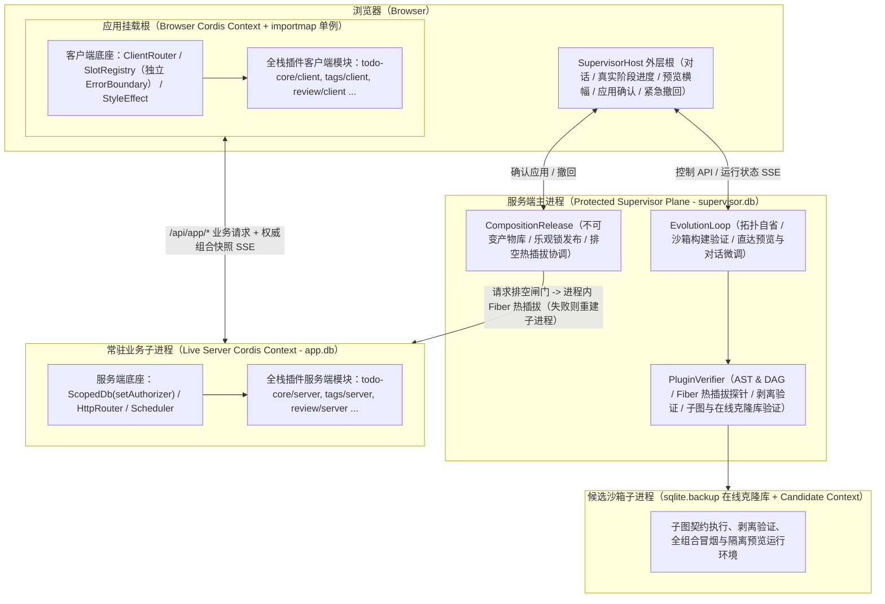

# 基于真 Cordis 的全栈自迭代架构 V3

日期：2026-11-20（经架构完整性与工程颗粒度审查定稿）。状态：现行设计基线，覆盖 `00-core-direction-v2.md` 与 `06-agent-redesign.md` 中冲突的宿主 Todo 扩展注册表、孤立 VM 插件桥、形式化规格编译与前置空历史复核机制。关联决策见 [ADR 0001](../adr/0001-evolution-scope-and-application-confirmation.md)–[ADR 0004](../adr/0004-freeze-request-and-show-execution-progress.md)、[ADR 0006](../adr/0006-dual-context-cordis-and-thin-supervisor.md)、[ADR 0007](../adr/0007-executable-subgraph-verification-and-direct-preview.md)；领域术语以根目录 [`CONTEXT.md`](../../CONTEXT.md) 为准。

---

## 1. 为什么必须重构：来自 V2 的硬证据与根因诊断

盘点 V2 基线（`1a715d1`）全仓 29,533 行生产代码与累计 679 次真实模型调用记录，暴露出三个不可调和的结构性事实：

1. **规模与职责严重倒挂**：承担进程监督、组合记版、持久化与基础宿主的代码仅 4,214 行，演示业务插件仅 100 行，前端视图 3,295 行；而服务于“规划规格编译、义务派生、案例身份去重、原文引文绑定、空历史双模型复核”的代码高达 **22,031 行（占全仓 74.6%）**。
2. **能力长短板彻底颠倒**：实测模型编写插件实现代码（`submit_candidate`）中位耗时仅 **10.67 秒**，而在规划编译与空历史需求复核阶段中位耗时达 **140.90 秒 + 132.44 秒**。模型最擅长“读真实代码 → 写标准代码与测试 → 根据运行报错快速修正”，却被挡在“盲填抽象 JSON 规格契约”的前置门禁之外。
3. **679 次调用完整六步通过率为 0，且核心理论基石从未真正启用**：
   - 本项目的核心理论依据是 **Cordis 的插件依赖注入与热插拔生命周期**；
   - 但 V2 的 `src/runtime/child.ts` 将每个插件关进孤立的 `node:vm` 上下文做 `JSON.stringify` 反射，切断了共享 `Context`，导致插件无法使用原生的 `Service`、`inject`、`bail/waterfall` 与 `effect`（`service.provide` 长期停留在 `"stub"`）；
   - 因为架空了真 Cordis，宿主被迫在进程外硬编码了 Todo 专用的 `Workspace` 与 `ExtensionRegistry`（仅限 `Task` 与 `task.detail` 文本槽位），并把所有插件验收拍平成全局 30 条上限的 `BrowserCase` 列表，最终在多插件叠加与停用场景下陷入无休止的组合爆炸。

**结论**：不是“基于 Cordis 的软件自迭代”假设不成立，而是必须**拆掉架空 Cordis 的孤立 VM 桥、宿主 Todo 硬编码与 2.2 万行形式化规格编译器，回到纯粹、对称、全栈的真 Cordis 插件组合架构**。

---

## 2. 核心理论公理：为什么真 Cordis 是自迭代的基石

与程序员使用通用 AI 工具直接改写单体仓库不同，运行中软件的持续自迭代面临三大死穴：**上下文随轮次膨胀、改新功能污染旧功能、停用或回退功能需要危险的删代码手术**。`cordis@4.0.0-rc.9` 的核心原语一一对应消解了这三大死穴：

1. **变更局部性与爆炸半径控制（`Plugin` + 内容寻址组合锁）**
   软件被表达为一棵有向无环的**插件组合（Composition）**。每次自迭代只新增一个插件或升级受影响的插件版本，其余未改插件精确锁定原 `versionId`。模型每次只需读取目标插件源码与上游公开的 `contract.d.ts` 接口声明，上下文规模与系统总功能数解耦。
2. **零代码手术的热插拔与功能启停（`Fiber` + `ctx.effect` + `dispose`）**
   插件注册的所有路由、事件钩子、定时任务、前端界面组件与专属样式表均绑定在自身 `Fiber` 的 `effect` 上。停用某项功能只需在组合中卸载该插件 `Fiber`（`await fiber.dispose()`），副作用自动逆序清零，自有命名空间持久化数据原封不动；重新启用时重新挂载同一版本 `Fiber` 即可恢复，无需模型改写任何代码。
3. **跨业务通用与无上限演进（`Service` + `inject` + 双端钩子）**
   **监督壳（Supervisor）** 不含任何具体业务概念；连基础业务本体（如 `todo-core`，或迁移到库存、CRM 时的核心模块）本身也只是一个普通的根业务 Cordis 插件。下游插件通过 `inject` 消费上游 `Service`，通过 `bail / waterfall / on` 参与业务生命周期，通过客户端插槽与路由贡献任意真实的 React 视图。

---

## 3. 全栈插件源码与构建产物标准契约

为确保人类维护者、沙箱构建器与自迭代 Agent 对“一个全栈 Cordis 插件”拥有完全一致的工程约定，所有受管插件统一遵循以下源码包结构与类型扩充规范。

### 3.1 插件源码目录布局（Workspace Plugin Package）

每个插件位于独立的 `plugins/<pluginId>/` 目录下：

```text
plugins/<pluginId>/
├── manifest.json       # 静态拓扑元数据（禁止代码动态篡改）
├── contract.d.ts       # 可选：公开 Service / 双端事件 / 前端 Slot 类型扩充
├── server.ts           # 可选：服务端 Cordis 插件入口
├── client.tsx          # 可选：浏览器端 Cordis 插件入口（含 React 组件）
└── tests/
    └── *.spec.ts       # 绑定最小依赖子图 closure(pluginId) 的 API / Playwright 测试
```

1. **`manifest.json` 规范**：
   ```ts
   export interface PluginManifest {
     readonly pluginId: string;               // 稳定小写标识，如 "todo-core" | "tags" | "review"
     readonly name: string;                   // 人类可读名称
     readonly dependencies: readonly string[]; // 显式依赖的上游 pluginId 列表（严格构成 DAG）
   }
   ```
2. **`contract.d.ts`（标准 Cordis 模块扩充，同时作为 `introspect()` 喂给模型的接口文档）**：
   ```ts
   // 示例：plugins/todo-core/contract.d.ts
   export interface TaskItem {
     readonly id: string;
     readonly title: string;
     readonly state: "open" | "done";
     readonly createdAt: string;
   }

   export interface BeforeTransitionPayload {
     readonly task: TaskItem;
     readonly nextState: "open" | "done";
     readonly meta?: Record<string, unknown>;
   }

   export interface TodoService {
     list(): TaskItem[];
     get(id: string): TaskItem | null;
     create(title: string): TaskItem;
     transition(id: string, nextState: "open" | "done", meta?: Record<string, unknown>): Promise<TaskItem>;
   }

   declare module "cordis" {
     interface Context {
       todo: TodoService;
     }
     interface Events {
       "todo:before-transition"(payload: BeforeTransitionPayload): Promise<void | false | string>;
       "todo:changed"(task: TaskItem): void;
     }
   }

   declare module "@host/client-sdk" {
     interface SlotPropsMap {
       "todo.item.badges": { readonly task: TaskItem };
       "todo.item.detail": { readonly task: TaskItem };
     }
   }
   ```

### 3.2 插件构建、浏览器单例共享与动态样式机制

为彻底消除浏览器端动态 `import()` 引发的 **React/Cordis 多实例冲突（`Invalid hook call`）** 与 **动态 Tailwind CSS 样式丢失**，构建与加载管线执行以下硬规范：

1. **宿主浏览器 `importmap` 共享基座**：
   - 宿主构建时将共享运行时预打包为固定 vendor ESM 入口，并在应用 HTML 头部注入 `<script type="importmap">`：
     - 映射键固定包含：`"cordis"`、`"react"`、`"react-dom"`、`"react-dom/client"`、`"react/jsx-runtime"`、`"lucide-react"`、`"@base-ui/react"`、`"@host/client-sdk"`；
   - 编译任意插件的 `client.tsx` 时，上述模块一律标记为 **`external`**，保证全页面从始至终只有唯一一份 React 与唯一一份客户端 `cordis` 实例，且单个插件 `client.mjs` 产物仅数 KB。
2. **按插件编译并随 `Fiber` 自动装卸的 Tailwind CSS v4 样式**：
   - 构建 `client.tsx` 时，调用仓库已安装的 `tailwindcss@4.3.3` 编程接口 `compile()`，基于宿主统一 `@theme` 令牌（仅编译 `@import "tailwindcss/utilities.css"`，不重复注入 `preflight` 重置样式）扫描当前插件源码提取出的类名，生成独立 `styleCss` 字符串写入 `PluginArtifact`；
   - 客户端运行时在挂载某插件 `Fiber` 前，通过该 `Fiber` 的 `effect` 向 `document.head` 注入 `<style data-cordis-plugin="${pluginId}@${versionId}">`；当该插件 `Fiber` 执行 `dispose()` 停用或升级替换时，旧 `<style>` 节点随 `effect` 自动移除，做到**零缺样式、零残留污染**。

---

## 4. 总体架构：双平面与五个深模块接口

系统划分为维护者持有的**监督壳平面（Supervisor Plane）**与模型可演进的**双端对称 Cordis 应用平面（Cordis App Plane）**。



### 4.1 模块一：`CordisAppRuntime` 与不可伪造身份机制

```ts
export interface PluginArtifact {
  readonly pluginId: string;
  readonly versionId: string;
  readonly name: string;
  readonly dependencies: readonly string[];
  readonly contractTypes: string;   // contract.d.ts 原文（空则为 ""）
  readonly serverCode?: string;     // 编译后 ESM 代码，落盘为 releases/<pluginId>-<versionId>/server.mjs
  readonly clientCode?: string;     // 编译后 ESM 代码，映射为 /plugins/<pluginId>/<versionId>/client.mjs
  readonly styleCss?: string;       // 插件专属 Tailwind utilities CSS
  readonly sourceFiles: Readonly<Record<string, string>>;
  readonly testFiles: Readonly<Record<string, string>>;
}

export interface CompositionMember {
  readonly pluginId: string;
  readonly versionId: string;
  readonly enabled: boolean;
}

export interface CompositionSnapshot {
  readonly compositionId: string;
  readonly parentCompositionId: string | null;
  readonly members: readonly CompositionMember[];
  readonly createdAt: string;
}

export interface ActiveClientComposition {
  readonly compositionId: string;
  readonly plugins: ReadonlyArray<{
    readonly pluginId: string;
    readonly versionId: string;
    readonly dependencies: readonly string[];
    readonly clientEntryUrl?: string;
    readonly styleCss?: string;
  }>;
}

export interface CordisAppRuntime {
  applyComposition(target: CompositionSnapshot): Promise<RuntimeHealth>;
  introspect(): Promise<CompositionTopology>;
  close(): Promise<void>;
}
```

**关键运行时一致性机制**：
1. **不可伪造的宿主插件身份（解决 `plugin.name` 伪造与 Cordis 动态 `caller` 覆盖问题）**：
   - `cordis@4.0.0-rc.9` 的 `fiber.runtime.name` 取自插件自行导出的 `name`，不可作为权限依据；且其 `Service` 追踪代理（`createTraceable`）在下游插件 `B` 调用上游 `A` 的 `Service` 方法时，会将方法内的 `this.ctx` 临时替换为调用方 `B` 的 shadow `ctx`。
   - 宿主挂载插件 `P` 时，必须使用宿主模块私有的 `const HOST_PLUGIN_ID = Symbol('host.pluginId')` 创建派生上下文：
     ```ts
     const pluginCtx = rootCtx.extend({ [HOST_PLUGIN_ID]: P.pluginId });
     const fiber = pluginCtx.plugin(serverModule.default);
     ```
   - 底座服务（如 `ctx.db`、`ctx.http`、`ctx.schedule`）在插件 `apply(ctx)` 或 `Service` 构造函数**首次读取属性时**，立即根据 `this.ctx[HOST_PLUGIN_ID]` 实例化并返回永久绑定该 `ownerPluginId` 的专属门面对象（如 `const db = ctx.db`），后续即使被下游插件跨服务调用，其内部持有的 `db` 归属也绝不随 `caller` 漂移。
2. **排空保护的进程内热插拔与全量快照 SSE 对账**：
   - 切换组合时，宿主先挂起新进入的 `/api/app/*` 请求并等待在途短请求排空（上限 2,000ms，超时则直接走子进程重建），按反向拓扑序 `await fiber.dispose()` 卸载停用或旧版插件，再按正向拓扑序挂载新版插件并逐一核验 `fiber.state === FiberState.ACTIVE`，随后放行请求闸门；
   - 服务端不发送易在断线时失步的“增量装卸事件”，而是在每次切换完成及每次浏览器 SSE 连接/重连握手时，推送完整的权威 `ActiveClientComposition` 快照；浏览器 `ClientRuntime` 对比本地已挂载的 `(pluginId, versionId)` 映射表做幂等 Reconcile（逆拓扑序 `dispose` 多余/旧版客户端 `Fiber`，正拓扑序动态 `import()` 挂载新增/新版客户端 `Fiber`）。

### 4.2 模块二：根底座服务精确接口（Root System Services）

服务端与客户端根 `Context` 注入以下零业务耦合底座服务：

```ts
// 1. 服务端受控数据库服务（ctx.db）
export interface ScopedStatement {
  run(...params: unknown[]): { changes: number | bigint; lastInsertRowid: number | bigint };
  get<T = Record<string, unknown>>(...params: unknown[]): T | undefined;
  all<T = Record<string, unknown>>(...params: unknown[]): T[];
}

export interface ScopedDb {
  readonly pluginId: string;
  readonly tablePrefix: string; // 固定格式：`plg_${pluginId.replace(/[^a-z0-9]/g, "_")}__`
  exec(sql: string): void;
  prepare(sql: string): ScopedStatement;
  transaction<T>(fn: () => T): T;
}

// 2. 服务端动态 HTTP 路由服务（ctx.http，内部绑定 ctx.effect 自动注销）
export interface HttpRouter {
  route(
    method: "GET" | "POST" | "PUT" | "PATCH" | "DELETE",
    subPath: string, // 自动挂载于 /api/app/<pluginId>/<subPath> 或显式无冲突路径
    handler: (req: AppRequest) => Promise<Response | unknown> | Response | unknown,
  ): () => void;
}

// 3. 服务端在线定时调度服务（ctx.schedule，内部绑定 ctx.effect 自动清理）
export interface SchedulerService {
  every(intervalMs: number, task: () => Promise<void> | void): () => void;
  at(timestampIso: string, key: string, task: () => Promise<void> | void): () => void;
}

// 4. 客户端路由与命名插槽服务（clientCtx.router / clientCtx.slots）
export interface ClientRouter {
  registerPage(page: {
    readonly path: string;
    readonly navLabel?: string;
    readonly order?: number;
    readonly component: React.ComponentType;
  }): () => void;
}

export interface SlotRegistry {
  register<K extends keyof SlotPropsMap>(
    slotName: K,
    component: React.ComponentType<SlotPropsMap[K]>,
    options?: { readonly order?: number; readonly id?: string },
  ): () => void;
}
```

**`ScopedDb` 引擎级强隔离实现规范（基于 Node 24 `node:sqlite` 原生能力）**：
- 数据库连接初始化即开启 `db.enableDefensive(true)` 与 `PRAGMA journal_mode = WAL`；
- 不采用易被绕过的手写 SQL 正则，而是在 `ScopedDb.prepare(sql)` 与 `ScopedDb.exec(sql)` 的 SQLite 字节码编译窗口同步挂载 `db.setAuthorizer` 回调：
  1. 对 `SQLITE_CREATE_TABLE`、`SQLITE_CREATE_INDEX`、`SQLITE_READ`、`SQLITE_INSERT`、`SQLITE_UPDATE`、`SQLITE_DELETE`、`SQLITE_ALTER_TABLE`：若目标表名非 `sqlite_*` 系统元数据且不以当前插件的 `tablePrefix`（`plg_<id>__`）开头，立即返回 `SQLITE_DENY`；
  2. 对 `SQLITE_DROP_TABLE`、`SQLITE_DROP_VIEW`、`SQLITE_ATTACH`、`SQLITE_DETACH`、`SQLITE_CREATE_VTABLE`：一律返回 `SQLITE_DENY`；
  3. 对 `SQLITE_ALTER_TABLE` 额外拦截包含 `DROP COLUMN` 或 `RENAME` 的破坏性语句；
- **跨插件弱引用与孤儿容错**：不同插件表之间不建物理 SQL 外键，统一用业务记录字符串 ID 弱关联；当某插件被停用期间上游核心记录被删除，该插件重新启用查询自身表时按上游当前有效记录过滤或惰性忽略孤儿 ID。

### 4.3 模块三：`PluginVerifier` 四道拓扑与实证门禁

候选变更在进入隔离预览前，必须在沙箱中顺序通过以下四道确定性门禁：

1. **门禁 ①：静态边界、DAG 拓扑与 Fiber 热插拔循环探针**
   - `@babel/parser` AST 扫描：禁止导入 Node 宿主模块（`node:*`）、监督壳目录或任何其他插件私有源码文件；服务端仅允许导入 `cordis`、`@host/server-sdk` 与包内相对路径，客户端仅允许导入 `importmap` 白名单包与包内相对路径；
   - `manifest.json` 依赖图校验：无环（DAG）、全部依赖目标均存在于组合且处于启用态，**上游插件绝对不能直接或间接依赖下游插件**；
   - 热插拔循环探针：在沙箱启动候选组合，验证所有启用插件 `fiber.state === FiberState.ACTIVE`；随后对本次变更涉及的每个插件依次执行 `await fiber.dispose()` → 重新 `plugin()` 挂载 → 再次断言全部 `ACTIVE`，确保 `effect` 清理完整、无重复监听或路由残留。
2. **门禁 ②：防单体退化的精确剥离不变量（Ablation Invariant）**
   - 当同一次候选变更修改了既有上游插件 $U$，同时新增或修改了依赖 $U$ 的下游插件 $D$ 时，分两种精确情形执行剥离探针：
     - **情形 A（纯开通用接缝：$U$ 的既有测试文件未改动）**：在沙箱中卸载 $D$（仅挂载 $closure(U)$，即 $U$ 及其自身上游依赖），运行 $U$ 原有的冻结子图测试集，**必须 100% 原样通过**。一旦模型偷懒把 $D$ 的拦截规则或必填逻辑写进了 $U$，卸载 $D$ 后 $U$ 的原测试立即失败拦截；
     - **情形 B（复合需求同批修改了 $U$ 自身业务规则：$U$ 的既有测试文件发生改动）**：① 强制进入门禁 ④ 在《变更简报》高亮展示 $U$ 的测试 diff 供用户核准；② 卸载 $D$ 后仅挂载更新版 $closure(U)$，$U$ 仍必须独立达到 `FiberState.ACTIVE` 并 100% 通过更新后的 $closure(U)$ 测试集，证明 $U$ 在运行时与测试上对 $D$ 零反向耦合；
   - 若两个被改插件互无依赖关系（平行兄弟插件），各自在独立 `closure(P)` 下不加载对方分别验证，杜绝隐式横向耦合。
3. **门禁 ③：双层可执行验证、红绿差分与 `sqlite.backup` 克隆库冒烟**
   - **第一层（最小依赖子图契约验证）**：对组合内每个受影响（自身变更或上游变更）的已启用插件 $P$，在仅挂载 `closure(P)` 的隔离沙箱中运行 `plugins/<P>/tests/*.spec.ts`（含 HTTP API 断言与真实 Chromium Playwright 页面交互测试）；
   - **红绿差分规则**：凡新增插件或修改既有插件业务代码，本次新增/更新的子图测试在旧基线对应子图（若为新插件则挂载不含该插件的父子图）上运行**必须失败（红）**，在候选子图上运行**必须通过（绿）**；若属纯视觉美化或纯内部重构未产生行为级红绿差分，允许通过编译与既有回归，但自动置位 `noBehavioralDiffWarning = true`，在《变更简报》顶部醒目提示人工核验预览；
   - **第二层（真实数据在线热备克隆与全组合轻量 E2E）**：调用 `node:sqlite` 原生 `await backup(liveAppDb, sandboxDbPath)` 在线安全克隆当前正式库真实数据（严禁在 WAL 活动库上裸跑 `fs.copyFileSync`），挂载候选全部 `enabled: true` 插件：
     - 校验全量插件 `ACTIVE`、客户端首屏渲染零 `ErrorBoundary` 触发、零未捕获控制台/页面异常；
     - 若包含停用插件操作（`enabled: false`），前后比对被停用插件全部 `plg_<id>__*` 表的数据指纹，断言记录零丢失；
     - 执行当前激活组合的关键路径冒烟用例。
4. **门禁 ④：既有测试变更透明披露（Test Diff Disclosure）**
   - 宿主对候选与基线之间所有已存在插件的 `tests/*.spec.ts` 做确定性 AST/文本对比；凡修改或删除了既有测试断言，提取变更前后用例名与关键代码 diff 写入《变更简报》，禁止静默改测试放水。

### 4.4 模块四：`CompositionRelease` 与乐观并发控制

- 持久化物理隔离为两个 SQLite 库：
  - `supervisor.db`（维护者控制面独占）：存储 `plugin_artifacts`、`compositions`、`active_composition_pointer` 与 `evolution_runs`；
  - `app.db`（业务子进程独占写）：存储所有业务插件各自的 `plg_<pluginId>__*` 表。
- **发布确认乐观锁**：
  ```ts
  export interface ApplyResult {
    readonly composition: CompositionSnapshot;
    readonly mode: "in-process-hot-swap" | "subprocess-rebuilt";
  }

  export interface CompositionRelease {
    recordArtifact(artifact: PluginArtifact): void;
    apply(candidateRunId: string, expectedBaseCompositionId: string): Promise<ApplyResult>;
    rollback(expectedCurrentCompositionId: string): Promise<ApplyResult>;
  }
  ```
  `apply` 执行前在 `supervisor.db` 短事务内严格校验当前 `liveCompositionId === expectedBaseCompositionId` 且候选门禁回执完整有效；若预览期间正式组合已发生切换或撤回，明确拒绝并提示基于最新组合重新验证，绝不静默覆盖并发变更。
- **保数据撤回**：`rollback` 只将 `active_composition_pointer` 前进指向新的回退修订（引用上一可用组合的精确成员列表），不回档 `app.db`，随后触发双端热切换。

### 4.5 模块五：`EvolutionLoop` 状态机与工具闭环

- **运行状态机（持久化于 `supervisor.db`）**：
  `running` →（遇重大业务歧义）`awaiting_clarification` /（遇调用或时间预算耗尽）`awaiting_budget` /（门禁全绿）`preview_ready` →（用户在预览中继续对话微调）回到 `running` 增量迭代同一候选工作区 →（用户点击确认应用）`applied`；任何非已提交阶段支持用户 `cancelled`，服务意外重启时将未完成 `running` 标记中断且**不自动续调付费模型**，已达 `preview_ready` 的候选可直接从磁盘产物恢复隔离预览会话。
- **精简 5 工具接口**：
  1. `inspect_plugin({ pluginId })`：按需读取指定插件的源码与现有子图测试（拓扑摘要与全部已安装插件的 `contract.d.ts` 已在初始上下文单份提供）；
  2. `clarify_request({ question, options })`：仅在存在实质性业务目标分歧或毁损性需求时暂停询问用户；
  3. `stage_plugin_changes({ upserts, toggles })`：在候选沙箱工作区写入新增/修改插件的标准目录文件，或翻转插件 `enabled` 状态；
  4. `verify_candidate({ pureVisualOrRefactor? })`：触发构建与门禁 ①②③④，结构化返回真实 `tsc` 错误、AST 违规、Cordis Fiber 状态、剥离探针报告或 Playwright 失败日志供模型闭环修正（默认单次运行预算上限如 10 次模型调用，耗尽进入 `awaiting_budget` 由用户决定是否追加）；
  5. `present_preview({ summary, highlights })`：仅当最近一次 `verify_candidate` 全绿且哈希未变时允许调用，结合宿主自动生成的测试 diff 与数据兼容报告合成《变更简报》，挂载隔离预览环境进入 `preview_ready`。

---

## 5. 六步连续自迭代与跨业务迁移走查

用曾经卡死 V2 的完整六步连续链与跨业务场景检验 V3 架构的工作方式：

1. **第 1 步：新增标签插件（`tags`）**
   - `todo-core` 已暴露 `TodoService` 与 `<Slot name="todo.item.badges" />` / `<Slot name="todo.item.detail" />`（若未暴露则同批升级 `todo-core` 加 `<Slot>` 并经门禁 ② 剥离探针验证无耦合）。Agent 新增 `plugins/tags/`（`plg_tags__items` + 服务端接口 + 客户端徽标/编辑组件 + `tags.spec.ts`）。门禁 ①②③ 通过后直达预览，点击确认应用后双端进程内热挂载 `tags`，页面不刷新即刻出现标签能力。
2. **第 2 步：新增独立计数插件（`counter`）**
   - `todo-core` 与 `tags` 精确锁定原 `versionId` 不动。仅新增 `plugins/counter/`（`plg_counter__counts` + 客户端步进按钮组件 + `counter.spec.ts`）。`closure(counter) = {todo-core, counter}` 子图契约测试旧红新绿通过，克隆库全组合冒烟通过，热挂载生效。
3. **第 3 步：标签保存改为统一小写**
   - 仅升级 `plugins/tags/`（`todo-core`、`counter` 锁死不动）。修改 `tags/server.ts` 归一化逻辑并同步更新 `tags/tests/tags.spec.ts`。门禁 ③ 确认新断言在旧版红、新版绿；门禁 ④ 提取 `tags.spec.ts` 变更 diff 展示于《变更简报》；确认后热替换双端 `tags` Fiber，既有大写历史数据在 `plg_tags__items` 中原样保留展示。
4. **第 4 步：完成任务前必须填写复盘（`review`）**
   - 同批升级 `todo-core`（仅在客户端完成按钮前增加通用 `await clientCtx.bail('todo:before-transition', ...)`、在服务端 `transition` 内增加 `await ctx.bail('todo:before-transition', ...)`，不改 `todo-core.spec.ts`）+ 新增 `plugins/review/`（客户端弹窗收集复盘并写入 `plg_review__notes`，服务端强校验拦截未填复盘的完成请求）。
   - **四道门禁表现**：
     - 门禁 ② 剥离验证：卸载 `review` 后，升级版 `todo-core` 100% 通过原封不动的 `todo-core.spec.ts`（无复盘直接点完成即成功），铁证 `todo-core` 未混入复盘逻辑；
     - 门禁 ③ 子图隔离：`tags.spec.ts` 跑在 `{todo-core, tags}`、`counter.spec.ts` 跑在 `{todo-core, counter}`，完全不受 `review` 拦截动作干扰，零测试连坐；`review.spec.ts` 跑在 `{todo-core, review}` 验证未填拦截与填后完成；
     - 全组合克隆库冒烟验证四插件同屏协同正常。
5. **第 5 步：停用标签插件，保留历史数据及计数、复盘功能**
   - Agent 零业务代码生成，直接调用 `stage_plugin_changes({ toggles: [{ pluginId: "tags", enabled: false }] })`。门禁 ③ 核验 `plg_tags__items` 数据指纹零变化，剩余启用插件全绿。确认应用后双端 `tags` Fiber 及其 `<style>` 瞬间卸载。
6. **第 6 步：重新启用标签插件**
   - 直接调用 `stage_plugin_changes({ toggles: [{ pluginId: "tags", enabled: true }] })`。双端重新挂载原 `tags@versionId`，`closure(tags)` 测试与真实历史标签数据即刻恢复展示。
7. **跨业务迁移检验（如替换为库存管理 `inventory-core`）**
   - 将种子插件目录由 `plugins/todo-core/` 换为 `plugins/inventory-core/`（表前缀 `plg_inventory_core__*`，暴露 `InventoryService` 与出入库钩子/页面插槽），后续连续迭代“批次效期预警插件”、“出库审批拦截插件”、“盘点图表路由页插件”时，**`SupervisorHost`、`CordisAppRuntime`、`CompositionRelease`、`PluginVerifier` 与 `EvolutionLoop` 零行代码修改**。

---

## 6. 存量资产处置与分阶段实施路线（V2 → V3）

不在旧的 2.2 万行规格编译链路上渐进修补，在 `dev` 分支按三个独立可验收的零付费工程里程碑推进，直至全部确定性门禁闭环后再申请单次真实模型验收：

### 6.1 存量代码去留清单

- **复用或演进的底层资产**：
  - 子进程生命周期监督、超时 `SIGKILL` 与串行激活骨架（参考 `src/runtime/runtime.ts`、`src/release/release.ts` 重构为 `CordisAppRuntime` 与 `CompositionRelease`）；
  - `@babel/parser` AST 导入检查能力（参考 `src/release/business-bundle.ts` 升级为双端白名单与 DAG 检查）；
  - DeepSeek 流式传输保活、错误分类、未知用量保守预留与预算账本（保留 `src/evolution/deepseek.ts`、`transport-failure.ts`、`budget.ts`）；
  - Microsoft To Do 极简视觉令牌与外层助手侧栏交互规范（保留 `DESIGN.md` 与 `src/web/style.css` 主题基调）。
- **整体退役不再接入新主线的旧模块**：
  - `src/runtime/child.ts` 中的孤立 `node:vm` `SourceTextModule` JSON 反射包装；
  - `src/server/workspace.ts` 中的 Todo 专属表与状态机、`src/server/extensions/registry.ts`、`ui-slots.ts`；
  - `src/evolution/` 与 `src/server/` 下全部形式化规格编译、义务派生、案例去重与空历史双模型复核文件（`specification.ts`、`references.ts`、`obligation-derivation.ts`、`acceptance-obligations.ts`、`acceptance-surface.ts`、`browser-case-content.ts`、`historical-preparation.ts`、`field-review.ts`、`review.ts`、`request-admission.ts`、`requirement-coverage.ts` 等）。

### 6.2 三阶段开发与验收里程碑

1. **里程碑 V3-M1：双端对称真 Cordis 运行时与 `ScopedDb` 地基（纯确定性测试，零付费）**
   - 交付物：
     - 服务端共享 `Context` 子进程加载器（`[HOST_PLUGIN_ID]` 身份注入 + `ScopedDb(setAuthorizer)` + `HttpRouter` + `Scheduler` + 请求排空闸门）；
     - 浏览器端 `importmap` 共享基座、`ClientRuntime`（SSE 全量快照幂等 Reconcile + Tailwind v4 插件级 `<style>` 动态装卸 + `ClientRouter` + 带独立 `ErrorBoundary` 的 `<Slot>`）；
     - 第一个标准全栈种子插件 `plugins/todo-core/`。
   - 验收门禁（单测 + Playwright E2E）：
     - 手写 `tags` 与拦截型 `review` 插件夹具，实测双端不刷新页面热插拔（挂载 → 生效 → `dispose` 无残留 → 重挂载恢复）；
     - 实测 `ScopedDb` 阻断跨插件读写表、`DROP TABLE` 及伪造 `plugin.name` 攻击，且跨插件 `Service` 方法调用不误杀；
     - 实测单一插件客户端组件抛错被 `<Slot>` 内 `ErrorBoundary` 局部隔离，不影响主应用与监督壳；
     - 实测插件死循环触发子进程超时强杀并自动回退恢复。
2. **里程碑 V3-M2：`PluginVerifier` 四道门禁、在线克隆预览与乐观锁发布（纯确定性测试，零付费）**
   - 交付物：
     - 全栈插件构建器（`tsc` 类型校验 + 客户端 external ESM 打包 + Tailwind v4 按需编译）；
     - `PluginVerifier` 完整四道门禁（AST/DAG + 热插拔循环探针 + 门禁 ② 情形 A/B 剥离不变量 + `closure(P)` 子图红绿差分 + `sqlite.backup` 克隆库全组合冒烟 + 测试 diff 提取）；
     - 隔离预览会话（独立克隆库与端口/前缀路由隔离）+ 外层 `SupervisorHost` 控制栏（预览横幅、《变更简报》、乐观锁“确认应用”与“紧急撤回”）。
   - 验收门禁：
     - 构造“把复盘必填偷塞进 `todo-core`”的耦合候选反例，验证门禁 ② `dispose` 剥离探针 100% 确定性拒绝；
     - 构造“空测试 / 恒真测试”反例，验证门禁 ③ 红绿差分拦截；
     - 构造正式库存在历史数据的场景，验证预览操作不污染正式库、确认应用热切换生效、紧急撤回不丢期间新增数据。
3. **里程碑 V3-M3：极简 `EvolutionLoop` 接入、六步桩预演与受控真机验证**
   - 交付物：
     - 基于实时 `introspect()` 与 `contract.d.ts` 的 5 工具 `EvolutionLoop`（支持明确需求直达预览、预览内增量对话微调、澄清暂停、预算暂停续行与重启安全恢复）。
   - 验收门禁：
     - 零付费本地模型桩完整跑通 0→5 六步连续链，以及切换到第二业务种子插件（如 `inventory-core`）的两步自迭代；
     - 严格遵守 `STOP_SERIES` 纪律：零付费 CI 全绿后，仅在用户单次明确授权下开启受费用护栏约束的真实模型六步连续验证与跨业务迁移实测。
